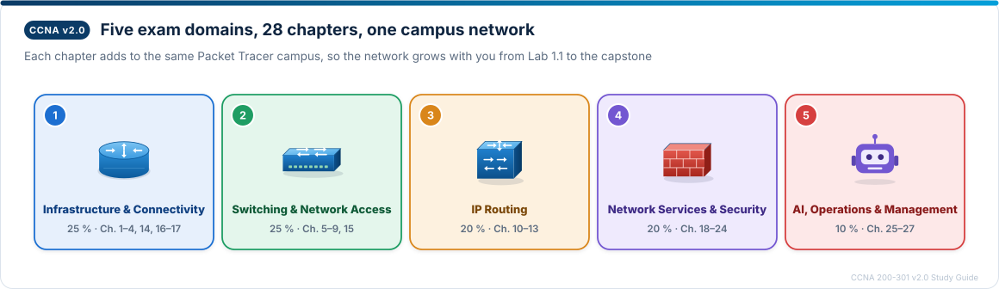
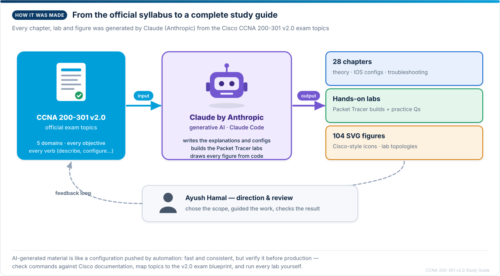

# 🌐 Cisco CCNA 200-301 v2.0 Study Guide & Lab Manual

[](https://www.cisco.com)
[](#)
[](#)
[](https://logiclinguist8989.github.io/200-301-CCNA-v2.0/)
[](docs/FIGURES.md)
[](LICENSE-CONTENT)
[](LICENSE-CODE)
[](#)
[](#-ai-generated-content)

> A comprehensive, hands-on study guide and lab manual aligned strictly with the updated **Cisco CCNA 200-301 v2.0** exam blueprint. Designed to bridge the gap between theoretical concepts and practical Cisco IOS command-line mastery through a unified campus topology.

<p align="center">
  <a href="https://logiclinguist8989.github.io/200-301-CCNA-v2.0/"><b>📖 Read the guide online →</b></a><br>
  <sub>Self-check quizzes · exam mode · subnetting practice · mistakes notebook · review schedule · dark mode</sub>
</p>

<p align="center">
  
</p>

## 🧭 Contents

- [Overview](#-overview)
- [Study Tools (website)](#-study-tools-website)
- [Repository Structure](#-repository-structure)
- [Curriculum Breakdown](#-curriculum-breakdown)
- [Figures](#%EF%B8%8F-figures)
- [Unified Addressing Architecture](#%EF%B8%8F-unified-addressing-architecture)
- [CLI Command Conventions](#-cli-command-conventions)
- [Getting Started](#-getting-started)
- [Contributing](#-contributing)
- [AI-Generated Content](#-ai-generated-content)
- [License & Attribution](#-license--attribution)

---

## 📌 Overview

This repository houses a full 28-chapter curriculum covering the five official domains of the CCNA 200-301 v2.0 examination. Every chapter contains learning objectives, conceptual explanations, protocol internals, Cisco IOS configuration templates, verification commands (`show`/`debug`), practical troubleshooting scenarios, and exam-focused review questions with rationales.

### What Makes This Guide Different?
- **Unified Campus Addressing Plan:** Rather than isolated, disconnected exercises, every lab across all chapters reuses a persistent network addressing scheme so your campus network topology grows with you.
- **v2.0 Delta Tracking:** Objectives are explicitly classified as *Same core as v1.1*, *Deeper in v2.0*, or *New in v2.0* (such as AI in Network Operations and modern automation workflows).
- **Packet Tracer Ready:** Lab scenarios explicitly document what can and cannot be simulated in Cisco Packet Tracer.
- **104 Vector Diagrams:** Every concept, flowchart and lab topology is illustrated with crisp SVG figures that use Cisco-style device icons and stay sharp at any zoom level.

---

## 🎓 Study Tools (website)

The [study website](https://logiclinguist8989.github.io/200-301-CCNA-v2.0/) turns the guide into an interactive course. Everything runs in your browser — no account, no sign-up, and your progress is saved only on your own device.

| Tool | What it does |
| --- | --- |
| 📝 **Self-check quizzes** | 392 questions at the end of the 28 chapters, built from each chapter's practice questions and answer key. Multiple choice is marked instantly with an explanation; written questions are revealed and self-marked. |
| ⏱️ **[Exam mode](https://logiclinguist8989.github.io/200-301-CCNA-v2.0/exam.html)** | Timed, mixed-chapter practice exams (10–60 questions) at real-exam pace, scored by exam domain. Choose **Real exam — no going back** to lock each question once you move on, as in Cisco's exam. |
| 🎯 **[Subnetting practice](https://logiclinguist8989.github.io/200-301-CCNA-v2.0/practice.html)** | Unlimited random IPv4 questions at three levels, with streaks and step-by-step magic-number solutions. |
| 📒 **[Mistakes notebook](https://logiclinguist8989.github.io/200-301-CCNA-v2.0/mistakes.html)** | Every question you miss is saved automatically, with a retry card and a note for *what I thought → what is true → why I mixed it up*. |
| 🔁 **Review schedule** | A finished chapter quiz comes back after 1 day, 1 week and 1 month (sooner if you score below 85 %), shown on the home page. |
| 🧠 **Callouts** | Colour-coded boxes for exam tips, common traps, memory tricks and "Lab it" links to each chapter's Packet Tracer lab. |
| ⌨️ **Router-style CLI** | IOS commands shown as a router console, with a one-click **Copy commands** button that strips prompts and output. |

> **Suggested routine:** read a chapter → build its lab → take the quiz → 10 minutes of subnetting practice daily → clear your *Review due* list → a weekly pass through the mistakes notebook → practice exams in real-exam mode before you book.

The site is generated from the Markdown guides in this repository; its source is on the [`gh-pages`](https://github.com/logiclinguist8989/200-301-CCNA-v2.0/tree/gh-pages) branch (`_generator/`).

---

## 📁 Repository Structure

```text
├── CCNA 200-301 v2.0 Study Guide.md    # Part 1: Core Fundamentals to Security (Chapters 1–23)
├── Part 2 — Chapters 24–28.md          # Part 2: Advanced Services, Automation & AI (Chapters 24–28)
├── assets/
│   ├── figures/ch01 … ch28/            # 104 generated SVG figures, one folder per chapter
│   └── readme/                         # Artwork used on this README page
├── docs/
│   └── FIGURES.md                      # Browsable index of every figure with previews
├── tools/
│   ├── figures/                        # Figure generator (Python, no dependencies)
│   │   ├── svgkit.py                   #   drawing kit: palette, Cisco-style device icons, layouts
│   │   ├── chapters/                   #   one module per chapter group with the figure code
│   │   ├── build.py                    #   renders every figure to assets/figures
│   │   ├── link_figures.py             #   embeds figures in the guides
│   │   ├── make_index.py               #   writes docs/FIGURES.md
│   │   └── readme_art.py               #   draws the README artwork
│   └── check_links.py                  # Verifies every local link and image in the Markdown
├── .github/workflows/docs-checks.yml   # CI (manual for now): figures up to date + no broken links
├── CONTRIBUTING.md                     # How to propose fixes and new figures
├── LICENSE                             # Dual-license summary (what each license covers)
├── LICENSE-CONTENT                     # CC BY-NC-SA 4.0 — guides, docs, figures
├── LICENSE-CODE                        # MIT — tools and CI
└── README.md                           # Documentation & study roadmap
```

---

## 📖 Curriculum Breakdown

<p align="center">
  
</p>

### 🔹 Part 1: Core Networking & Campus Infrastructure (Chapters 1–23)
*File: [`CCNA 200-301 v2.0 Study Guide.md`](./CCNA%20200-301%20v2.0%20Study%20Guide.md)*

- **Part 0:** Syllabus analysis, exam weighting, time management, and unified addressing conventions.

**Domain 1 — Network Infrastructure and Connectivity (25 %)** · Chapters 1–4, 14, 16–17<br>
Cabling and interface diagnosis, IPv4 subnetting and VLSM, IPv6 addressing and SLAAC, hypervisors and containers, DHCPv4 server/relay/client, wireless principles, and client troubleshooting on Windows, macOS and Linux.

<table>
  <tr>
    <td width="33%" align="center"><a href="assets/figures/ch01/fig-01-01-encapsulation.svg"></a><br><sub><b>Figure 1.1</b> — Encapsulation</sub></td>
    <td width="33%" align="center"><a href="assets/figures/ch02/fig-02-04-vlsm-plan.svg"></a><br><sub><b>Figure 2.4</b> — VLSM plan to scale</sub></td>
    <td width="33%" align="center"><a href="assets/figures/ch14/fig-14-02-dhcp-relay-giaddr.svg"></a><br><sub><b>Figure 14.2</b> — DHCP relay and giaddr</sub></td>
  </tr>
</table>

**Domain 2 — Switching and Network Access (25 %)** · Chapters 5–9, 15<br>
VLANs, 802.1Q trunks and SVIs, LACP EtherChannel, edge ports with PoE and voice VLANs, CDP/LLDP documentation audits, Rapid PVST+ with its protection features, and the troubleshooting toolkit.

<table>
  <tr>
    <td width="33%" align="center"><a href="assets/figures/ch05/fig-05-03-frame-across-trunk.svg"></a><br><sub><b>Figure 5.3</b> — A frame crossing a trunk</sub></td>
    <td width="33%" align="center"><a href="assets/figures/ch06/fig-06-01-stp-vs-etherchannel.svg"></a><br><sub><b>Figure 6.1</b> — STP vs EtherChannel</sub></td>
    <td width="33%" align="center"><a href="assets/figures/ch09/fig-09-03-stp-election.svg"></a><br><sub><b>Figure 9.3</b> — STP election result</sub></td>
  </tr>
</table>

**Domain 3 — IP Routing (20 %)** · Chapters 10–13<br>
Reading the routing table, longest-prefix match, static and floating static routes, single-area OSPFv2/OSPFv3, and HSRP/VRRP gateway redundancy.

<table>
  <tr>
    <td width="33%" align="center"><a href="assets/figures/ch10/fig-10-04-longest-prefix-match.svg"></a><br><sub><b>Figure 10.4</b> — Longest prefix match</sub></td>
    <td width="33%" align="center"><a href="assets/figures/ch12/fig-12-01-ospf-neighbor-states.svg"></a><br><sub><b>Figure 12.1</b> — OSPF neighbor states</sub></td>
    <td width="33%" align="center"><a href="assets/figures/ch13/fig-13-01-fhrp-group.svg"></a><br><sub><b>Figure 13.1</b> — One virtual gateway</sub></td>
  </tr>
</table>

**Domain 4 — Network Services and Security (20 %)** · Chapters 18–23 (and 24 in Part 2)<br>
SSH and AAA with TACACS+/RADIUS, SCP/SFTP file and image management, standard and extended ACLs, NAT/PAT, DNS record diagnosis, and Layer 2 security (DHCP snooping, DAI, port security, storm control, RA guard).

<table>
  <tr>
    <td width="33%" align="center"><a href="assets/figures/ch18/fig-18-02-aaa-method-list.svg"></a><br><sub><b>Figure 18.2</b> — AAA ERROR vs FAIL</sub></td>
    <td width="33%" align="center"><a href="assets/figures/ch21/fig-21-02-pat-translation-table.svg"></a><br><sub><b>Figure 21.2</b> — PAT translation table</sub></td>
    <td width="33%" align="center"><a href="assets/figures/ch23/fig-23-01-dhcp-snooping.svg"></a><br><sub><b>Figure 23.1</b> — DHCP snooping</sub></td>
  </tr>
</table>

### 🔹 Part 2: Advanced Services, Automation & Modern NetOps (Chapters 24–28)
*File: [`Part 2 — Chapters 24–28.md`](./Part%202%20%E2%80%94%20Chapters%2024%E2%80%9328.md)*

- **Chapter 24 — IPsec Site-to-Site & Remote-Access VPNs** (Domain 4): IPsec architecture, IKE, ESP vs AH, tunnel vs transport mode, and `show crypto` verification.
- **Chapter 25 — Syslog & SNMP** (Domain 5): message anatomy, severity levels and facilities, and SNMP managers, agents, MIBs, OIDs, traps and informs.
- **Chapter 26 — Network Management & Ansible** (Domain 5): device-, cloud- and controller-based management, infrastructure as code, and Ansible playbooks.
- **Chapter 27 — AI in Network Operations** (Domain 5): agentic AI, levels of autonomy and guardrails, and building safe operations prompts.
- **Chapter 28 — Comprehensive Final Review:** cross-domain questions, integrated troubleshooting scenarios, a capstone lab and exam-readiness checklists.

<table>
  <tr>
    <td width="33%" align="center"><a href="assets/figures/ch24/fig-24-02-esp-transport-vs-tunnel.svg"></a><br><sub><b>Figure 24.2</b> — ESP transport vs tunnel</sub></td>
    <td width="33%" align="center"><a href="assets/figures/ch26/fig-26-02-controller-north-south.svg"></a><br><sub><b>Figure 26.2</b> — Controller APIs</sub></td>
    <td width="33%" align="center"><a href="assets/figures/ch27/fig-27-01-agent-loop.svg"></a><br><sub><b>Figure 27.1</b> — The AI agent loop</sub></td>
  </tr>
</table>

---

## 🖼️ Figures

Every chapter is illustrated with numbered figures placed beside the text that refers to them — **104 in total**. They are vector (SVG) images drawn from code, so they render sharply on GitHub at any size and can be corrected in one place. Browse them all in the **[figure index](docs/FIGURES.md)**.

<table>
  <tr>
    <td width="50%"><br><sub><b>Figure 5.4</b> — Router-on-a-stick vs multilayer switch SVIs</sub></td>
    <td width="50%"><br><sub><b>Figure 9.5</b> — Rapid PVST+ port roles for VLAN 10</sub></td>
  </tr>
  <tr>
    <td width="50%"><br><sub><b>Figure 11.3</b> — Floating static failover</sub></td>
    <td width="50%"><br><sub><b>Figure 16.2</b> — A 2.4 GHz channel reuse plan</sub></td>
  </tr>
</table>

**Regenerating the figures** (Python 3.9+, no extra packages):

```bash
python3 tools/figures/build.py              # render all figures to assets/figures/
python3 tools/figures/build.py 9.5 14.2     # render selected figures only
python3 tools/figures/link_figures.py       # embed any new figures in the guides
python3 tools/figures/make_index.py         # refresh docs/FIGURES.md
python3 tools/check_links.py                # verify every local link and image
```

To change a figure, edit its function in `tools/figures/chapters/` (search for the figure number, e.g. `"9.5"`), rebuild, and commit both the code and the SVG. Run `python3 tools/check_links.py` before committing; the CI workflow (started manually from the Actions tab) runs the same checks.

---

## 🗺️ Unified Addressing Architecture

To ensure consistency across Packet Tracer labs, all scenarios follow this unified plan:

| Component | Standard Allocation |
|---|---|
| **Host Devices** | `R1`, `R2`, `R3` (Routers) · `SW1`, `SW2`, `DSW1` (Switches) · `PC1`, `PC2`, `SRV1` |
| **User VLANs** | VLAN 10 (Staff) · VLAN 20 (Voice) · VLAN 30 (Wireless) · VLAN 40 (IoT/Printers) |
| **Management VLAN** | VLAN 99 |
| **Native VLAN (Trunk)** | VLAN 999 (Unused security best practice) |
| **IPv4 LAN Subnets** | `10.10.VLAN.0/24` (e.g., VLAN 10 = `10.10.10.0/24`) |
| **Point-to-Point Links** | `10.0.0.0/30` or `/31` blocks between core routers |
| **IPv6 Prefix** | `2001:db8::/32` (RFC 3849 documentation space) |
| **Public IPv4 Range** | `203.0.113.0/24` and `198.51.100.0/24` (RFC 5737 documentation space) |

---

## 💻 CLI Command Conventions

| Prompt Mode | Description | Permitted Actions |
|---|---|---|
| `R1>` | User EXEC | Basic status checks, ping, traceroute |
| `R1#` | Privileged EXEC | `show`, `debug`, `copy running-config startup-config`, `reload` |
| `R1(config)#` | Global Configuration | System-wide parameters, hostname, routing process |
| `R1(config-if)#` | Interface Configuration | IP address, duplex, encapsulation, switchport modes |
| `R1(config-router)#` | Router Configuration | Network statements, router IDs, passive-interfaces |
| `R1(config-line)#` | Line Configuration | Console, AUX, and VTY terminal security and timeouts |

---

## 🚀 Getting Started

**Prefer reading in the browser?** Open the study website at **[logiclinguist8989.github.io/200-301-CCNA-v2.0](https://logiclinguist8989.github.io/200-301-CCNA-v2.0/)** — no download needed. Take each chapter's quiz, practise subnetting, and sit timed exams — see [Study Tools](#-study-tools-website).

1. **Clone the repository:**
   ```bash
   git clone https://github.com/logiclinguist8989/200-301-CCNA-v2.0.git
   ```
2. **Open the Study Guides:**
   - Begin with [`CCNA 200-301 v2.0 Study Guide.md`](./CCNA%20200-301%20v2.0%20Study%20Guide.md) for core foundations and syllabus breakdown.
   - Proceed to [`Part 2 — Chapters 24–28.md`](./Part%202%20%E2%80%94%20Chapters%2024%E2%80%9328.md) for VPNs, network automation, and AI NetOps.
3. **Practice with Packet Tracer:**
   - Keep Cisco Packet Tracer open while reading each chapter's configuration blocks.
4. **Reinforce Knowledge:**
   - Complete the end-of-chapter review questions and practical troubleshooting drills to validate mastery.

---

## 🤝 Contributing

Found a technical error, a typo, or a figure that could be clearer? Please open an issue or a pull request — see [CONTRIBUTING.md](CONTRIBUTING.md) for the workflow and style rules.

---

## 🤖 AI-Generated Content

> **Every word, every config block and every diagram in this repository was generated by Claude, Anthropic's AI model — built strictly from the official Cisco CCNA 200-301 v2.0 exam syllabus.**

<p align="center">
  
</p>

| Layer of the stack | Generated by Claude from the v2.0 syllabus |
| --- | --- |
| 📘 **Application layer** — the study content | All 28 chapters: objectives, explanations, protocol internals, IOS configurations, verification and troubleshooting tables, practice questions and answer keys |
| 🧪 **Transport layer** — the labs | Every Packet Tracer lab, the unified campus addressing plan and the step-by-step builds that carry you from Lab 1.1 to the capstone |
| 🖼️ **Network layer** — the figures | All 104 vector diagrams in `assets/figures/` and the Python generator in `tools/figures/` that draws them |
| ⚙️ **Data link layer** — the repository | The figure index, link checker, CI workflow, contributing guide and this README |
| 👤 **Physical layer** — the human | Ayush Hamal: chose the scope, directed the work and reviews the result |

### 🔍 Verify before you trust — a `show` command for the reader

AI-generated material is like a configuration pushed by automation: fast and consistent, but always **verified before it goes into production**.

```text
Reader# show trust-but-verify
  ✔ Cross-check commands against Cisco documentation      → cisco.com/c/en/us/support
  ✔ Map every topic to the official v2.0 exam topics      → learningnetwork.cisco.com
  ✔ Run every lab in Packet Tracer or on real gear        → don't trust expected output blindly
  ✔ Found a bug? Open an issue or a pull request          → see CONTRIBUTING.md
```

---

## 📄 License & Attribution

Authored by **Ayush Hamal** ([@logiclinguist8989](https://github.com/logiclinguist8989)), with all content and figures generated by **Claude** (Anthropic) from the CCNA 200-301 v2.0 syllabus (see [AI-Generated Content](#-ai-generated-content)).

This repository is dual-licensed — see [LICENSE](LICENSE) for exactly which files each license covers:

| What | License | In short |
| --- | --- | --- |
| Study guides, README, docs and all figures | [CC BY-NC-SA 4.0](LICENSE-CONTENT) | Share and adapt for **non-commercial** use, with **credit**, under the **same license** |
| Figure generator, link checker and CI (`tools/`, `.github/`) | [MIT](LICENSE-CODE) | Reuse freely, keep the copyright notice |

Please credit reuse as: *"CCNA 200-301 v2.0 Study Guide by Ayush Hamal, licensed under CC BY-NC-SA 4.0"*, with a link to this repository.

*This guide is an independent study resource aligned with the public Cisco CCNA 200-301 v2.0 exam topics and is not affiliated with or endorsed by Cisco. Cisco, CCNA, Cisco IOS and Packet Tracer are trademarks or registered trademarks of Cisco Systems, Inc.*
