# Figure index

All **104 figures** in the study guide, grouped by chapter. Every figure is a scalable SVG generated
from code in [`tools/figures`](../tools/figures) — see the [README](../README.md#%EF%B8%8F-figures) for how to rebuild them.

| Chapter | Figures |
| --- | --- |
| [Chapter 1 — Networking foundations, cables and interfaces](#chapter-1--networking-foundations-cables-and-interfaces) | 10 |
| [Chapter 2 — IPv4 addressing and subnetting](#chapter-2--ipv4-addressing-and-subnetting) | 7 |
| [Chapter 3 — IPv6 addressing and prefix sizing](#chapter-3--ipv6-addressing-and-prefix-sizing) | 4 |
| [Chapter 4 — Hypervisors, virtual machines and containers](#chapter-4--hypervisors-virtual-machines-and-containers) | 4 |
| [Chapter 5 — VLANs, trunks, Layer 2/Layer 3 interfaces and SVIs](#chapter-5--vlans-trunks-layer-2layer-3-interfaces-and-svis) | 6 |
| [Chapter 6 — EtherChannel with LACP](#chapter-6--etherchannel-with-lacp) | 4 |
| [Chapter 7 — Edge-host ports: VLAN, PoE, port channel and LACP](#chapter-7--edge-host-ports-vlan-poe-port-channel-and-lacp) | 4 |
| [Chapter 8 — Validating network documentation with CDP and LLDP](#chapter-8--validating-network-documentation-with-cdp-and-lldp) | 3 |
| [Chapter 9 — Rapid PVST+ and STP protection](#chapter-9--rapid-pvst-and-stp-protection) | 5 |
| [Chapter 10 — Interpreting the routing table](#chapter-10--interpreting-the-routing-table) | 4 |
| [Chapter 11 — IPv4 and IPv6 static routing](#chapter-11--ipv4-and-ipv6-static-routing) | 4 |
| [Chapter 12 — Single-area OSPFv2 and OSPFv3](#chapter-12--single-area-ospfv2-and-ospfv3) | 3 |
| [Chapter 13 — First hop redundancy protocols](#chapter-13--first-hop-redundancy-protocols) | 3 |
| [Chapter 14 — DHCPv4 client, server and relay](#chapter-14--dhcpv4-client-server-and-relay) | 4 |
| [Chapter 15 — The troubleshooting toolkit](#chapter-15--the-troubleshooting-toolkit) | 3 |
| [Chapter 16 — Wireless principles](#chapter-16--wireless-principles) | 4 |
| [Chapter 17 — Client connectivity on Windows, macOS and Linux](#chapter-17--client-connectivity-on-windows-macos-and-linux) | 2 |
| [Chapter 18 — Secure device access: local users, SSH and AAA](#chapter-18--secure-device-access-local-users-ssh-and-aaa) | 3 |
| [Chapter 19 — Managing configurations and images with SCP and SFTP](#chapter-19--managing-configurations-and-images-with-scp-and-sftp) | 2 |
| [Chapter 20 — IPv4 access control lists](#chapter-20--ipv4-access-control-lists) | 3 |
| [Chapter 21 — NAT and PAT on IOS XE routers](#chapter-21--nat-and-pat-on-ios-xe-routers) | 3 |
| [Chapter 22 — Diagnosing DNS records](#chapter-22--diagnosing-dns-records) | 3 |
| [Chapter 23 — Layer 2 security features](#chapter-23--layer-2-security-features) | 3 |
| [Chapter 24 — IPsec site-to-site and remote-access VPNs](#chapter-24--ipsec-site-to-site-and-remote-access-vpns) | 3 |
| [Chapter 25 — Syslog and SNMP](#chapter-25--syslog-and-snmp) | 3 |
| [Chapter 26 — Network management approaches and Ansible](#chapter-26--network-management-approaches-and-ansible) | 3 |
| [Chapter 27 — AI in network operations: agents and prompts](#chapter-27--ai-in-network-operations-agents-and-prompts) | 3 |
| [Chapter 28 — Final review](#chapter-28--final-review) | 1 |

## Chapter 1 — Networking foundations, cables and interfaces

Source: [`CCNA 200-301 v2.0 Study Guide.md`](../CCNA%20200-301%20v2.0%20Study%20Guide.md#chapter-1--networking-foundations-cables-and-interfaces)

| Figure | Caption | Preview |
| --- | --- | --- |
| **1.1** | Encapsulation: each TCP/IP layer adds its header to the data on the way down | <a href="../assets/figures/ch01/fig-01-01-encapsulation.svg">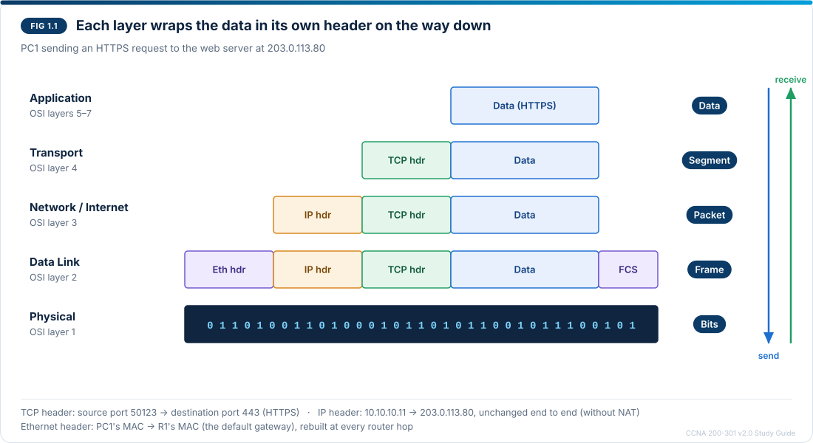</a> |
| **1.2** | Hop-by-hop forwarding: MAC addresses are rewritten by R1, IP addresses are not | <a href="../assets/figures/ch01/fig-01-02-hop-by-hop-forwarding.svg">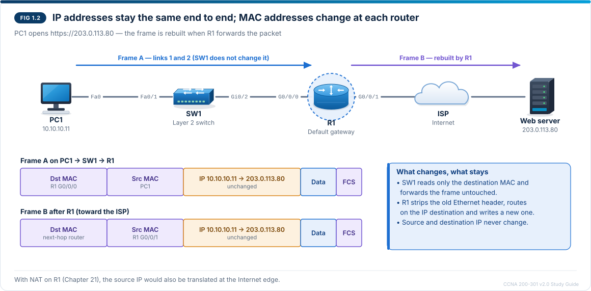</a> |
| **1.3** | Ethernet II frame layout with field sizes and purposes (fields not drawn to scale) | <a href="../assets/figures/ch01/fig-01-03-ethernet-frame.svg">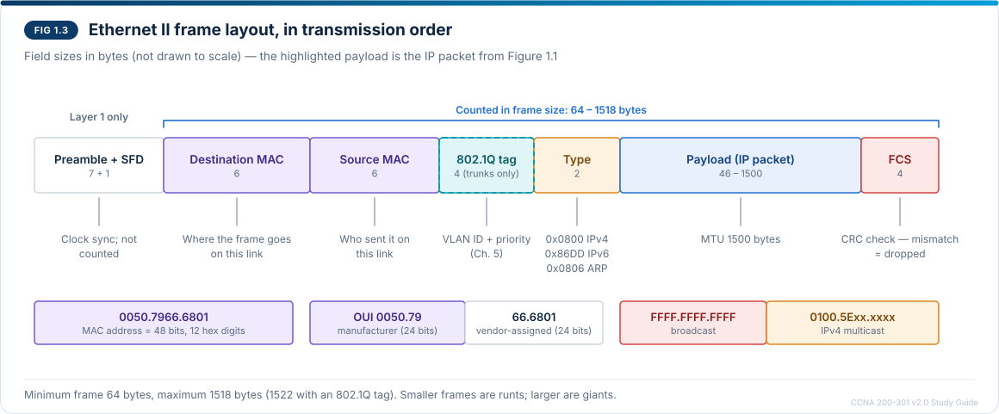</a> |
| **1.4** | Switch frame-forwarding logic: learn, then flood, filter or forward | <a href="../assets/figures/ch01/fig-01-04-switch-forwarding-logic.svg">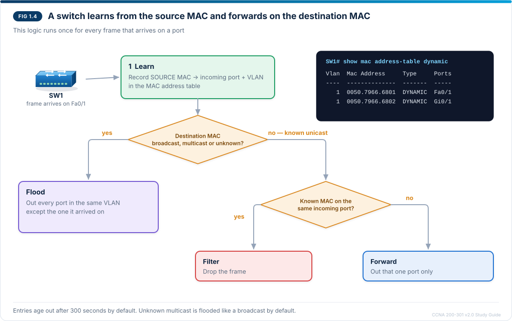</a> |
| **1.5** | Cisco IOS mode hierarchy and the commands that move between modes | <a href="../assets/figures/ch01/fig-01-05-ios-modes.svg">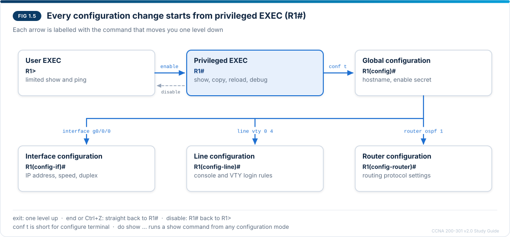</a> |
| **1.6** | Straight-through and crossover pin mapping for 10/100 Ethernet (MDI vs MDI-X) | <a href="../assets/figures/ch01/fig-01-06-straight-vs-crossover.svg">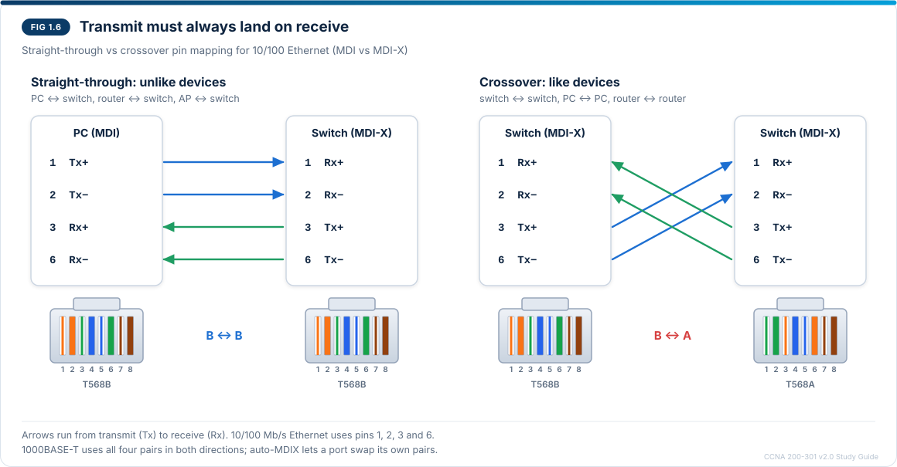</a> |
| **1.7** | Multimode vs single-mode fiber: core size, light source and light paths | <a href="../assets/figures/ch01/fig-01-07-multimode-vs-singlemode.svg">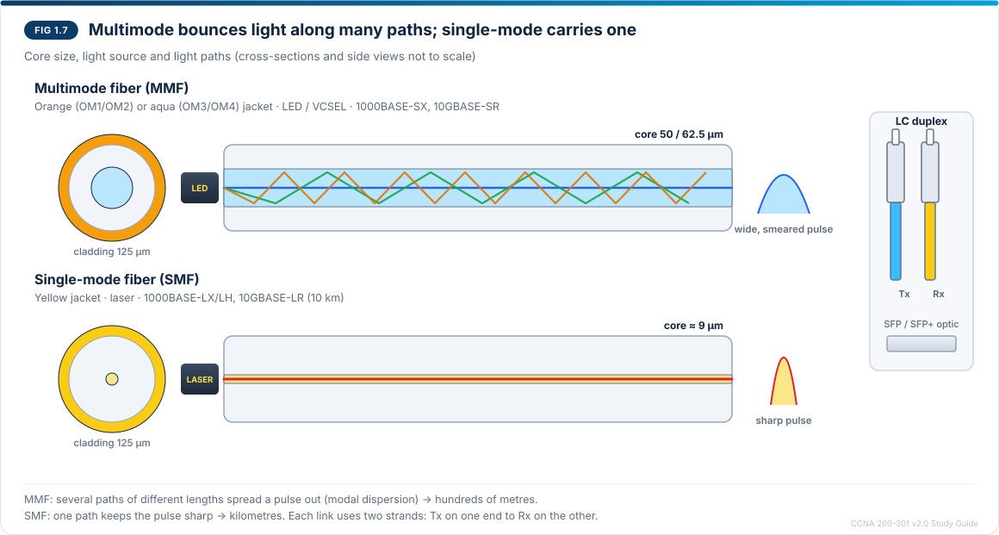</a> |
| **1.8** | Duplex mismatch: how it forms and the evidence on each side of the link | <a href="../assets/figures/ch01/fig-01-08-duplex-mismatch.svg">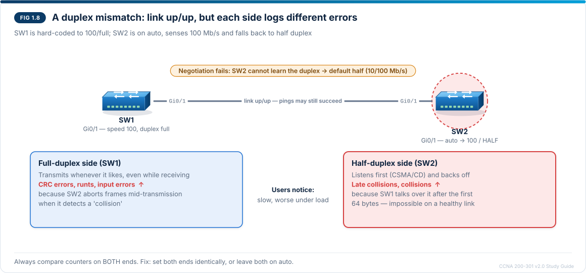</a> |
| **1.9** | Interface troubleshooting flowchart: status first, then counters, on both ends | <a href="../assets/figures/ch01/fig-01-09-interface-troubleshooting.svg">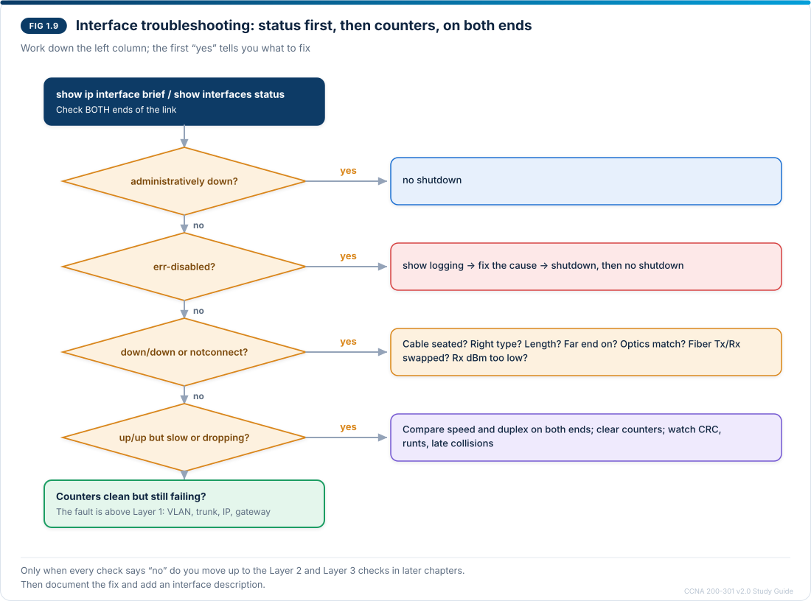</a> |
| **1.10** | Lab 1.1 topology with interfaces, cable types and IPv4 addresses | <a href="../assets/figures/ch01/fig-01-10-lab-1-1-topology.svg">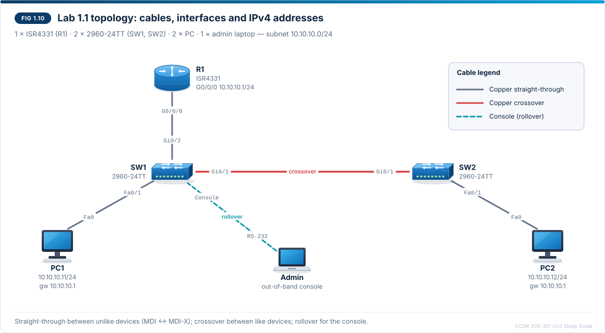</a> |

## Chapter 2 — IPv4 addressing and subnetting

Source: [`CCNA 200-301 v2.0 Study Guide.md`](../CCNA%20200-301%20v2.0%20Study%20Guide.md#chapter-2--ipv4-addressing-and-subnetting)

| Figure | Caption | Preview |
| --- | --- | --- |
| **2.1** | Octet place values: converting 10101100 to 172 | <a href="../assets/figures/ch02/fig-02-01-octet-place-values.svg">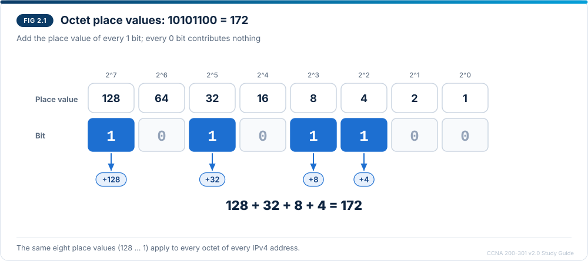</a> |
| **2.2** | 192.168.10.75/26 in binary: network bits, host bits, network and broadcast addresses | <a href="../assets/figures/ch02/fig-02-02-address-in-binary.svg">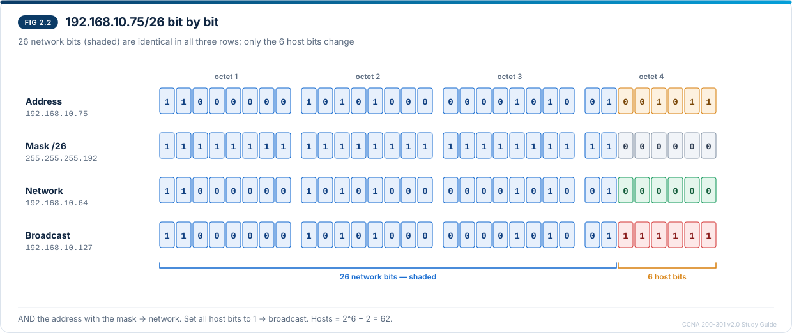</a> |
| **2.3** | Dividing 192.168.10.0/24 into /26 blocks and locating host .75 | <a href="../assets/figures/ch02/fig-02-03-block-size-number-line.svg">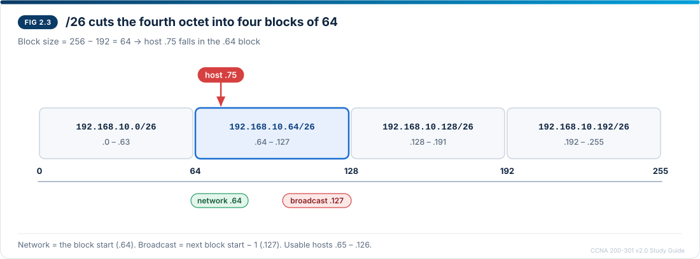</a> |
| **2.4** | VLSM plan for 172.16.0.0/24, drawn to scale, with the last /27 enlarged | <a href="../assets/figures/ch02/fig-02-04-vlsm-plan.svg">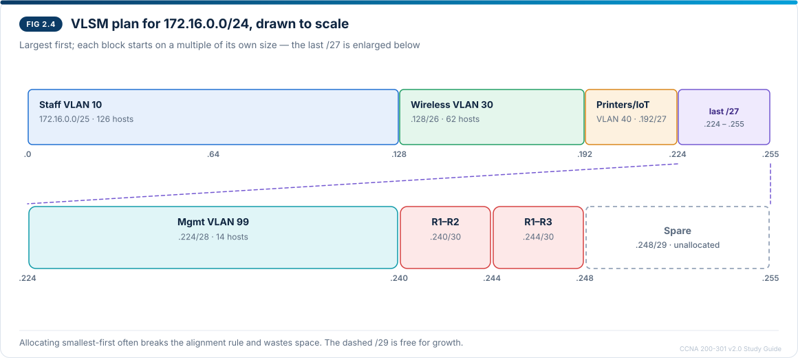</a> |
| **2.5** | Summarizing 10.10.8.0/24 to 10.10.11.0/24 into 10.10.8.0/22 by comparing third-octet bits | <a href="../assets/figures/ch02/fig-02-05-route-summarization.svg">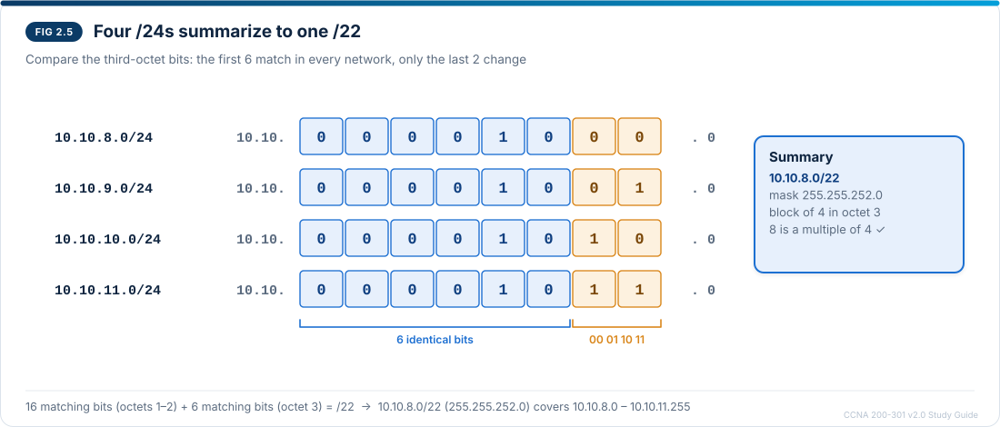</a> |
| **2.6** | Host IPv4 troubleshooting flowchart: APIPA, mask, gateway, duplicates | <a href="../assets/figures/ch02/fig-02-06-host-ipv4-troubleshooting.svg">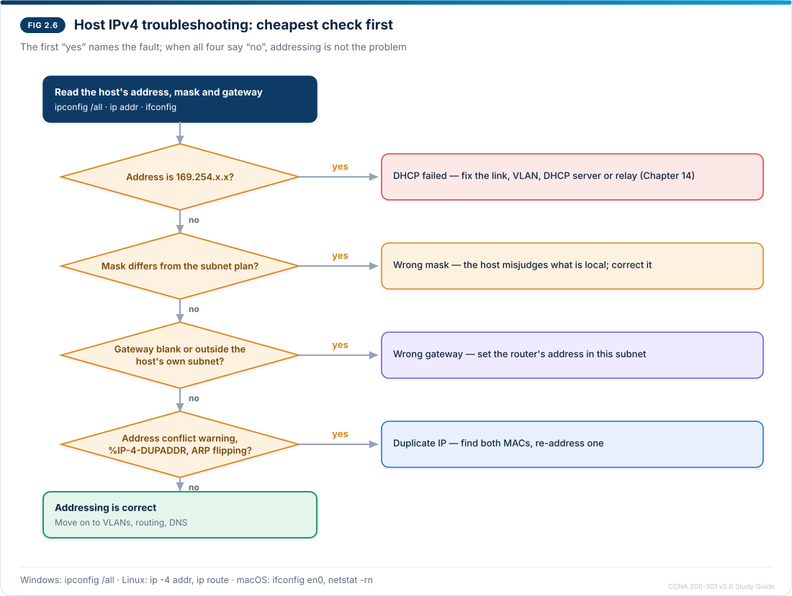</a> |
| **2.7** | Lab 2.1 topology: three VLSM subnets on R1's three interfaces |  |

## Chapter 3 — IPv6 addressing and prefix sizing

Source: [`CCNA 200-301 v2.0 Study Guide.md`](../CCNA%20200-301%20v2.0%20Study%20Guide.md#chapter-3--ipv6-addressing-and-prefix-sizing)

| Figure | Caption | Preview |
| --- | --- | --- |
| **3.1** | Structure of a global unicast address in a /64 subnet | <a href="../assets/figures/ch03/fig-03-01-ipv6-gua-structure.svg">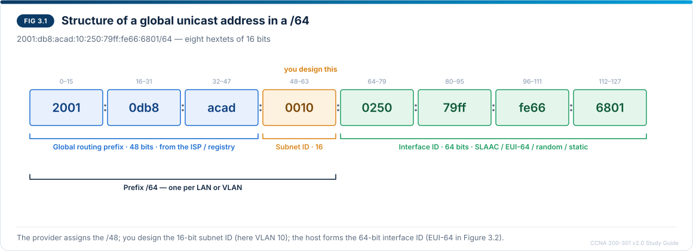</a> |
| **3.2** | Modified EUI-64 for MAC 0050.7966.6801: split, insert FFFE, flip the U/L bit | <a href="../assets/figures/ch03/fig-03-02-modified-eui-64.svg">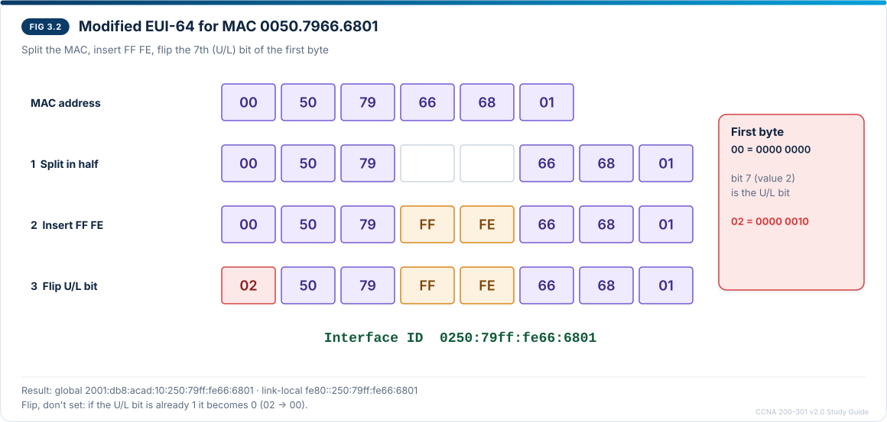</a> |
| **3.3** | SLAAC message sequence between PC1 and R1, with DAD | <a href="../assets/figures/ch03/fig-03-03-slaac-sequence.svg">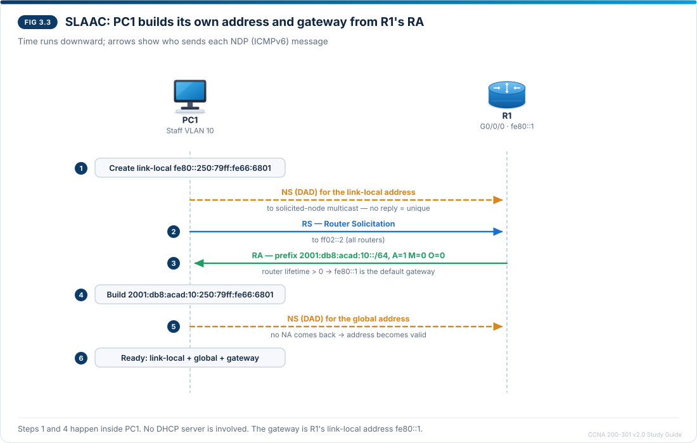</a> |
| **3.4** | Lab 3.1 dual-stack topology with IPv6 prefixes and assignment methods | <a href="../assets/figures/ch03/fig-03-04-lab-3-1-topology.svg">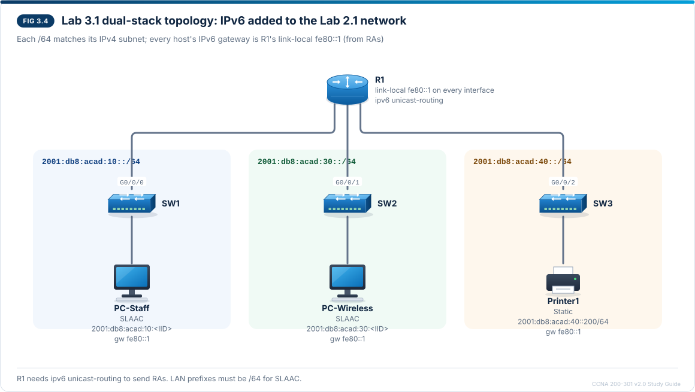</a> |

## Chapter 4 — Hypervisors, virtual machines and containers

Source: [`CCNA 200-301 v2.0 Study Guide.md`](../CCNA%20200-301%20v2.0%20Study%20Guide.md#chapter-4--hypervisors-virtual-machines-and-containers)

| Figure | Caption | Preview |
| --- | --- | --- |
| **4.1** | Software stacks: Type 1 hypervisor, Type 2 hypervisor and containers | <a href="../assets/figures/ch04/fig-04-01-hypervisor-stacks.svg">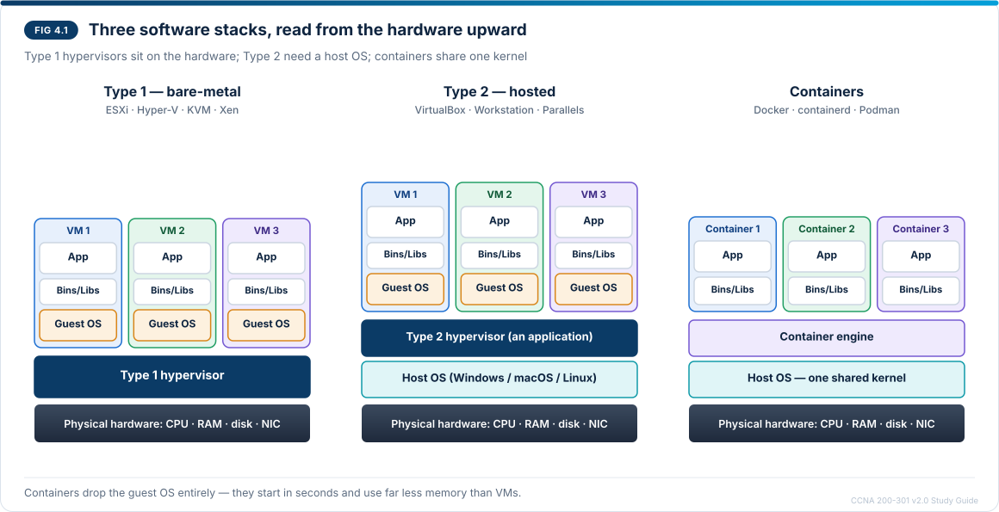</a> |
| **4.2** | Virtual switching: vNICs, port groups, vSwitch and an LACP trunk to SW1 | <a href="../assets/figures/ch04/fig-04-02-virtual-switching.svg">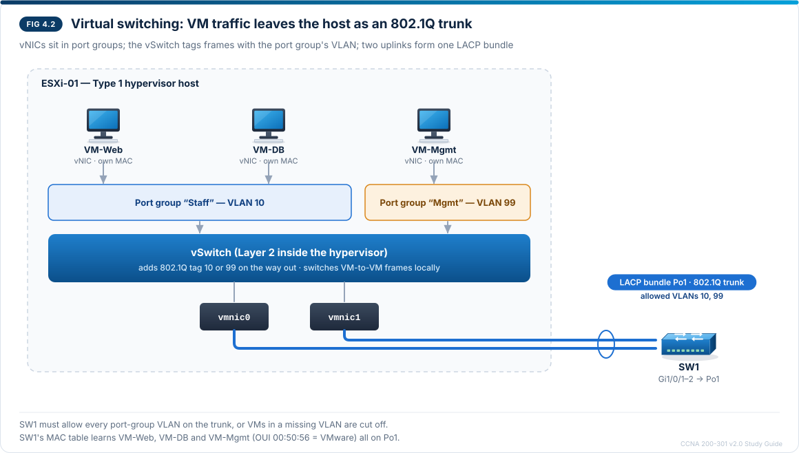</a> |
| **4.3** | Default Docker networking: docker0 bridge, NAT and a published port (-p 8080:80) | <a href="../assets/figures/ch04/fig-04-03-docker-networking.svg">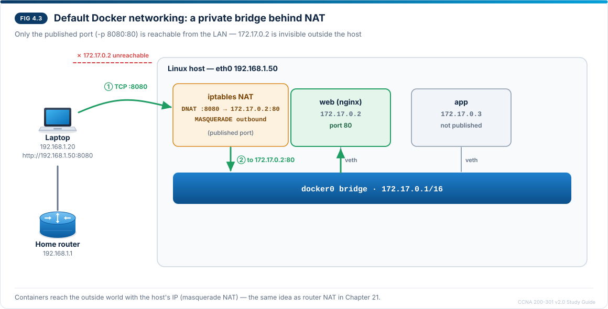</a> |
| **4.4** | VirtualBox NAT, Bridged and Host-only modes with example addresses | <a href="../assets/figures/ch04/fig-04-04-virtualbox-network-modes.svg">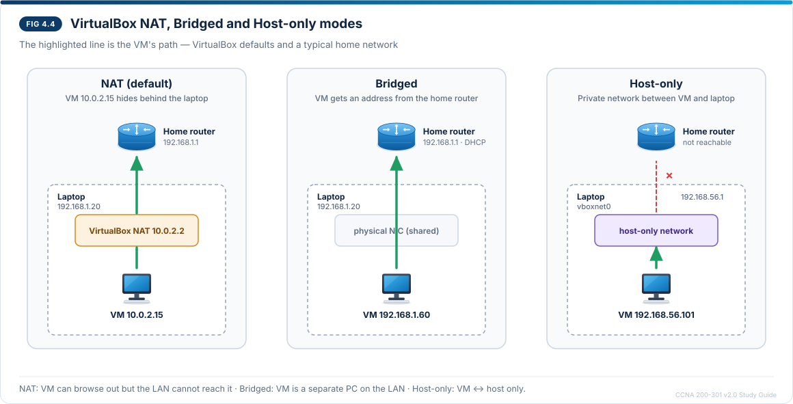</a> |

## Chapter 5 — VLANs, trunks, Layer 2/Layer 3 interfaces and SVIs

Source: [`CCNA 200-301 v2.0 Study Guide.md`](../CCNA%20200-301%20v2.0%20Study%20Guide.md#chapter-5--vlans-trunks-layer-2layer-3-interfaces-and-svis)

| Figure | Caption | Preview |
| --- | --- | --- |
| **5.1** | Three VLANs on one switch: a broadcast stays inside its own VLAN | <a href="../assets/figures/ch05/fig-05-01-vlans-broadcast-domains.svg">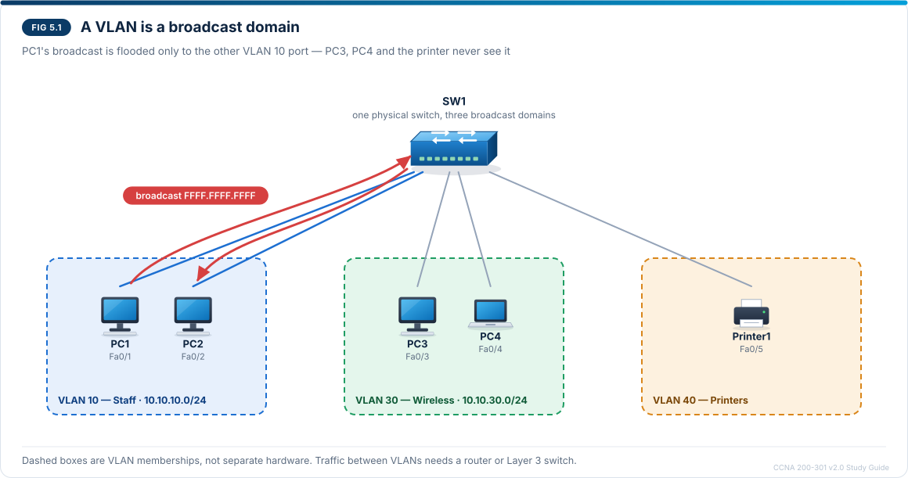</a> |
| **5.2** | 802.1Q tag position in the Ethernet frame and its four fields | <a href="../assets/figures/ch05/fig-05-02-dot1q-tag.svg">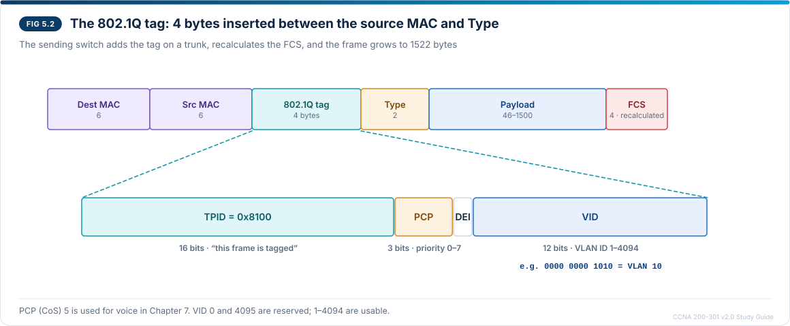</a> |
| **5.3** | A VLAN 10 frame crossing an 802.1Q trunk between SW1 and SW2 | <a href="../assets/figures/ch05/fig-05-03-frame-across-trunk.svg">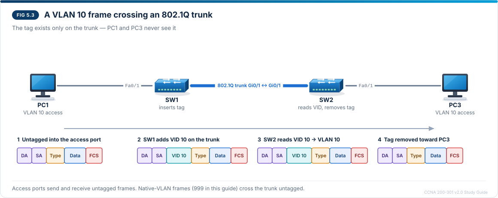</a> |
| **5.4** | Inter-VLAN routing: router-on-a-stick (left) vs multilayer switch SVIs (right) | <a href="../assets/figures/ch05/fig-05-04-inter-vlan-routing.svg">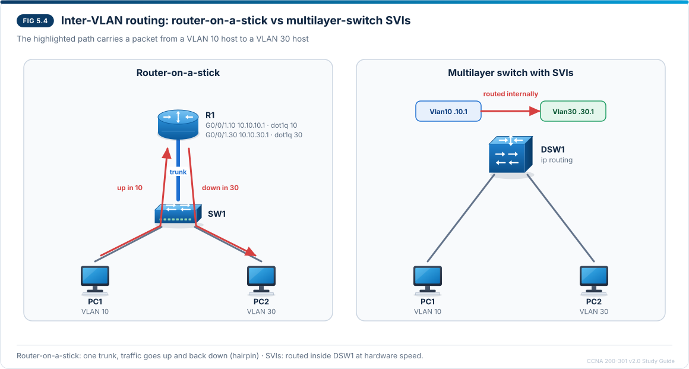</a> |
| **5.5** | VLAN, trunk and gateway troubleshooting flowchart | <a href="../assets/figures/ch05/fig-05-05-vlan-troubleshooting.svg">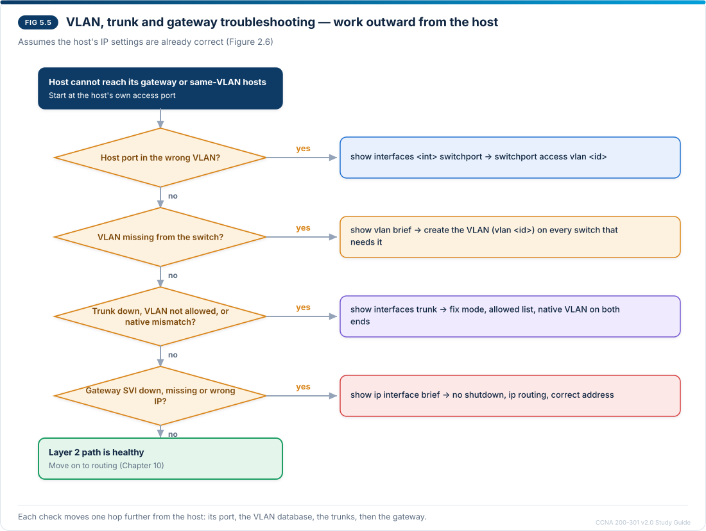</a> |
| **5.6** | Lab 5.1 topology: VLANs, trunks, SVIs and the routed uplink |  |

## Chapter 6 — EtherChannel with LACP

Source: [`CCNA 200-301 v2.0 Study Guide.md`](../CCNA%20200-301%20v2.0%20Study%20Guide.md#chapter-6--etherchannel-with-lacp)

| Figure | Caption | Preview |
| --- | --- | --- |
| **6.1** | Two parallel links with STP (left) vs the same links bundled as EtherChannel Po1 (right) | <a href="../assets/figures/ch06/fig-06-01-stp-vs-etherchannel.svg">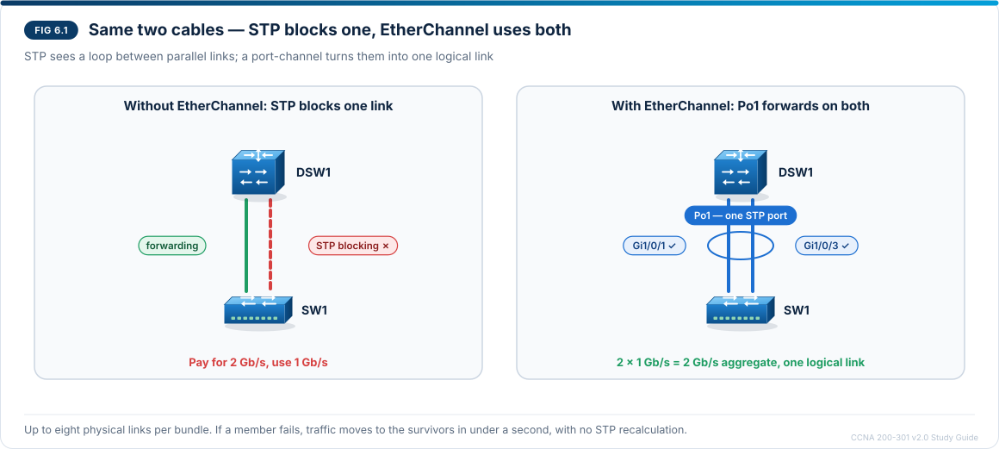</a> |
| **6.2** | Per-flow load balancing across the two members of Po1 | <a href="../assets/figures/ch06/fig-06-02-per-flow-load-balancing.svg">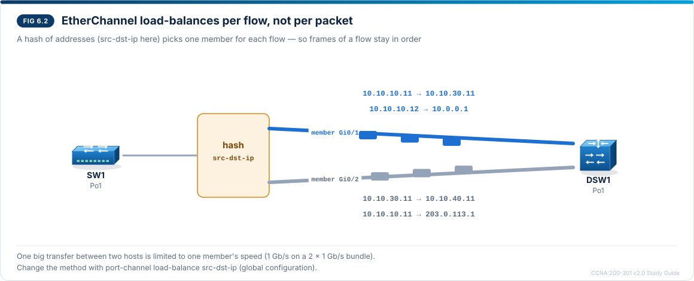</a> |
| **6.3** | Layer 2 trunk EtherChannel (Po1) vs Layer 3 routed EtherChannel (Po3) | <a href="../assets/figures/ch06/fig-06-03-l2-vs-l3-etherchannel.svg">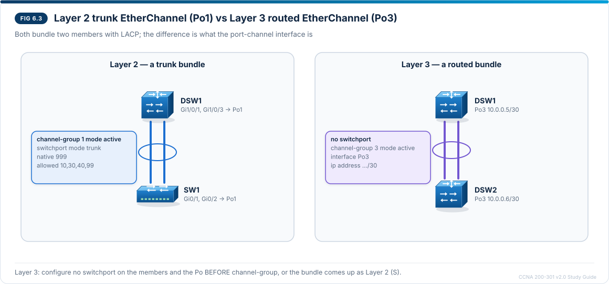</a> |
| **6.4** | Lab 6.1 topology: Po1 and Po2 Layer 2 trunks, Po3 Layer 3 bundle to DSW2 | <a href="../assets/figures/ch06/fig-06-04-lab-6-1-topology.svg">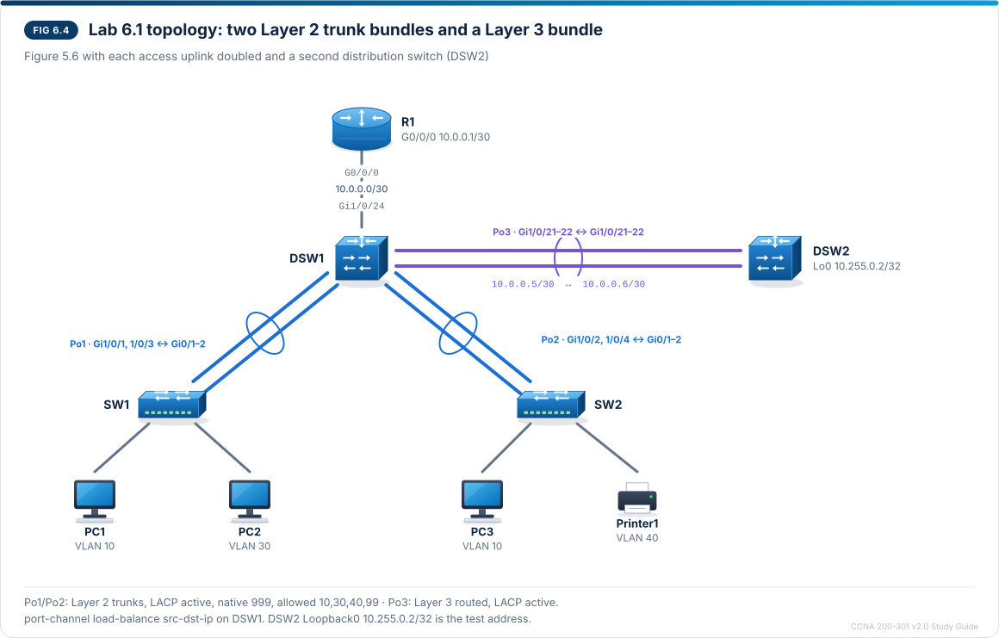</a> |

## Chapter 7 — Edge-host ports: VLAN, PoE, port channel and LACP

Source: [`CCNA 200-301 v2.0 Study Guide.md`](../CCNA%20200-301%20v2.0%20Study%20Guide.md#chapter-7--edge-host-ports-vlan-poe-port-channel-and-lacp)

| Figure | Caption | Preview |
| --- | --- | --- |
| **7.1** | Edge-device port profiles for objective 2.2.a–e | <a href="../assets/figures/ch07/fig-07-01-edge-port-profiles.svg">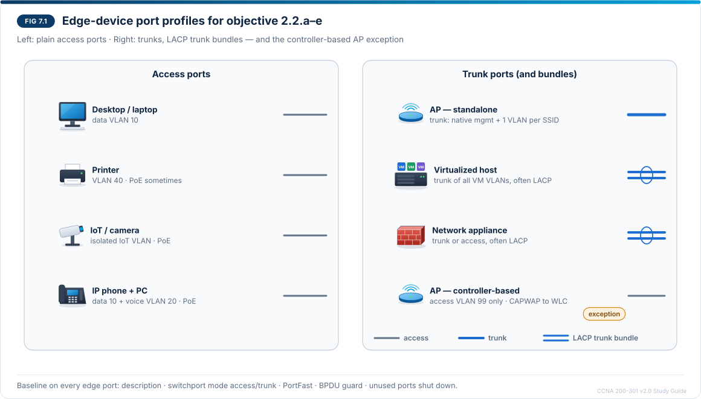</a> |
| **7.2** | IP phone and PC sharing one switch port: voice VLAN 20 tagged, data VLAN 10 untagged | <a href="../assets/figures/ch07/fig-07-02-voice-vlan.svg">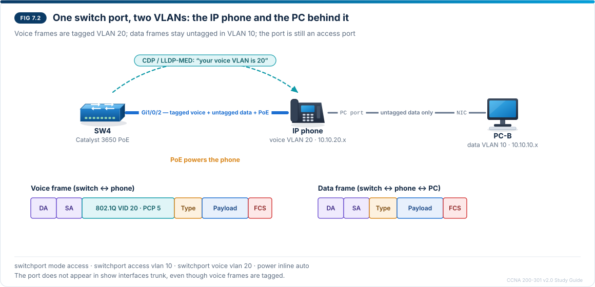</a> |
| **7.3** | Standalone AP on a trunk (left) vs controller-based AP on an access port with a CAPWAP tunnel (right) | <a href="../assets/figures/ch07/fig-07-03-standalone-vs-lightweight-ap.svg">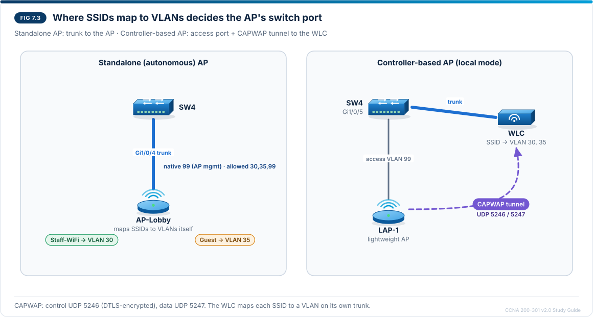</a> |
| **7.4** | Lab 7.1 topology: one PoE switch with five edge-device profiles | <a href="../assets/figures/ch07/fig-07-04-lab-7-1-topology.svg">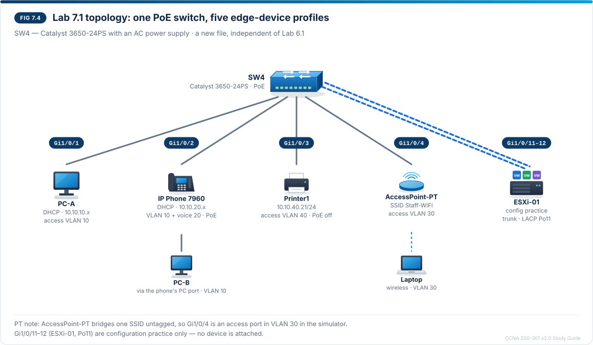</a> |

## Chapter 8 — Validating network documentation with CDP and LLDP

Source: [`CCNA 200-301 v2.0 Study Guide.md`](../CCNA%20200-301%20v2.0%20Study%20Guide.md#chapter-8--validating-network-documentation-with-cdp-and-lldp)

| Figure | Caption | Preview |
| --- | --- | --- |
| **8.1** | Discovery scope: each device learns only its directly connected CDP/LLDP neighbors | <a href="../assets/figures/ch08/fig-08-01-discovery-scope.svg">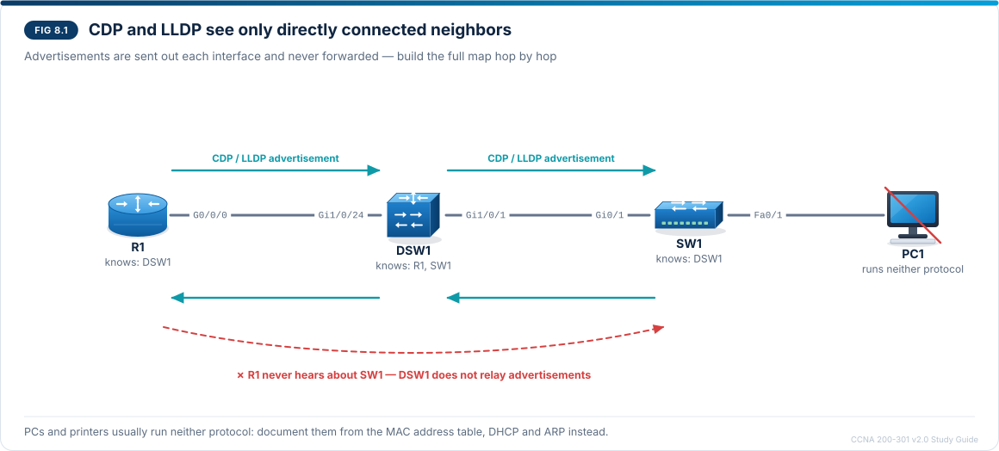</a> |
| **8.2** | Documentation validation workflow with CDP and LLDP | <a href="../assets/figures/ch08/fig-08-02-documentation-validation-workflow.svg">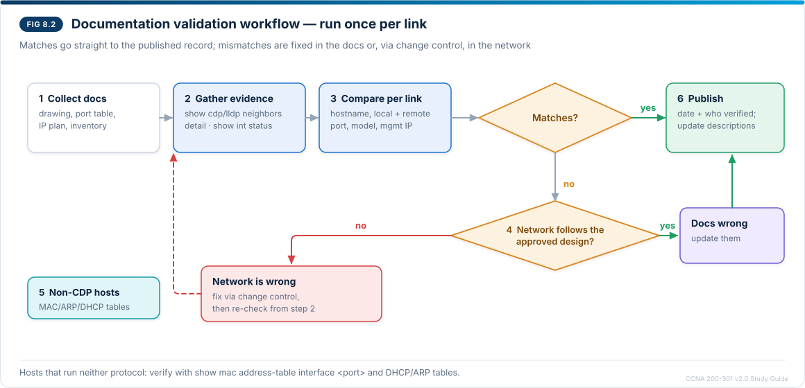</a> |
| **8.3** | DSW1's documented neighbors (left) vs what CDP discovered (right), mismatches outlined in red | <a href="../assets/figures/ch08/fig-08-03-dsw1-audit.svg">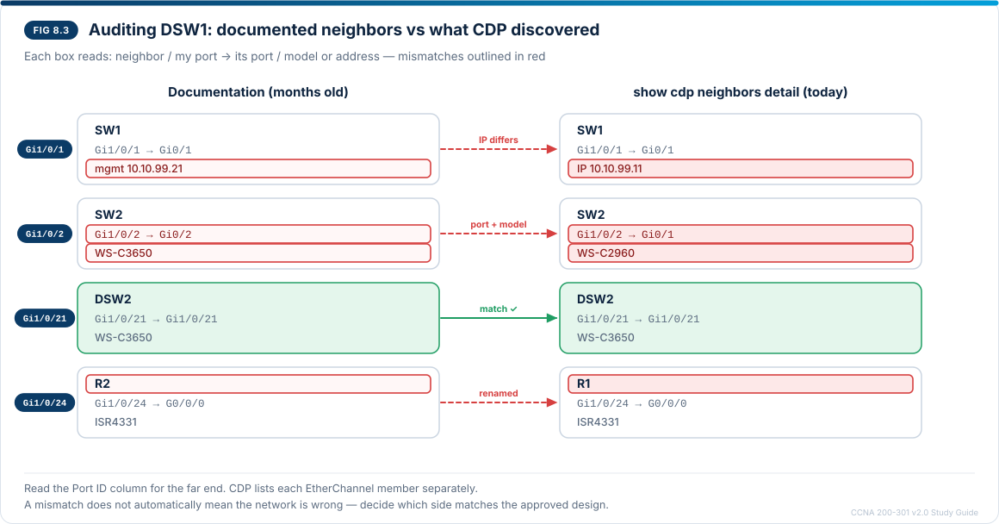</a> |

## Chapter 9 — Rapid PVST+ and STP protection

Source: [`CCNA 200-301 v2.0 Study Guide.md`](../CCNA%20200-301%20v2.0%20Study%20Guide.md#chapter-9--rapid-pvst-and-stp-protection)

| Figure | Caption | Preview |
| --- | --- | --- |
| **9.1** | A Layer 2 loop without STP: one broadcast becomes an endless storm | <a href="../assets/figures/ch09/fig-09-01-layer2-loop.svg">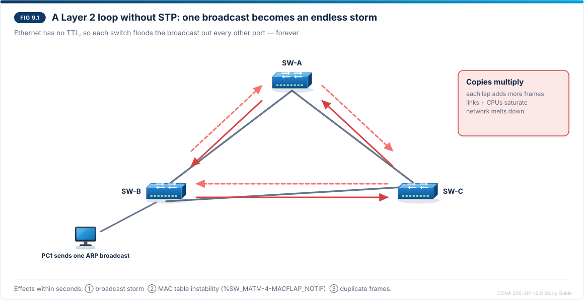</a> |
| **9.2** | Bridge ID structure with a VLAN 10 example | <a href="../assets/figures/ch09/fig-09-02-bridge-id.svg">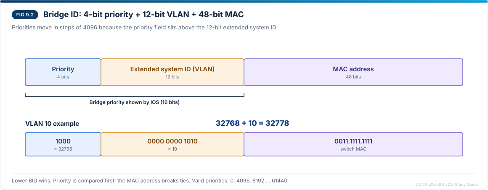</a> |
| **9.3** | STP election result for VLAN 10: root bridge, root ports, designated ports and the alternate port | <a href="../assets/figures/ch09/fig-09-03-stp-election.svg">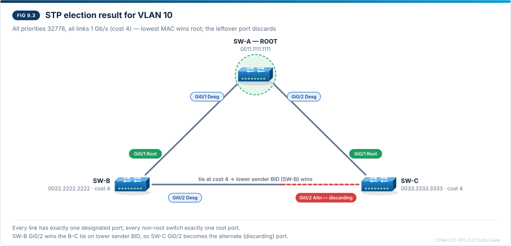</a> |
| **9.4** | Placement of root guard, loop guard, PortFast and BPDU guard in the campus | <a href="../assets/figures/ch09/fig-09-04-stp-protection-placement.svg">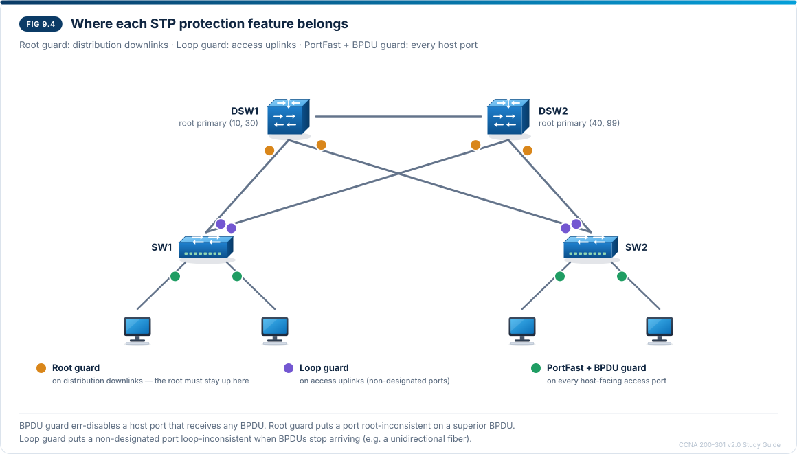</a> |
| **9.5** | Lab 9.1 topology with the expected Rapid PVST+ port roles for VLAN 10 | <a href="../assets/figures/ch09/fig-09-05-lab-9-1-topology.svg">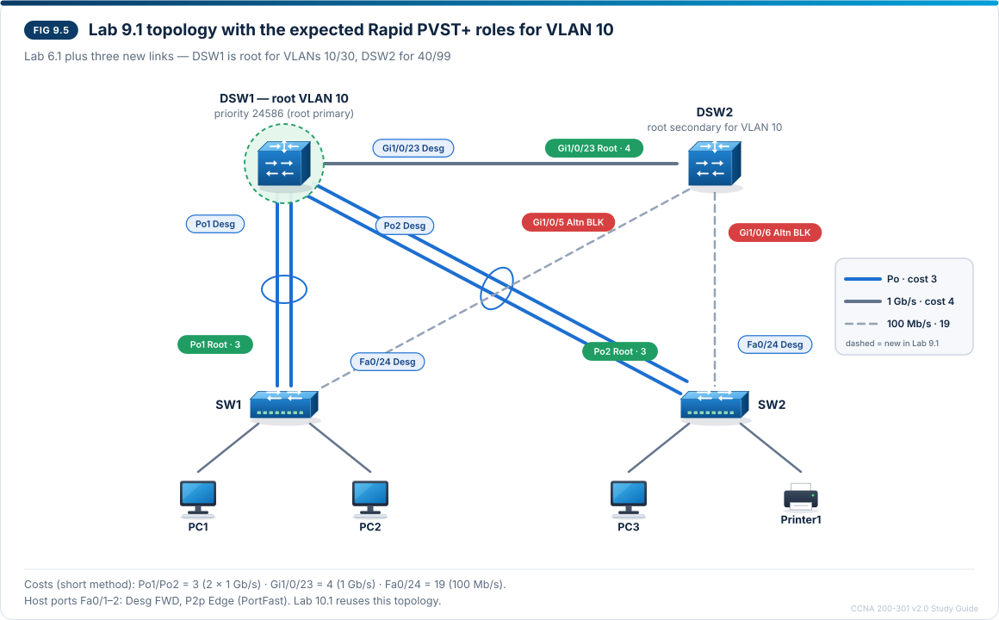</a> |

## Chapter 10 — Interpreting the routing table

Source: [`CCNA 200-301 v2.0 Study Guide.md`](../CCNA%20200-301%20v2.0%20Study%20Guide.md#chapter-10--interpreting-the-routing-table)

| Figure | Caption | Preview |
| --- | --- | --- |
| **10.1** | The router's per-packet forwarding process | <a href="../assets/figures/ch10/fig-10-01-router-forwarding-process.svg">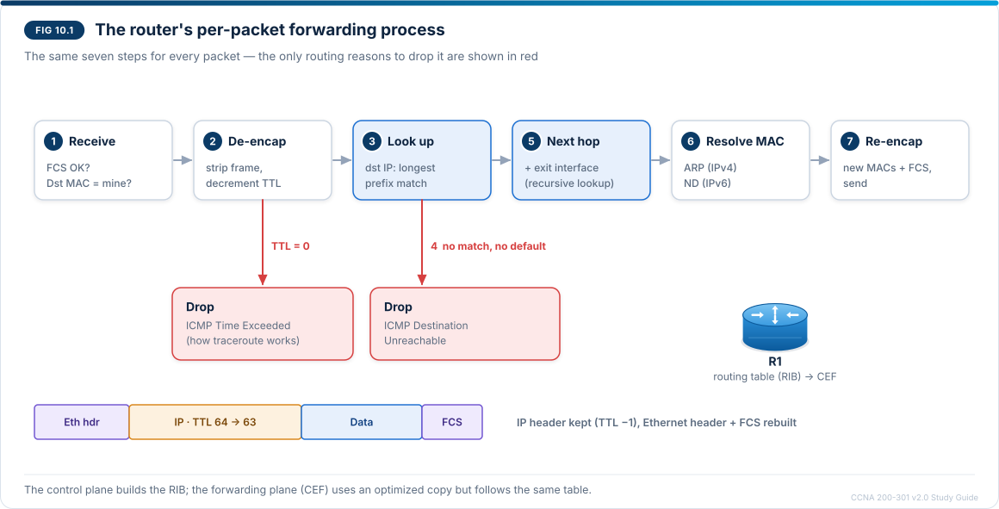</a> |
| **10.2** | Anatomy of one routing table entry from R1 | <a href="../assets/figures/ch10/fig-10-02-routing-entry-anatomy.svg">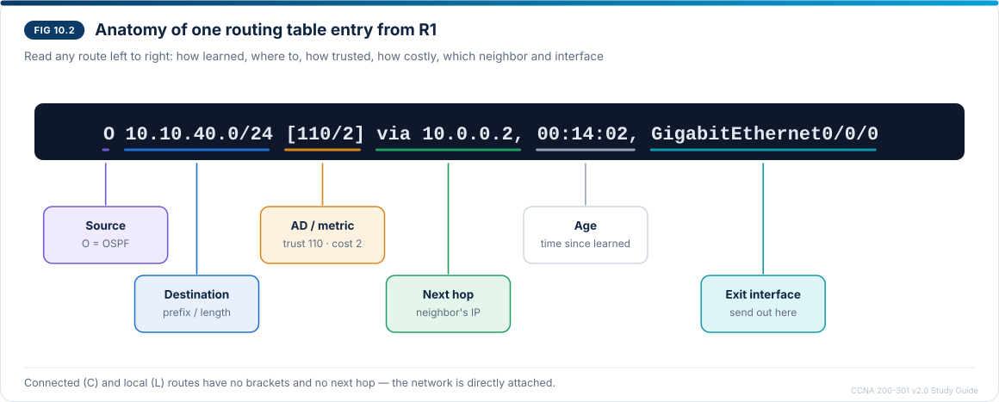</a> |
| **10.3** | Route selection: AD and metric when building the table, longest match when forwarding | <a href="../assets/figures/ch10/fig-10-03-route-selection.svg">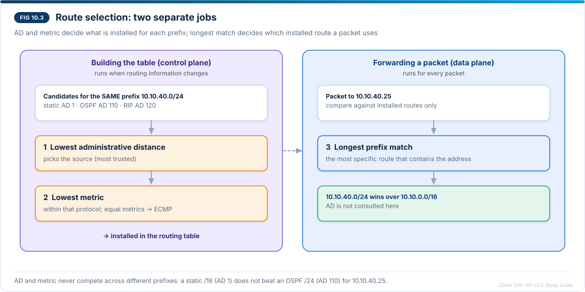</a> |
| **10.4** | Longest prefix match for 10.10.40.25 against five of R1's routes | <a href="../assets/figures/ch10/fig-10-04-longest-prefix-match.svg">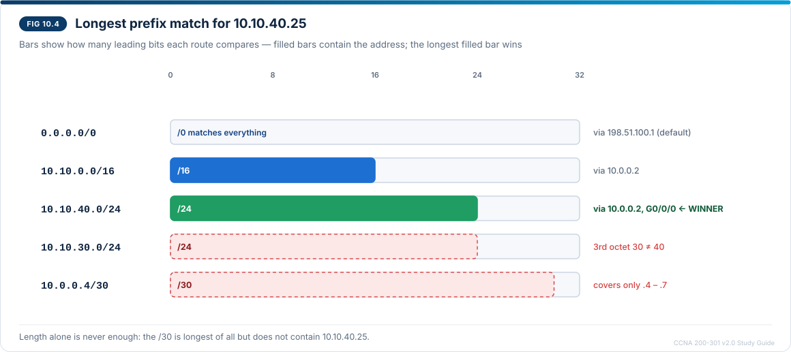</a> |

## Chapter 11 — IPv4 and IPv6 static routing

Source: [`CCNA 200-301 v2.0 Study Guide.md`](../CCNA%20200-301%20v2.0%20Study%20Guide.md#chapter-11--ipv4-and-ipv6-static-routing)

| Figure | Caption | Preview |
| --- | --- | --- |
| **11.1** | Default, network, host and floating static routes on R1 (the Lab 11.1 network) | <a href="../assets/figures/ch11/fig-11-01-static-route-types.svg">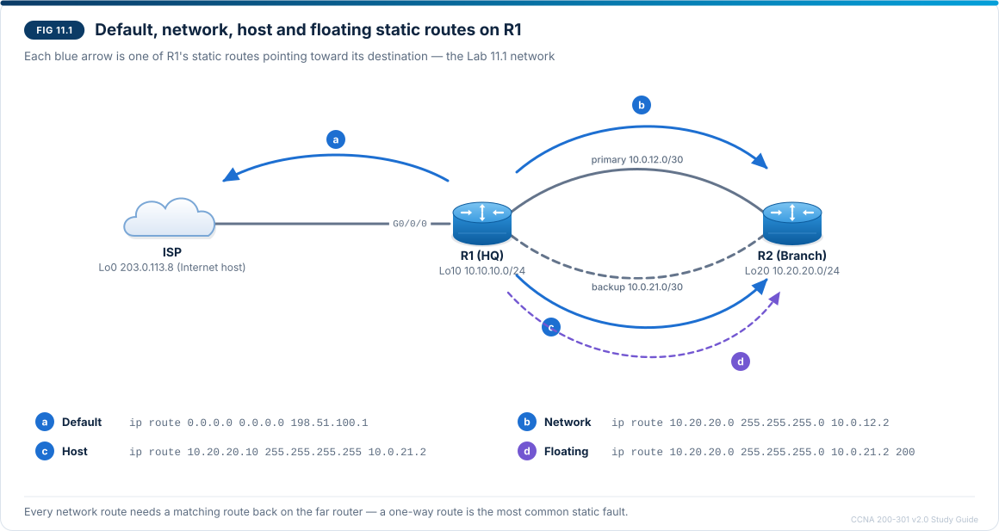</a> |
| **11.2** | Next-hop, exit-interface and fully specified static routes compared |  |
| **11.3** | Floating static failover on R1: before and after the primary link fails |  |
| **11.4** | Lab 11.1 topology with IPv4 and IPv6 addressing |  |

## Chapter 12 — Single-area OSPFv2 and OSPFv3

Source: [`CCNA 200-301 v2.0 Study Guide.md`](../CCNA%20200-301%20v2.0%20Study%20Guide.md#chapter-12--single-area-ospfv2-and-ospfv3)

| Figure | Caption | Preview |
| --- | --- | --- |
| **12.1** | OSPF neighbor states and the packets that move two routers from Down to Full |  |
| **12.2** | DR/BDR election on a broadcast LAN: FULL and 2-WAY adjacencies |  |
| **12.3** | Lab 12.1 topology: broadcast LAN with DR/BDR and a point-to-point link |  |

## Chapter 13 — First hop redundancy protocols

Source: [`CCNA 200-301 v2.0 Study Guide.md`](../CCNA%20200-301%20v2.0%20Study%20Guide.md#chapter-13--first-hop-redundancy-protocols)

| Figure | Caption | Preview |
| --- | --- | --- |
| **13.1** | A first hop redundancy group: one virtual gateway shared by an active and a standby router |  |
| **13.2** | HSRP failover timeline with default timers |  |
| **13.3** | Lab 13.1 HSRP plan on the Lab 9.1 campus: active gateway per VLAN |  |

## Chapter 14 — DHCPv4 client, server and relay

Source: [`CCNA 200-301 v2.0 Study Guide.md`](../CCNA%20200-301%20v2.0%20Study%20Guide.md#chapter-14--dhcpv4-client-server-and-relay)

| Figure | Caption | Preview |
| --- | --- | --- |
| **14.1** | The DHCP DORA exchange between a client and a server on the same subnet |  |
| **14.2** | DHCP relay: the client's broadcast becomes a unicast to the server, stamped with giaddr |  |
| **14.3** | DHCP troubleshooting flowchart from client to server |  |
| **14.4** | Lab 14.1 topology: DHCP server R1, relays DSW1 and DSW2, ISP serving R1's outside interface |  |

## Chapter 15 — The troubleshooting toolkit

Source: [`CCNA 200-301 v2.0 Study Guide.md`](../CCNA%20200-301%20v2.0%20Study%20Guide.md#chapter-15--the-troubleshooting-toolkit)

| Figure | Caption | Preview |
| --- | --- | --- |
| **15.1** | Divide-and-conquer troubleshooting: the question and the commands at each layer |  |
| **15.2** | How traceroute discovers each hop with rising TTL values |  |
| **15.3** | Reading the capture above: four conversations and what each proves |  |

## Chapter 16 — Wireless principles

Source: [`CCNA 200-301 v2.0 Study Guide.md`](../CCNA%20200-301%20v2.0%20Study%20Guide.md#chapter-16--wireless-principles)

| Figure | Caption | Preview |
| --- | --- | --- |
| **16.1** | 2.4 GHz channels 1–13 and why only 1, 6 and 11 avoid overlap |  |
| **16.2** | A 2.4 GHz channel reuse plan with channels 1, 6 and 11 |  |
| **16.3** | WPA2/WPA3-Enterprise: 802.1X authentication between supplicant, authenticator and RADIUS server |  |
| **16.4** | Lab 16.1 topology: an ESS of two APs on channels 1 and 6 |  |

## Chapter 17 — Client connectivity on Windows, macOS and Linux

Source: [`CCNA 200-301 v2.0 Study Guide.md`](../CCNA%20200-301%20v2.0%20Study%20Guide.md#chapter-17--client-connectivity-on-windows-macos-and-linux)

| Figure | Caption | Preview |
| --- | --- | --- |
| **17.1** | Client connectivity checks in order, with the usual cause when each one fails |  |
| **17.2** | How a client's mask decides between its gateway and direct delivery |  |

## Chapter 18 — Secure device access: local users, SSH and AAA

Source: [`CCNA 200-301 v2.0 Study Guide.md`](../CCNA%20200-301%20v2.0%20Study%20Guide.md#chapter-18--secure-device-access-local-users-ssh-and-aaa)

| Figure | Caption | Preview |
| --- | --- | --- |
| **18.1** | An administrator's SSH login authenticated, authorized and accounted by a TACACS+ server |  |
| **18.2** | AAA method list: ERROR moves to the next method, FAIL stops the login |  |
| **18.3** | Lab 18.1: AAA-1 in VLAN 99 serving DSW1 (TACACS+) and SW1 (RADIUS) |  |

## Chapter 19 — Managing configurations and images with SCP and SFTP

Source: [`CCNA 200-301 v2.0 Study Guide.md`](../CCNA%20200-301%20v2.0%20Study%20Guide.md#chapter-19--managing-configurations-and-images-with-scp-and-sftp)

| Figure | Caption | Preview |
| --- | --- | --- |
| **19.1** | SCP with the switch as server (left) and SCP/SFTP with the switch as client (right) |  |
| **19.2** | Software image upgrade workflow with hash verification |  |

## Chapter 20 — IPv4 access control lists

Source: [`CCNA 200-301 v2.0 Study Guide.md`](../CCNA%20200-301%20v2.0%20Study%20Guide.md#chapter-20--ipv4-access-control-lists)

| Figure | Caption | Preview |
| --- | --- | --- |
| **20.1** | ACL processing: top-down, first match, implicit deny |  |
| **20.2** | Matching two addresses against 10.10.30.0 0.0.0.255 |  |
| **20.3** | Lab 20.1 policy: WIRELESS-IN on VLAN 30 and MGMT-ONLY on the VTY lines |  |

## Chapter 21 — NAT and PAT on IOS XE routers

Source: [`CCNA 200-301 v2.0 Study Guide.md`](../CCNA%20200-301%20v2.0%20Study%20Guide.md#chapter-21--nat-and-pat-on-ios-xe-routers)

| Figure | Caption | Preview |
| --- | --- | --- |
| **21.1** | NAT address terms: inside/outside, local/global |  |
| **21.2** | PAT translation table: one public address, many ports |  |
| **21.3** | Lab 21.1 topology and NAT plan |  |

## Chapter 22 — Diagnosing DNS records

Source: [`CCNA 200-301 v2.0 Study Guide.md`](../CCNA%20200-301%20v2.0%20Study%20Guide.md#chapter-22--diagnosing-dns-records)

| Figure | Caption | Preview |
| --- | --- | --- |
| **22.1** | Recursive DNS resolution and caching |  |
| **22.2** | The campus.example records and how they chain |  |
| **22.3** | DNS diagnosis flow |  |

## Chapter 23 — Layer 2 security features

Source: [`CCNA 200-301 v2.0 Study Guide.md`](../CCNA%20200-301%20v2.0%20Study%20Guide.md#chapter-23--layer-2-security-features)

| Figure | Caption | Preview |
| --- | --- | --- |
| **23.1** | DHCP snooping: trusted and untrusted ports, binding table |  |
| **23.2** | Dynamic ARP inspection decisions |  |
| **23.3** | Lab 23.1 port roles on SW1 and SW2 |  |

## Chapter 24 — IPsec site-to-site and remote-access VPNs

Source: [`Part 2 — Chapters 24–28.md`](../Part%202%20%E2%80%94%20Chapters%2024%E2%80%9328.md#chapter-24--ipsec-site-to-site-and-remote-access-vpns)

| Figure | Caption | Preview |
| --- | --- | --- |
| **24.1** | Site-to-site and remote-access VPNs |  |
| **24.2** | ESP transport mode and tunnel mode packet layouts |  |
| **24.3** | Lab 24.1 site-to-site VPN topology |  |

## Chapter 25 — Syslog and SNMP

Source: [`Part 2 — Chapters 24–28.md`](../Part%202%20%E2%80%94%20Chapters%2024%E2%80%9328.md#chapter-25--syslog-and-snmp)

| Figure | Caption | Preview |
| --- | --- | --- |
| **25.1** | Anatomy of an IOS syslog message |  |
| **25.2** | Syslog severity levels and the logging threshold |  |
| **25.3** | SNMP manager, agent, operations and ports |  |

## Chapter 26 — Network management approaches and Ansible

Source: [`Part 2 — Chapters 24–28.md`](../Part%202%20%E2%80%94%20Chapters%2024%E2%80%9328.md#chapter-26--network-management-approaches-and-ansible)

| Figure | Caption | Preview |
| --- | --- | --- |
| **26.1** | Five network management approaches |  |
| **26.2** | Controller-based management: northbound and southbound interfaces |  |
| **26.3** | Ansible architecture and an infrastructure-as-code workflow |  |

## Chapter 27 — AI in network operations: agents and prompts

Source: [`Part 2 — Chapters 24–28.md`](../Part%202%20%E2%80%94%20Chapters%2024%E2%80%9328.md#chapter-27--ai-in-network-operations-agents-and-prompts)

| Figure | Caption | Preview |
| --- | --- | --- |
| **27.1** | The agent loop, its tools and guardrails |  |
| **27.2** | Levels of autonomy for AI agents in network operations |  |
| **27.3** | The four components of an operations prompt |  |

## Chapter 28 — Final review

Source: [`Part 2 — Chapters 24–28.md`](../Part%202%20%E2%80%94%20Chapters%2024%E2%80%9328.md#chapter-28--final-review)

| Figure | Caption | Preview |
| --- | --- | --- |
| **28.1** | The finished campus lab, all features |  |
