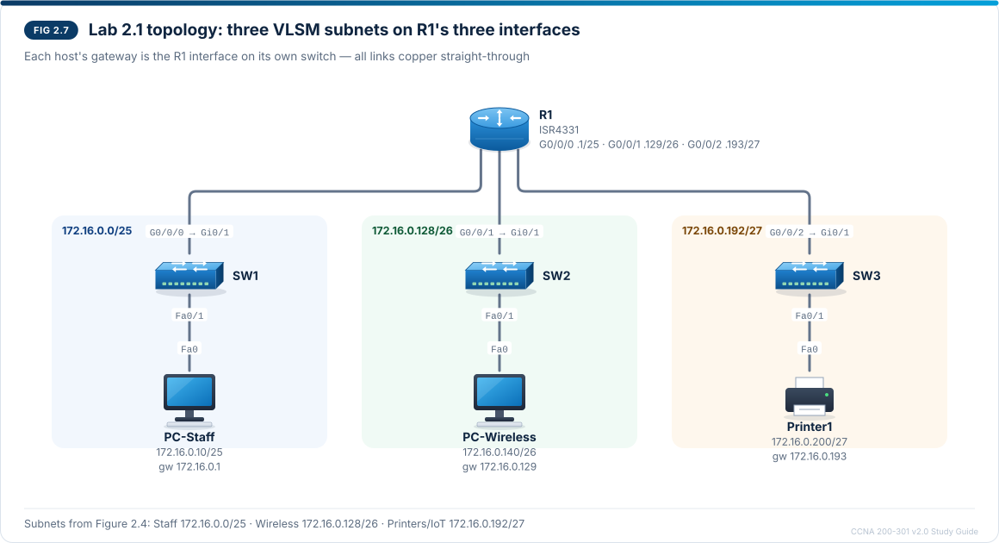

# Chapter 2 — IPv4 addressing and subnetting

CCNA-style practice questions for [Chapter 2](../CCNA%20200-301%20v2.0%20Study%20Guide.md#chapter-2--ipv4-addressing-and-subnetting) · Domain 1 · Objective 1.3. The format is described in the [question bank README](README.md).

## Questions

### Q1 · Multiple choice — choose two
<sub>Source: 2.3, 2.4</sub>

Which two subnet masks are valid? (Choose two.)

- [x] 255.255.255.248
- [ ] 255.255.255.250
- [x] 255.255.224.0
- [ ] 255.255.0.255
- [ ] 255.255.255.196

> **Explanation:** A mask is a run of 1s followed by 0s, so every mask octet must be 0, 128, 192, 224, 240, 248, 252, 254 or 255, and every octet to the right of a value below 255 must be 0. 255.255.255.248 is /29 and 255.255.224.0 is /19. 250 (11111010) and 196 (11000100) have 0 bits between 1 bits, and 255.255.0.255 has 1s after 0s.

---

### Q2 · Multiple choice
<sub>Source: 2.6, 2.7</sub>

A host is configured as 10.10.37.200/21. Which range lists the usable host addresses of the host's subnet?

- [ ] 10.10.37.1 – 10.10.37.254
- [ ] 10.10.36.1 – 10.10.39.254
- [x] 10.10.32.1 – 10.10.39.254
- [ ] 10.10.32.0 – 10.10.39.255

> **Explanation:** /21 is 255.255.248.0, so the interesting octet is the third and the block size is 256 − 248 = 8. The multiples of 8 are 0, 8, 16, 24, 32, 40 …, and 37 falls in the block that starts at 32. The network is 10.10.32.0 and the next one is 10.10.40.0, so the broadcast is 10.10.39.255 and the usable range is 10.10.32.1 – 10.10.39.254 (2^11 − 2 = 2,046 hosts). The .37.1 – .37.254 range treats the host as a /24, the range starting at 10.10.36.1 uses a block of 4 (a /22), and the range from 10.10.32.0 to 10.10.39.255 includes the network and broadcast addresses, which cannot be given to hosts.

---

### Q3 · Drag and drop — match
<sub>Source: 2.5</sub>

Drag each address to its address type. A type can be used more than once, and not every type is used.

| Address | Type |
| --- | --- |
| 172.30.8.20 | Private (RFC 1918) |
| 172.34.8.20 | Public |
| 192.168.8.20 | Private (RFC 1918) |
| 169.254.8.20 | Link-local (APIPA) |
| 100.64.8.20 | Shared address space (carrier-grade NAT) |
| 127.8.8.20 | Loopback |

**Extra targets:** Multicast · Documentation

> **Explanation:** 172.16.0.0/12 runs only from 172.16.0.0 to 172.31.255.255, so 172.30.8.20 is private but 172.34.8.20 is public. 192.168.0.0/16 is the third RFC 1918 block. 169.254.0.0/16 is APIPA: the host asked DHCP and got no answer. 100.64.0.0/10 is carrier-grade NAT space and is not RFC 1918. The whole of 127.0.0.0/8 is loopback. Multicast is 224.0.0.0/4 and the documentation ranges are 192.0.2.0/24, 198.51.100.0/24 and 203.0.113.0/24, so none of these addresses belong to them.

---

### Q4 · Multiple choice
<sub>Source: 2.8</sub>

An engineer must divide 10.20.0.0/16 into equal-sized subnets. Each subnet must support at least 1,000 hosts, and the design must create as many subnets as possible. Which prefix length meets the requirement, and how many subnets does it create?

- [ ] /23, which creates 128 subnets
- [x] /22, which creates 64 subnets
- [ ] /22, which creates 62 subnets
- [ ] /21, which creates 32 subnets

> **Explanation:** Find the smallest number of host bits with 2^h − 2 ≥ 1,000: 9 bits give only 510, 10 bits give 1,022, so the prefix is 32 − 10 = /22 (255.255.252.0). Going from /16 to /22 borrows 6 bits, and 2^6 = 64 subnets — subtract 2 for hosts, never for subnets. A /23 is too small for 1,000 hosts; a /21 supports them but creates only 32 subnets.

---

### Q5 · Drag and drop — match
<sub>Source: 2.9</sub>

A new branch receives 192.168.64.0/23. The engineer builds a VLSM plan: requirements are allocated largest first, each gets the smallest prefix that fits, and each starts at the next free address that is a multiple of its block size. Drag the correct subnet to each requirement. Not every subnet is used.

| Requirement | Subnet |
| --- | --- |
| Staff, VLAN 10: 200 hosts | 192.168.64.0/24 |
| Wireless, VLAN 30: 100 hosts | 192.168.65.0/25 |
| Printers/IoT, VLAN 40: 40 hosts | 192.168.65.128/26 |
| Management, VLAN 99: 10 hosts | 192.168.65.192/28 |

**Extra targets:** 192.168.64.128/25 · 192.168.65.128/27

> **Explanation:** 200 hosts need 8 host bits (254 usable), so Staff gets a /24: 192.168.64.0 – 192.168.64.255. 100 hosts need a /25 (126), placed at the next free multiple of 128: 192.168.65.0. 40 hosts need a /26 (62) at 192.168.65.128, and 10 hosts need a /28 (14) at 192.168.65.192, leaving 192.168.65.208 – 192.168.65.255 spare. 192.168.64.128/25 overlaps the Staff /24, and a /27 offers only 30 hosts, too few for 40.

---

### Q6 · Multiple choice
<sub>Source: 2.10, 2.11</sub>

Refer to the exhibit.

```
R2# show ip route connected
      172.16.0.0/16 is variably subnetted, 6 subnets, 3 masks
C        172.16.4.0/24 is directly connected, GigabitEthernet0/0/0
L        172.16.4.1/32 is directly connected, GigabitEthernet0/0/0
C        172.16.5.0/24 is directly connected, GigabitEthernet0/0/1
L        172.16.5.1/32 is directly connected, GigabitEthernet0/0/1
C        172.16.6.0/23 is directly connected, GigabitEthernet0/0/2
L        172.16.6.1/32 is directly connected, GigabitEthernet0/0/2
```

Which is the most specific single summary route that covers all of R2's connected subnets?

- [ ] 172.16.4.0/23
- [x] 172.16.4.0/22
- [ ] 172.16.6.0/22
- [ ] 172.16.0.0/21

> **Explanation:** The three C routes cover 172.16.4.0 to 172.16.7.255 (the /23 holds both 6 and 7). In binary the third octets 4 to 7 are 00000100 to 00000111, so the first 6 bits match: 16 + 6 = /22. A /22 is a block of 4 in the third octet and 4 is a multiple of 4, so 172.16.4.0/22 is exact. 172.16.4.0/23 misses 172.16.6.0/23; 172.16.6.0/22 does not start on a multiple of 4, so it is not a valid summary network; 172.16.0.0/21 covers the routes but also 172.16.0.0 – 172.16.3.255, so it is less specific.

---

### Q7 · CLI
<sub>Source: 2.9, 2.11</sub>

R2 GigabitEthernet0/0/1 will be the gateway for the Management subnet (VLAN 99), 172.16.0.224/28, from the VLSM plan. You are in interface configuration mode for that interface. Enter the command that assigns it the subnet's first usable address, 172.16.0.225.

**Prompt:** `R2(config-if)#`

**Accepted:** `ip address 172.16.0.225 255.255.255.240`

> **Explanation:** IOS takes the mask in dotted decimal, not a prefix length such as `/28`. 28 bits = 255.255.255.240, a block of 16: usable .225 – .238, broadcast .239. Router interfaces are shut by default, so `no shutdown` follows, and `show ip interface brief` and `show ip route connected` verify the result.

---

### Q8 · Multiple choice
<sub>Source: 2.7, 2.12</sub>

Refer to the exhibit.

```
C:\> ipconfig /all
Ethernet adapter Ethernet0:
   Connection-specific DNS Suffix  . :
   Physical Address. . . . . . . . . : 00-50-56-A1-3C-7E
   DHCP Enabled. . . . . . . . . . . : No
   IPv4 Address. . . . . . . . . . . : 172.16.0.180(Preferred)
   Subnet Mask . . . . . . . . . . . : 255.255.255.224
   Default Gateway . . . . . . . . . : 172.16.0.129
```

A test PC was added by hand to the Wireless subnet, 172.16.0.128/26, whose gateway is R1 at 172.16.0.129. The PC can ping 172.16.0.170, but it cannot ping PC-Wireless at 172.16.0.140 or any remote network. Which change fixes the problem?

- [x] Change the subnet mask to 255.255.255.192
- [ ] Change the subnet mask to 255.255.255.0
- [ ] Change the default gateway to 172.16.0.161
- [ ] Change the default gateway to 172.16.0.1

> **Explanation:** With 255.255.255.224 (/27, block 32) the PC calculates its subnet as 172.16.0.160/27 (.161 – .190). 172.16.0.170 is inside that range, so the PC reaches it directly. 172.16.0.140 and every remote network need the gateway, but 172.16.0.129 lies outside the PC's /27, so the PC cannot even ARP for it. The plan's mask is /26 (255.255.255.192): 172.16.0.128/26 contains both .180 and the gateway. A /24 mask would make the PC treat the Staff and Printer subnets as local and ARP for them; .161 is not a router address; 172.16.0.1 is the Staff subnet's gateway, outside the Wireless subnet.

---

### Q9 · Drag and drop — order
<sub>Source: 2.12</sub>

A user's PC cannot reach some destinations. Drag the host IPv4 checks into the recommended order, starting with the quickest check.

1. Check whether the address is in 169.254.0.0/16 (APIPA)
2. Compare the address and mask with the subnet plan
3. Confirm that the default gateway is inside the host's subnet and answers a ping
4. Look for a duplicate address (conflict warning, `%IP-4-DUPADDR`, ARP entry flipping between MACs)

> **Explanation:** The checks run from cheapest to hardest. A 169.254.x.x address is spotted at a glance and means DHCP failed. Next comes the mask, because a wrong mask makes the host misjudge what is local. Then the gateway, which must be in the host's own subnet. A duplicate address is the hardest to prove because it needs logs and ARP tables. If all four checks pass, addressing is not the problem; move on to VLANs, routing and DNS.

## Testlet A · Lab 2.1 after a maintenance window

Refer to the scenario. R1 routes between the three VLSM subnets of Lab 2.1: Staff 172.16.0.0/25 on G0/0/0, Wireless 172.16.0.128/26 on G0/0/1 and Printers/IoT 172.16.0.192/27 on G0/0/2. PC-Staff (172.16.0.10) uses gateway 172.16.0.1, PC-Wireless (172.16.0.140) uses 172.16.0.129 and Printer1 (172.16.0.200) uses 172.16.0.193. After a maintenance window users report problems, and the engineer collects the output below from R1 and from PC-Staff.



```
R1# show ip interface brief
Interface              IP-Address      OK? Method Status                Protocol
GigabitEthernet0/0/0   172.16.0.1      YES manual up                    up
GigabitEthernet0/0/1   172.16.0.129    YES manual up                    up
GigabitEthernet0/0/2   172.16.0.193    YES manual administratively down down

R1# show ip route connected
      172.16.0.0/16 is variably subnetted, 4 subnets, 3 masks
C        172.16.0.0/25 is directly connected, GigabitEthernet0/0/0
L        172.16.0.1/32 is directly connected, GigabitEthernet0/0/0
C        172.16.0.128/26 is directly connected, GigabitEthernet0/0/1
L        172.16.0.129/32 is directly connected, GigabitEthernet0/0/1
```

```
C:\> ipconfig
Ethernet adapter Ethernet0:
   IPv4 Address. . . . . . . . . . . : 172.16.0.10
   Subnet Mask . . . . . . . . . . . : 255.255.255.0
   Default Gateway . . . . . . . . . : 172.16.0.1
```

### Q10 · Multiple choice
<sub>Source: 2.12, 2.13</sub>

PC-Staff can ping its gateway, 172.16.0.1, but its pings to PC-Wireless at 172.16.0.140 fail. What is the cause?

- [ ] R1 has no connected route to 172.16.0.128/26
- [x] PC-Staff's /24 mask makes it treat 172.16.0.140 as local, so it ARPs for PC-Wireless directly instead of sending the packet to R1
- [ ] PC-Staff's default gateway is outside its own subnet
- [ ] 172.16.0.140 is the broadcast address of the Wireless subnet

> **Explanation:** The plan gives PC-Staff a /25 (255.255.255.128), but the host has 255.255.255.0, so it believes everything from 172.16.0.0 to 172.16.0.255 is local. It ARPs for 172.16.0.140, nobody on SW1 answers, and the ping fails. The gateway ping still works because 172.16.0.1 is local under either mask — a successful gateway ping does not prove the mask is right. R1 does have C 172.16.0.128/26, the gateway is inside the host's subnet, and the Wireless broadcast address is 172.16.0.191.

---

### Q11 · Multiple choice — choose two
<sub>Source: 2.11, 2.13</sub>

Which two statements about the exhibit are true? (Choose two.)

- [x] R1 has no C route for 172.16.0.192/27 because G0/0/2 is administratively down
- [x] Even after PC-Staff's mask is corrected, Printer1 cannot communicate with the other subnets until G0/0/2 is enabled
- [ ] "4 subnets, 3 masks" shows that R1's interfaces must be changed to the same prefix length
- [ ] G0/0/2 has lost its IP address, so the address must be entered again
- [ ] The L routes are networks that R1 learned from a neighbouring router

> **Explanation:** A missing C route means the interface is down or unaddressed. `show ip interface brief` still lists 172.16.0.193 on G0/0/2, so the address is there; the interface is shut down. Printer1's gateway is 172.16.0.193, so no traffic leaves or reaches the Printers/IoT subnet through R1 until G0/0/2 comes up, which is a separate fault from PC-Staff's mask. "Variably subnetted, 3 masks" (/25, /26 and /32) is normal VLSM, and L routes are /32 routes for R1's own interface addresses.

---

### Q12 · CLI
<sub>Source: 2.11, 2.13</sub>

You are in interface configuration mode for R1 G0/0/2. Enter the command that fixes R1's part of the problem.

**Prompt:** `R1(config-if)#`

**Accepted:** `no shutdown`

> **Explanation:** `administratively down` means the interface has been shut down; router interfaces are shut by default, and forgetting `no shutdown` is a common mistake. Once G0/0/2 is up/up, `show ip route connected` shows C 172.16.0.192/27 and L 172.16.0.193/32 again. PC-Staff's mask still has to be corrected to 255.255.255.128 on the host itself.
