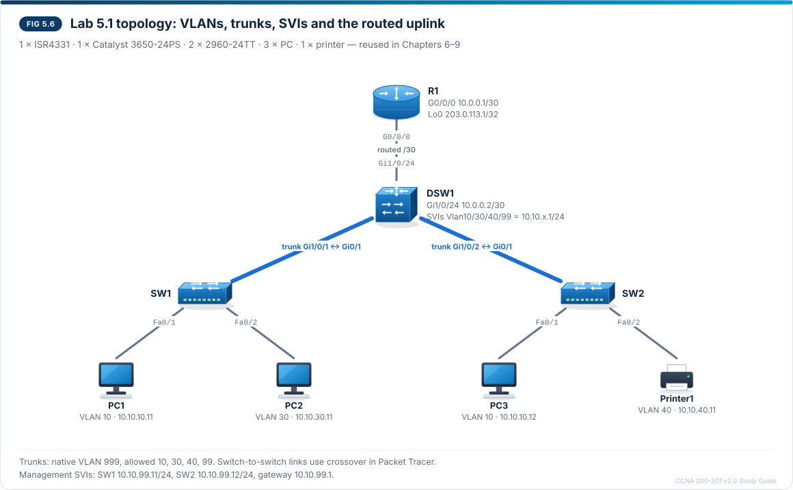

# Chapter 5 — VLANs, trunks, Layer 2/Layer 3 interfaces and SVIs

CCNA-style practice questions for [Chapter 5](../CCNA%20200-301%20v2.0%20Study%20Guide.md#chapter-5--vlans-trunks-layer-2layer-3-interfaces-and-svis) · Domain 2 · Objectives 2.1.a, 2.1.b and 2.1.d. The format is described in the [question bank README](README.md).

## Questions

### Q1 · Multiple choice
<sub>Source: 5.4, 5.9, 5.12</sub>

Refer to the exhibit.

```
SW2# show vlan brief

VLAN Name                             Status    Ports
---- -------------------------------- --------- -------------------------------
1    default                          active    Fa0/3, Fa0/4, Fa0/5, Fa0/6
                                                Fa0/7, Fa0/8, Fa0/9, Fa0/10
                                                Fa0/11, Fa0/12, Fa0/13, Fa0/14
                                                Fa0/15, Fa0/16, Fa0/17, Fa0/18
                                                Fa0/19, Fa0/20, Fa0/21, Fa0/22
                                                Fa0/23, Fa0/24, Gi0/2
4    VLAN0004                         active    Fa0/2
10   STAFF                            active    Fa0/1
30   WIRELESS                         active
40   PRINTERS                         active
99   MGMT                             active
999  NATIVE                           active
1002 fddi-default                     act/unsup
1003 token-ring-default               act/unsup
1004 fddinet-default                  act/unsup
1005 trnet-default                    act/unsup
```

Printer1 (10.10.40.11/24, gateway 10.10.40.1) is connected to SW2 Fa0/2 and cannot reach its gateway. PC3 on Fa0/1 can reach its gateway 10.10.10.1. SW2 Gi0/1 is the 802.1Q trunk to the distribution switch DSW1, which holds the VLAN gateways. What is the most likely cause?

- [x] Fa0/2 is assigned to VLAN 4 instead of VLAN 40.
- [ ] Gi0/1 is missing from the output, so the trunk to DSW1 is down.
- [ ] VLAN 40 has no ports listed, so it is inactive and passes no traffic.
- [ ] The VLAN name PRINTERS must match the VLAN 40 name on DSW1 before VLAN 40 can cross the trunk.

> **Explanation:** Fa0/2 is listed under VLAN 4, a typo for 40, so Printer1 sits in a VLAN that has no gateway. Assigning a port to a VLAN that does not exist creates that VLAN automatically on most switches, which is why an unplanned VLAN 4 appears in the list. The fix is `switchport access vlan 40` on Fa0/2, then `no vlan 4`. Gi0/1 is missing because trunk ports are never listed in `show vlan brief`. VLAN 40 shows `active` even without access ports, and VLAN names are local labels that do not have to match between switches.

---

### Q2 · Multiple choice
<sub>Source: 5.3</sub>

An engineer is documenting the VLAN plan for a new switch block. Which statement about VLAN IDs is correct?

- [x] VLANs 1002–1005 are reserved for legacy Token Ring and FDDI and cannot be deleted.
- [ ] VLAN 1 can be deleted after every port has been moved out of it.
- [ ] VLAN 999 belongs to the extended range.
- [ ] VLAN 4095 is the highest VLAN ID that can be assigned to an access port.

> **Explanation:** VLANs 1002–1005 are reserved for legacy Token Ring and FDDI and cannot be deleted. VLAN 1 is the default VLAN that every port starts in, and it cannot be deleted either. The normal range is 2–1001, so VLAN 999 is a normal-range VLAN; the extended range is 1006–4094. VLAN IDs 0 and 4095 are reserved and never used, so 4094 is the highest usable ID.

---

### Q3 · Multiple choice — choose two
<sub>Source: 5.5</sub>

Two switches are connected by an 802.1Q trunk. VLANs 1 and 10 are both allowed on it, and nobody has changed its native VLAN. Which two statements describe the frames that cross this trunk? (Choose two.)

- [x] A VLAN 10 frame carries a 4-byte tag with VID 10.
- [x] A VLAN 1 frame is sent untagged.
- [ ] A VLAN 1 frame carries a tag with VID 1 so that the other switch can identify its VLAN.
- [ ] The VLAN ID is carried in the 3-bit PCP field of the tag.
- [ ] The tag raises the maximum Ethernet frame size from 1518 to 1526 bytes.

> **Explanation:** 802.1Q inserts a 4-byte tag (TPID 0x8100, 3-bit PCP, 1-bit DEI, 12-bit VID) between the source MAC address and the Type field, and the switch recalculates the FCS. Frames in the native VLAN — VLAN 1 by default — cross the trunk untagged, and the receiving switch places untagged frames in its native VLAN. The VLAN ID is the 12-bit VID; PCP carries the priority (Class of Service). The 4 extra bytes raise the maximum frame size from 1518 to 1522 bytes.

---

### Q4 · Drag and drop — match
<sub>Source: 5.5</sub>

Two switch ports are connected to each other. Drag each pair of configured switchport modes to the result. A result can be used more than once.

| Modes on the two ends | Result |
| --- | --- |
| dynamic auto and dynamic auto | Access link |
| dynamic desirable and dynamic auto | Trunk |
| trunk and dynamic auto | Trunk |
| access and dynamic desirable | Access link |
| access and trunk | Mismatch |

> **Explanation:** A `dynamic auto` port only answers DTP requests and never starts negotiation, so two auto ports both wait and the link stays an access link — the classic exam trap. A `dynamic desirable` port actively asks, so it forms a trunk with an auto, desirable or trunk neighbor. A `trunk` port forms a trunk with any dynamic neighbor, while an `access` port makes a dynamic neighbor run as an access link. One end hard-coded as access and the other as trunk is a mismatch that should never be configured. Best practice is to hard-code `switchport mode trunk` or `switchport mode access` and disable DTP with `switchport nonegotiate`.

---

### Q5 · Multiple choice
<sub>Source: 5.8, 5.9, 5.10, 5.12</sub>

Refer to the exhibit.



```
DSW1# show interfaces trunk

Port        Mode         Encapsulation  Status        Native vlan
Gi1/0/1     on           802.1q         trunking      999
Gi1/0/2     on           802.1q         trunking      999

Port        Vlans allowed on trunk
Gi1/0/1     10,30,40,99
Gi1/0/2     10,30,99

Port        Vlans allowed and active in management domain
Gi1/0/1     10,30,40,99
Gi1/0/2     10,30,99

Port        Vlans in spanning tree forwarding state and not pruned
Gi1/0/1     10,30,40,99
Gi1/0/2     10,30,99
```

The figure shows the intended design. DSW1 Gi1/0/2 is the trunk to SW2. Printer1 (VLAN 40) on SW2 cannot reach its gateway 10.10.40.1, but PC3 (VLAN 10) on SW2 can reach 10.10.10.1. What is the cause?

- [x] VLAN 40 is not in the allowed VLAN list of the trunk to SW2.
- [ ] VLAN 40 has not been created on DSW1.
- [ ] Spanning tree is blocking VLAN 40 on Gi1/0/2.
- [ ] Gi1/0/2 has negotiated an access link with DTP.

> **Explanation:** Read the four blocks in order. Gi1/0/2 is trunking (mode `on`, native VLAN 999), but VLAN 40 is missing from the first block, the allowed list, so it cannot appear in the later blocks either. VLAN 40 does exist on DSW1: it is allowed, active and forwarding on Gi1/0/1. A VLAN blocked by spanning tree would still be listed as allowed and active and would be missing only from the last block. The fix is `switchport trunk allowed vlan add 40` on Gi1/0/2; without `add`, the command would replace the list and cut off VLANs 10, 30 and 99.

---

### Q6 · CLI
<sub>Source: 5.5, 5.9, 5.12</sub>

Refer to the exhibit.

```
*Mar  1 00:12:45.123: %CDP-4-NATIVE_VLAN_MISMATCH: Native VLAN mismatch discovered on GigabitEthernet0/1 (1), with DSW1 GigabitEthernet1/0/1 (999).
```

The campus standard is native VLAN 999 on every trunk, and DSW1 Gi1/0/1 already follows it. You are in interface configuration mode for SW1 Gi0/1. Enter the command that fixes the problem reported in the log.

**Prompt:** `SW1(config-if)#`

**Accepted:** `switchport trunk native vlan 999`

> **Explanation:** The message shows that SW1 Gi0/1 still uses native VLAN 1, the default, while DSW1 Gi1/0/1 uses 999. Untagged frames sent in one end's native VLAN arrive in a different VLAN at the other end, so traffic leaks between VLANs. Both ends must use the same native VLAN; the standard is 999, so SW1 is the side to change. Using an unused VLAN such as 999 instead of VLAN 1 is the best practice.

---

### Q7 · Multiple choice
<sub>Source: 5.6</sub>

Refer to the exhibit.

```
DSW1(config)# interface gigabitethernet1/0/24
DSW1(config-if)# description Routed link to R1 G0/0/0
DSW1(config-if)# no switchport
DSW1(config-if)# ip address 10.0.0.2 255.255.255.252
DSW1(config-if)# no shutdown
```

DSW1 is a Catalyst 3650 multilayer switch with `ip routing` enabled. Which statement describes Gi1/0/24 after these commands?

- [x] It belongs to no VLAN and does not run spanning tree.
- [ ] It stays in VLAN 1, and 10.0.0.2 becomes the switch's management address in VLAN 1.
- [ ] It forwards frames for every VLAN like a trunk, and also routes.
- [ ] It routes for 10.0.0.0/30 but keeps running spanning tree, because it is still a physical port on a switch.

> **Explanation:** `no switchport` turns the port into a Layer 3 routed port: it stops being a switchport, belongs to no VLAN and takes an IP address like a router interface. It is not an SVI, so it is not tied to VLAN 1 or any other VLAN, and it does not carry VLANs like a trunk. Spanning tree runs only on Layer 2 switchports, so being a physical port on a switch does not keep it in STP once it is a routed port. `ip routing` lets the switch route between this port and its SVIs; it does not change the port's Layer 3 role.

---

### Q8 · Drag and drop — order
<sub>Source: 5.7</sub>

PC1 (10.10.10.11, VLAN 10) pings PC2 (10.10.30.11, VLAN 30). DSW1 routes between the VLANs with SVIs, and no ARP entries exist yet. Drag the steps into the correct order.

1. PC1 sees that 10.10.30.11 is in another subnet and sends an ARP request for its gateway 10.10.10.1
2. PC1 sends the frame to the MAC address of DSW1's VLAN 10 SVI
3. DSW1 finds 10.10.30.0/24 as a connected route via Vlan30
4. DSW1 sends an ARP request for PC2 in VLAN 30
5. DSW1 sends a new frame to PC2 with the VLAN 30 SVI's MAC address as the source

> **Explanation:** PC1 compares the destination with its own subnet; because PC2 is in another subnet, PC1 needs its gateway's MAC address first. The frame arrives on DSW1 in VLAN 10 (tagged on a trunk from an access switch, or untagged on an access port). DSW1 routes the packet to the connected VLAN 30 subnet, resolves PC2's MAC address if needed and builds a new frame. The order is fixed: PC1 cannot send the data frame until its ARP for the gateway is answered, and DSW1's route lookup must come before its ARP because the lookup picks the exit interface (Vlan30) on which DSW1 then ARPs for PC2. The IP addresses never change; the MAC addresses are rewritten at the routing hop.

---

### Q9 · Drag and drop — match
<sub>Source: 5.5, 5.7, 5.9, 5.12</sub>

Drag each symptom to the command that fixes it. Not every command is used.

| Symptom | Fix |
| --- | --- |
| DSW1: `show ip route` returns "IP routing not enabled" | ip routing |
| SW1: pings from PC1 (10.10.10.11) to 10.10.99.11 fail, and a search of its running configuration for `default-gateway` returns nothing | ip default-gateway 10.10.99.1 |
| A Catalyst 3560 distribution switch: `switchport mode trunk` is rejected because the trunk encapsulation is Auto | switchport trunk encapsulation dot1q |
| DSW1: Vlan30 is up/down; VLAN 30 exists, no access port on DSW1 is in it, and `show interfaces trunk` shows it missing from every allowed list; VLANs 10, 40 and 99 must keep crossing the uplinks | switchport trunk allowed vlan add 30 |
| SW2: `show interfaces fa0/2 switchport` shows `Access Mode VLAN: 40 (Inactive)` | vlan 40 |

**Extra targets:** switchport nonegotiate · switchport trunk allowed vlan 30 · no shutdown

> **Explanation:** A "routing not enabled" message from `show ip route` means a multilayer switch is missing `ip routing`, so it answers on each SVI but does not route between them. A Layer 2 switch is like a host: with no default gateway in its configuration, its management SVI can reply only within VLAN 99, so it needs `ip default-gateway 10.10.99.1`. ISL-capable switches such as the Catalyst 3560 need `switchport trunk encapsulation dot1q` before `switchport mode trunk` is accepted. An SVI is up/down (not administratively down) when its VLAN has no active forwarding port; here VLAN 30 exists but is allowed on no trunk, so `switchport trunk allowed vlan add 30` on the uplink brings it up. `switchport trunk allowed vlan 30` would replace the list and cut off every other VLAN, and `no shutdown` fixes only an SVI that is administratively down. An access port shown as Inactive keeps its assignment to a deleted VLAN until the VLAN is recreated with `vlan 40`. `switchport nonegotiate` only stops DTP.

## Testlet A · Router-on-a-stick for VLANs 10 and 30

Refer to the scenario. R2 routes between VLAN 10 and VLAN 30 for SW3 using router-on-a-stick on G0/0/1, which connects to the trunk port Gi0/1 on SW3, a Layer 2 switch. PC1 (10.10.10.11/24, gateway 10.10.10.1) is on SW3 Fa0/1 in VLAN 10, and PC2 (10.10.30.11/24, gateway 10.10.30.1) is on SW3 Fa0/2 in VLAN 30. After a change on R2, PC1 can still ping 10.10.10.1, but PC2 cannot ping its gateway 10.10.30.1.

```
R2# show running-config | section GigabitEthernet0/0/1
interface GigabitEthernet0/0/1
 no ip address
 negotiation auto
interface GigabitEthernet0/0/1.10
 description Gateway VLAN 10
 encapsulation dot1Q 10
 ip address 10.10.10.1 255.255.255.0
interface GigabitEthernet0/0/1.30
 description Gateway VLAN 30
 encapsulation dot1Q 3
 ip address 10.10.30.1 255.255.255.0
interface GigabitEthernet0/0/1.999
 encapsulation dot1Q 999 native

R2# show ip interface brief | include 0/0/1
GigabitEthernet0/0/1   unassigned      YES unset  up                    up
GigabitEthernet0/0/1.10 10.10.10.1     YES manual up                    up
GigabitEthernet0/0/1.30 10.10.30.1     YES manual up                    up
GigabitEthernet0/0/1.999 unassigned    YES unset  up                    up

SW3# show interfaces trunk

Port        Mode         Encapsulation  Status        Native vlan
Gi0/1       on           802.1q         trunking      999

Port        Vlans allowed on trunk
Gi0/1       10,30

Port        Vlans allowed and active in management domain
Gi0/1       10,30

Port        Vlans in spanning tree forwarding state and not pruned
Gi0/1       10,30
```

### Q10 · Multiple choice
<sub>Source: 5.7, 5.9, 5.11</sub>

Why can PC2 not reach its gateway?

- [x] Frames tagged for VLAN 30 arrive from SW3 but match no subinterface on R2.
- [ ] VLAN 30 is not allowed on SW3's trunk to R2.
- [ ] The physical interface G0/0/1 has no IP address.
- [ ] Subinterface G0/0/1.30 is administratively down.

> **Explanation:** The subinterface number (.30) is only a label; the encapsulation command ties a subinterface to a VLAN, and on G0/0/1.30 it names VLAN 3 instead of 30. Frames tagged for VLAN 30 therefore reach no subinterface on R2, although every interface is still up/up. SW3 allows VLAN 30 and is forwarding it on Gi0/1. The physical interface needs only `no shutdown`; the IP addresses belong on the subinterfaces.

---

### Q11 · CLI
<sub>Source: 5.7, 5.11</sub>

Based on the exhibit, you have entered configuration mode for the R2 subinterface that is misconfigured. Enter the command that fixes the fault so that PC2 can reach its gateway again.

**Prompt:** `R2(config-subif)#`

**Accepted:** `encapsulation dot1Q 30`

> **Explanation:** G0/0/1.30 holds PC2's gateway address but is tied to VLAN 3, while PC2 is in VLAN 30. `encapsulation dot1Q 30` tells R2 to accept frames tagged with VLAN 30 on this subinterface and to tag the frames it sends with VLAN 30. Matching the subinterface number to the VLAN ID is good practice, but only the encapsulation command decides the VLAN. The native VLAN subinterface uses the `native` keyword (`encapsulation dot1Q 999 native`) to match SW3's native VLAN.

---

### Q12 · Multiple choice — choose two
<sub>Source: 5.7, 5.11</sub>

After the fix, PC1 can ping PC2. Which two statements are true about this design? (Choose two.)

- [x] A packet from PC1 to PC2 crosses the link between R2 and SW3 twice: up in VLAN 10 and back down in VLAN 30.
- [x] A `tracert 10.10.30.11` from PC1 shows 10.10.10.1 as the first hop.
- [ ] SW3 must be replaced with a multilayer switch running `ip routing` before PC1 can reach PC2.
- [ ] The native VLAN subinterface G0/0/1.999 must have an IP address before R2 can route between VLAN 10 and VLAN 30.
- [ ] R2 routes between the VLANs at hardware speed, so the trunk to SW3 cannot become a bottleneck.

> **Explanation:** Router-on-a-stick hairpins inter-VLAN traffic: the packet goes up the trunk to R2 in VLAN 10 and comes back down the same link in VLAN 30, and the trace shows R2's VLAN 10 address as the first hop. The design is cheap and works with a Layer 2 switch, but the single link carries the traffic twice, so the router CPU and the link can become bottlenecks. Each VLAN uses its own subinterface address as its gateway; the native VLAN subinterface only matches SW3's native VLAN and needs no IP address, as the working design shows. A Layer 2 switch is enough because R2 does the routing. Routing at hardware speed without an extra link is the advantage of SVIs on a multilayer switch.
