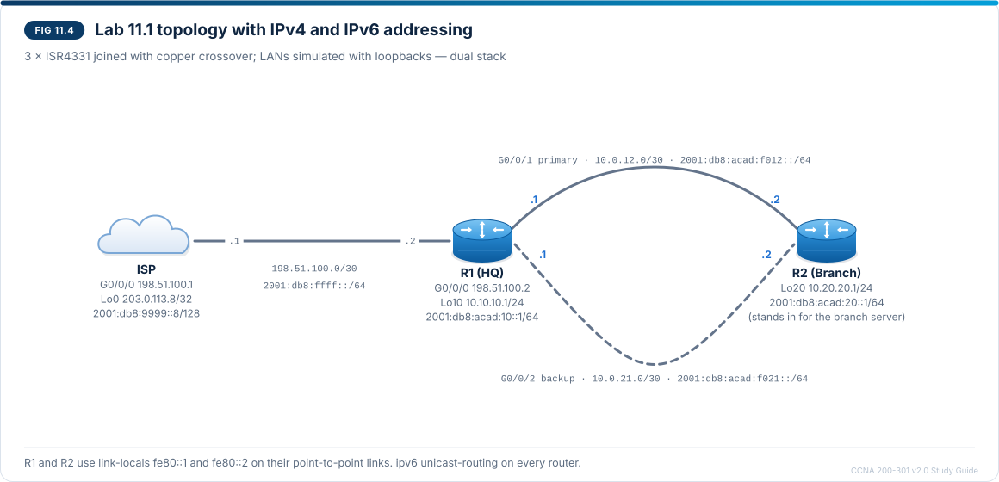

# Chapter 11 — IPv4 and IPv6 static routing

CCNA-style practice questions for [Chapter 11](../CCNA%20200-301%20v2.0%20Study%20Guide.md#chapter-11--ipv4-and-ipv6-static-routing) · Domain 3 · Objectives 3.2 and 3.2.a–d. The format is described in the [question bank README](README.md).

## Questions

### Q1 · Multiple choice
<sub>Source: 11.7, 11.9</sub>

Refer to the exhibit.

```
R1# show running-config | include ip route
ip route 0.0.0.0 0.0.0.0 198.51.100.1
ip route 10.20.20.0 255.255.255.0 10.0.12.2
ip route 10.20.20.0 255.255.255.0 10.0.21.2 200

R1# show ip route static
Gateway of last resort is 198.51.100.1 to network 0.0.0.0

S*    0.0.0.0/0 [1/0] via 198.51.100.1
      10.0.0.0/8 is variably subnetted, 7 subnets, 3 masks
S        10.20.20.0/24 [1/0] via 10.0.12.2
```

R1's G0/0/1 (10.0.12.1/30) and G0/0/2 (10.0.21.1/30) are both up/up. A colleague says that IOS ignored the backup route to the branch LAN because it is missing from the routing table. Which statement is correct?

- [x] The backup is a floating static route: its AD of 200 keeps it out of the routing table while the AD 1 route to 10.20.20.0/24 is installed.
- [ ] IOS discarded the backup route because only one static route to a prefix can exist in the configuration.
- [ ] The backup route is missing because its next hop 10.0.21.2 is unreachable.
- [ ] The backup route needs the `permanent` keyword before IOS installs it.

> **Explanation:** The route through 10.0.21.2 has AD 200, higher than the AD 1 route through 10.0.12.2, so it "floats" above it: it exists only in the configuration until the preferred route is removed, and then appears as `S 10.20.20.0/24 [200/0] via 10.0.21.2`. That is why `show running-config | include ip route` is the command that shows floating routes. Both routes are in the configuration, so IOS did not discard one. 10.0.21.2 sits in R1's connected 10.0.21.0/30 subnet on an up interface, so it is reachable. `permanent` only keeps a route installed when its exit interface goes down, which can black-hole traffic during an outage.

---

### Q2 · Multiple choice — choose two
<sub>Source: 11.3</sub>

R1 must reach the branch LAN 10.20.20.0/24 through R2 (10.0.12.2) across the Ethernet link on R1's G0/0/1. Which two statements about the possible forms of this static route are true? (Choose two.)

- [x] With `ip route 10.20.20.0 255.255.255.0 10.0.12.2`, R1 performs a recursive lookup on 10.0.12.2 to find the exit interface.
- [x] With `ip route 10.20.20.0 255.255.255.0 GigabitEthernet0/0/1 10.0.12.2`, R1 needs no recursive lookup and ARPs only for 10.0.12.2.
- [ ] With `ip route 10.20.20.0 255.255.255.0 GigabitEthernet0/0/1`, R1 ARPs only for 10.0.12.2.
- [ ] `ip route 10.20.20.0 255.255.255.0 GigabitEthernet0/0/1` is installed with an AD of 0, so it is preferred over the next-hop form.
- [ ] `ip route 10.20.20.0 255.255.255.0 10.0.12.2` is shown in the routing table as directly connected.

> **Explanation:** A next-hop-only route needs a recursive lookup: R1 looks up 10.0.12.2, finds `C 10.0.12.0/30` on G0/0/1 and uses that interface; the route appears as `S 10.20.20.0/24 [1/0] via 10.0.12.2`. The fully specified form names both the interface and the next hop, so there is no recursion and R1 ARPs only for the next hop — the recommended form on Ethernet. The exit-interface-only form is the one shown as directly connected: R1 ARPs for every destination and depends on R2 answering with proxy ARP. Its AD is still the default of 1.

---

### Q3 · Multiple choice
<sub>Source: 11.3, 11.7, 11.10</sub>

An engineer wants R1 to reach the branch LAN through 10.0.12.2 (G0/0/1), with 10.0.21.2 (G0/0/2) as the backup path, and configures `ip route 10.20.20.0 255.255.255.0 10.0.12.2 210` and `ip route 10.20.20.0 255.255.255.0 10.0.21.2 200`. Both links are up. Which path does R1 use for traffic to 10.20.20.0/24?

- [x] Only the path through 10.0.21.2, because its route has the lower AD
- [ ] Only the path through 10.0.12.2, because a higher AD gives a route higher priority
- [ ] Both paths, because two static routes to the same prefix are always load-shared
- [ ] Only the path through 10.0.12.2, because that route was configured first

> **Explanation:** The lower AD wins, so the AD 200 route through G0/0/2 is installed and the AD 210 route floats behind it: the intended "backup" has become the primary. This matches the troubleshooting signature "traffic takes the backup link all the time" caused by a floating AD lower than the primary's. Load sharing happens only when the ADs are **equal**, and the order of configuration does not matter. The fix is to give the primary route a lower AD than the backup, for example the default of 1.

---

### Q4 · Multiple choice
<sub>Source: 11.3, 11.10</sub>

Refer to the exhibit.

```
R1# show ip route static
Gateway of last resort is 198.51.100.1 to network 0.0.0.0

S*    0.0.0.0/0 [1/0] via 198.51.100.1
      10.0.0.0/8 is variably subnetted, 7 subnets, 3 masks
S        10.20.20.0/24 is directly connected, GigabitEthernet0/0/1

R1# show ip arp gigabitethernet0/0/1
Protocol  Address          Age (min)  Hardware Addr   Type   Interface
Internet  10.0.12.1               -   00a3.8e4f.1201  ARPA   GigabitEthernet0/0/1
Internet  10.0.12.2              17   00a3.8e5b.2201  ARPA   GigabitEthernet0/0/1
Internet  10.20.20.10             4   00a3.8e5b.2201  ARPA   GigabitEthernet0/0/1
Internet  10.20.20.11             2   00a3.8e5b.2201  ARPA   GigabitEthernet0/0/1
Internet  10.20.20.37             1   00a3.8e5b.2201  ARPA   GigabitEthernet0/0/1
Internet  10.20.20.52             0   00a3.8e5b.2201  ARPA   GigabitEthernet0/0/1
```

R2's G0/0/1 is 10.0.12.2/30. HQ users report that connections to hosts on the branch LAN work inconsistently. Which change fixes the root cause?

- [x] Replace the route with `ip route 10.20.20.0 255.255.255.0 GigabitEthernet0/0/1 10.0.12.2`
- [ ] Disable proxy ARP on R2's G0/0/1 so that R1 stops learning remote addresses
- [ ] Add the `permanent` keyword so that the route always stays in the table
- [ ] Raise the route's AD to 200

> **Explanation:** "Directly connected" for a remote prefix means an exit-interface-only static route. On Ethernet, R1 then ARPs for every destination, and it works only because R2 answers with proxy ARP — every 10.20.20.x entry carries R2's MAC address, the same as 10.0.12.2. The ARP cache fills with remote hosts, and the route works inconsistently. A fully specified route (or a next-hop route) makes R1 ARP only for 10.0.12.2. Disabling proxy ARP would break the existing route completely; `permanent` and the AD change nothing about how R1 resolves addresses.

---

### Q5 · Multiple choice
<sub>Source: 11.8, 11.10</sub>

Refer to the exhibit.

```
R2# show running-config | include ipv6
 ipv6 address 2001:DB8:ACAD:20::1/64
 ipv6 address FE80::2 link-local
 ipv6 address 2001:DB8:ACAD:F012::2/64
 ipv6 address FE80::2 link-local
 ipv6 address 2001:DB8:ACAD:F021::2/64
ipv6 route ::/0 GigabitEthernet0/0/1 FE80::1
ipv6 route ::/0 GigabitEthernet0/0/2 FE80::1 200
```

IPv4 works everywhere. R2 can ping R1's IPv6 addresses on both links, but hosts on the branch LAN (2001:db8:acad:20::/64) receive no router advertisements from R2 and cannot reach anything beyond R2 over IPv6. What is the cause?

- [x] `ipv6 unicast-routing` is missing, so R2 does not route IPv6 packets.
- [ ] Both default routes use FE80::1, so IOS cannot tell the two next hops apart.
- [ ] A link-local address cannot be the next hop of a default route; R1's global addresses are required.
- [ ] The AD 200 default route is load-sharing IPv6 traffic onto the backup link.

> **Explanation:** IPv6 static routes are ignored until `ipv6 unicast-routing` is enabled; the signature is no forwarding and no RAs, while the router can still ping its directly connected neighbors. The two default routes are valid: each names its exit interface, which is exactly what makes a link-local next hop such as FE80::1 unambiguous, even though both links use it. Link-local next hops are common because they do not change when global addressing is renumbered. The routes have different ADs (1 and 200), so the second one floats and nothing is load-shared.

---

### Q6 · Drag and drop — match
<sub>Source: 11.2, 11.4, 11.5, 11.6, 11.7, 11.8</sub>

Drag each static route command from the Lab 11.1 network to the route type it configures. A route type can be used more than once. The AD 200 route backs up an AD 1 route to the same prefix.

| Command | Route type |
| --- | --- |
| `ip route 0.0.0.0 0.0.0.0 198.51.100.1` | Default route |
| `ipv6 route ::/0 GigabitEthernet0/0/1 FE80::1` | Default route |
| `ip route 10.0.0.0 255.0.0.0 198.51.100.2` | Network route |
| `ipv6 route 2001:db8:acad:20::/64 2001:db8:acad:f012::2` | Network route |
| `ipv6 route 2001:db8:acad:20::10/128 2001:db8:acad:f021::2` | Host route |
| `ip route 10.20.20.0 255.255.255.0 10.0.21.2 200` | Floating static route |

**Extra targets:** Local (L) route

> **Explanation:** All four types use the same command and differ only in the destination and the AD. A **default** route covers 0.0.0.0/0 or ::/0 and becomes the gateway of last resort. A **network** route reaches one remote subnet or a summary of several — the ISP's 10.0.0.0/8 route is one summary for the whole company. A **host** route is /32 or /128 and wins by longest match. A **floating** static has a higher AD than the route it backs up, so it is installed only when that route is removed. Local (L) routes are the /32 entries IOS creates for the router's own interface addresses; routes you type are S routes.

---

### Q7 · Drag and drop — order
<sub>Source: 11.9, 11.10</sub>

HQ users cannot reach the branch server 10.20.20.10 through R1's static route. Drag the troubleshooting checks into the recommended order.

1. Check the network address, mask and next hop with `show running-config | include ip route`
2. Check that the route is installed with `show ip route static`
3. Check with `show ip route 10.20.20.10` that no longer prefix wins for the destination
4. Check that the routers on the far side have a route back to the source network
5. Test end to end with `ping 10.20.20.10 source 10.10.10.1` and `traceroute 10.20.20.10`

> **Explanation:** Work from the configuration outward: is the route configured correctly, is it installed (an unreachable next hop, a down exit interface or a lower-AD route to the same prefix keeps it out), is it the route actually used (a host route or a more specific network may win), is there a return route on every router back toward the source, and finally does the path work end to end. The ping uses `source` so that the return route to the LAN is tested too.

---

### Q8 · Drag and drop — match
<sub>Source: 11.6, 11.7, 11.10</sub>

Drag each static-routing symptom to its most likely cause.

| Symptom | Likely cause |
| --- | --- |
| `show ip route` lists two `[1/0]` next hops under 0.0.0.0/0, and traffic is split across both links | The backup route has the same AD as the primary |
| IOS rejects `ip route 10.20.20.1 255.255.255.0 10.0.12.2` with `%Inconsistent address and mask` | Host bits are set in the destination network |
| Traffic to 10.20.20.10 crosses the backup link, while the rest of 10.20.20.0/24 uses the primary link | A /32 host route overrides the network route |
| The ISP's router loses its upstream connection, but the floating default route never takes over | The local link is still up, so the primary static route stays installed |

**Extra targets:** The next hop is not on a connected subnet · The far router has no return route

> **Explanation:** Equal ADs install both routes, giving two `via` lines and unintended load sharing; the backup needs a higher AD. The destination must be the network address with all host bits 0 (10.20.20.0, not 10.20.20.1). A /32 beats the /24 by longest match, so one server can take a different path from its subnet. A static route cannot detect a failure beyond its next hop: the local link stays up, so the primary is never removed and traffic is black-holed — detecting that needs tracking or a routing protocol. An unreachable next hop would keep a route out of the table, and a missing return route breaks pings sourced from the LAN; neither matches these symptoms.

---

### Q9 · CLI
<sub>Source: 11.3, 11.8</sub>

IPv6 routing is already enabled on R1. R1 needs an IPv6 route to the branch LAN 2001:db8:acad:20::/64 over the primary link on its G0/0/1, using R2's link-local address fe80::2 as the next hop and the default AD. You are in global configuration mode on R1. Enter the command.

**Prompt:** `R1(config)#`

**Accepted:** `ipv6 route 2001:db8:acad:20::/64 GigabitEthernet0/0/1 fe80::2` · `ipv6 route 2001:db8:acad:20::/64 GigabitEthernet0/0/1 fe80::2 1`

> **Explanation:** Every IPv6 link uses FE80::/10, so a link-local next hop is meaningful only together with the exit interface: the route must be fully specified. Without the interface, IOS replies `% Interface has to be specified for a link-local nexthop`. Link-local next hops are popular because they do not change when global addressing is renumbered. Leaving out the AD gives the default of 1.

## Testlet A · Failover test between HQ and the branch

Refer to the scenario. R1 (HQ) and R2 (Branch) are joined by a primary link (R1 G0/0/1 10.0.12.1/30, R2 G0/0/1 10.0.12.2/30) and a backup link (R1 G0/0/2 10.0.21.1/30, R2 G0/0/2 10.0.21.2/30). R1's Loopback10 (10.10.10.1/24) stands in for the HQ LAN and R2's Loopback20 (10.20.20.1/24) for the branch LAN. To test failover, an engineer entered `shutdown` on R1 G0/0/1 and then collected the output below.



```
R1# show running-config | include ip route
ip route 0.0.0.0 0.0.0.0 198.51.100.1
ip route 10.20.20.0 255.255.255.0 10.0.12.2
ip route 10.20.20.0 255.255.255.0 10.0.21.2 200

R1# show ip route static
Gateway of last resort is 198.51.100.1 to network 0.0.0.0

S*    0.0.0.0/0 [1/0] via 198.51.100.1
      10.0.0.0/8 is variably subnetted, 5 subnets, 3 masks
S        10.20.20.0/24 [200/0] via 10.0.21.2

R1# ping 10.20.20.1
Type escape sequence to abort.
Sending 5, 100-byte ICMP Echos to 10.20.20.1, timeout is 2 seconds:
!!!!!
Success rate is 100 percent (5/5), round-trip min/avg/max = 1/1/2 ms

R1# ping 10.20.20.1 source 10.10.10.1
Type escape sequence to abort.
Sending 5, 100-byte ICMP Echos to 10.20.20.1, timeout is 2 seconds:
Packet sent with a source address of 10.10.10.1
.....
Success rate is 0 percent (0/5)

R2# show running-config | include ip route
ip route 0.0.0.0 0.0.0.0 10.0.12.1

R2# show ip route static
Gateway of last resort is not set
```

### Q10 · Multiple choice
<sub>Source: 11.5, 11.9, 11.10</sub>

Why does the ping sourced from 10.10.10.1 fail while the plain ping succeeds?

- [x] R2 has no route back to 10.10.10.0/24: its only default route uses 10.0.12.1, which is unreachable while the primary link is down, so the route was removed.
- [ ] R1 has no route to 10.20.20.0/24, because a floating static route is never installed while its primary route is still configured.
- [ ] R1 sends the sourced ping out G0/0/1, which is shut down.
- [ ] The ISP router has no return route for 10.10.10.0/24.

> **Explanation:** R1's side worked: the AD 1 route was removed with G0/0/1, and the floating route is installed as `[200/0] via 10.0.21.2`. The plain ping leaves G0/0/2 with source 10.0.21.1, a subnet R2 reaches as connected, so the replies get home. The sourced ping needs R2 to reach 10.10.10.0/24, but R2's only route was a default through 10.0.12.1; with its G0/0/1 down, that next hop is unreachable, the route is removed and the gateway of last resort is not set. This is the one-way route fault, and it is exactly what `ping ... source` is meant to reveal. The ISP is not on the path between R1 and R2.

---

### Q11 · CLI
<sub>Source: 11.4, 11.7</sub>

You are in global configuration mode on R2. Enter the command that adds a backup default route through R1's backup-link address 10.0.21.1 with an AD of 200, so that the backup link is used only when the primary default route is removed.

**Prompt:** `R2(config)#`

**Accepted:** `ip route 0.0.0.0 0.0.0.0 10.0.21.1 200` · `ip route 0.0.0.0 0.0.0.0 GigabitEthernet0/0/2 10.0.21.1 200`

> **Explanation:** A floating default needs an AD higher than the primary static route's AD of 1; 200 is the value used in the chapter. With R1 G0/0/1 still shut down, R2's primary default is not installed, so the new route appears at once as `S* 0.0.0.0/0 [200/0] via 10.0.21.1`, and the sourced ping succeeds. The fully specified form, with G0/0/2 before the next hop, is also correct and avoids the recursive lookup. Entering the backup without an AD (AD 1) would load-share across both links whenever both are up.

---

### Q12 · Multiple choice — choose two
<sub>Source: 11.7, 11.11</sub>

The engineer adds the AD 200 default route on R2 through 10.0.21.1 and then enters `no shutdown` on R1 G0/0/1. Both links are up/up again. Which two statements are true? (Choose two.)

- [x] R1 again shows `S 10.20.20.0/24 [1/0] via 10.0.12.2`, and its AD 200 route to 10.20.20.0/24 leaves the routing table.
- [x] R2's AD 200 default route stays in the running configuration but no longer appears in `show ip route`.
- [ ] R2 shows two next hops under 0.0.0.0/0 and shares traffic across both links.
- [ ] The floating routes stay in both routing tables until R1 and R2 are reloaded.
- [ ] R2 keeps using `S* 0.0.0.0/0 [200/0] via 10.0.21.1`, because the most recently configured route is preferred.

> **Explanation:** When the primary link returns, the AD 1 routes are installed again on both routers (R1 via 10.0.12.2, R2 via 10.0.12.1) and the floating routes disappear from the routing tables on their own. They remain in the configuration, ready for the next failure — check them with `show running-config | include ip route`. The ADs differ (1 and 200), so there is no load sharing, and neither a reload nor the order of configuration has anything to do with which route is installed.
