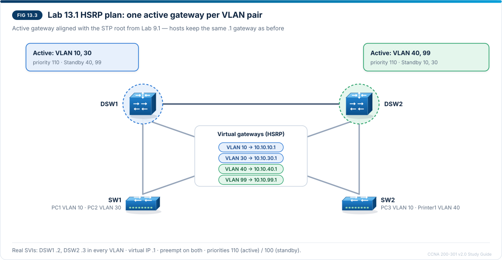

# Chapter 13 — First hop redundancy protocols

CCNA-style practice questions for [Chapter 13](../CCNA%20200-301%20v2.0%20Study%20Guide.md#chapter-13--first-hop-redundancy-protocols) · Domain 3 · Objective 3.4. The format is described in the [question bank README](README.md).

## Questions

### Q1 · Multiple choice
<sub>Source: 13.3, 13.6, 13.8</sub>

Refer to the exhibit. DSW1 was reloaded for maintenance and has been back online for 20 minutes. The design says DSW1 should be the Active router for VLAN 10.

```
DSW1# show standby vlan 10
Vlan10 - Group 10 (version 2)
  State is Standby
    3 state changes, last state change 00:20:07
  Virtual IP address is 10.10.10.1
  Active virtual MAC address is 0000.0c9f.f00a (MAC Not In Use)
  Hello time 3 sec, hold time 10 sec
  Preemption disabled
  Active router is 10.10.10.3, priority 100 (expires in 8.744 sec)
  Standby router is local
  Priority 110 (configured 110)
```

Which command, entered on DSW1's VLAN 10 SVI, makes DSW1 the Active router again?

- [ ] `standby 10 priority 120`
- [x] `standby 10 preempt`
- [ ] `standby version 2`
- [ ] `standby 10 timers 1 3`

> **Explanation:** `Preemption disabled` explains the problem: DSW1's priority (110) is already higher than the Active router's (100), but without `preempt` a recovered router does not take the Active role back, so DSW2 (10.10.10.3) keeps it. `standby 10 preempt` lets DSW1 reclaim the role. Raising the priority further changes nothing while preemption is off. The header already shows `(version 2)`, and DSW1 lists DSW2 as Active and itself as Standby, so the switches hear each other. Faster timers only shorten failover; they do not move the Active role.

---

### Q2 · Multiple choice
<sub>Source: 13.3, 13.6, 13.8, 13.10</sub>

Refer to the exhibit. DSW1 has `track 1 interface gigabitethernet1/0/24 line-protocol` and `standby 10 track 1 decrement 30` configured.

```
DSW1# show standby vlan 10
Vlan10 - Group 10 (version 2)
  State is Standby
    4 state changes, last state change 00:00:41
  Virtual IP address is 10.10.10.1
  Active virtual MAC address is 0000.0c9f.f00a (MAC Not In Use)
  Hello time 3 sec, hold time 10 sec
  Preemption enabled
  Active router is 10.10.10.3, priority 105 (expires in 8.512 sec)
  Standby router is local
  Priority 90 (configured 120)
    Track object 1 state Down decrement 30
```

Which statement explains why DSW1 is the Standby router?

- [x] Its tracked uplink is down, so its priority is now below DSW2's.
- [ ] Its Hellos stopped, so DSW2 took over when the hold timer expired.
- [ ] It has no preemption, so it cannot take back the Active role.
- [ ] DSW2's configured priority is higher than DSW1's configured priority.

> **Explanation:** `Priority 90 (configured 120)` and `Track object 1 state Down decrement 30` show that tracking lowered DSW1's priority by 30 (120 − 30 = 90) when its uplink went down. The Active router, 10.10.10.3, has priority 105, which is higher than 90, so DSW2 (with preemption) took the Active role and the gateway no longer sits on a switch with no way out. DSW1 is still exchanging Hellos (it is the Standby router and sees DSW2 as Active), `Preemption enabled` is shown, and DSW2's priority of 105 is below DSW1's configured 120. When the uplink recovers, DSW1 returns to 120 and, with preemption, becomes Active again.

---

### Q3 · Multiple choice
<sub>Source: 13.5, 13.8, 13.10</sub>

Refer to the exhibit. SW1 uses 10.10.99.1, a virtual IP, as its default gateway and has just pinged it.

```
SW1# show ip arp 10.10.99.1
Protocol  Address          Age (min)  Hardware Addr   Type   Interface
Internet  10.10.99.1              0   0000.0c9f.f063  ARPA   Vlan99
```

Which FHRP and group does the gateway use?

- [ ] HSRP version 2, group 63
- [x] HSRP version 2, group 99
- [ ] HSRP version 1, group 99
- [ ] VRRP, group 99

> **Explanation:** 0000.0c9f.fXXX is the HSRPv2 virtual MAC, with the group number in hexadecimal in the last three digits: 0x063 = 6 × 16 + 3 = 99, so this is group 99. Reading 63 as a decimal group number is a common mistake. HSRP version 1 would use 0000.0c07.ac63 for group 99, and VRRP would use 0000.5e00.0163.

---

### Q4 · Multiple choice — choose two
<sub>Source: 13.5, 13.7, 13.8</sub>

Refer to the exhibit.

```
DSW1# show vrrp brief
  Interface   Grp  A-F Pri  Time Own Pre State   Master addr/Group addr
  Vl10         10 IPv4 110     0  N   Y  MASTER  10.10.10.2(r)/10.10.10.1
  Vl20         20 IPv4 255     0  Y   Y  MASTER  10.10.20.1(r)/10.10.20.1
  Vl40         40 IPv4 100     0  N   Y  BACKUP  10.10.40.3(r)/10.10.40.1
```

Which two statements are true? (Choose two.)

- [x] DSW1 is the address owner for group 20, so it stays Master while it is up.
- [x] Traffic that hosts in VLAN 40 send to their gateway is forwarded by 10.10.40.3.
- [ ] Hosts in VLAN 10 should use 10.10.10.2 as their default gateway.
- [ ] DSW1 needs `preempt` configured before it can take back the Master role in group 10 after a failure.
- [ ] Hosts in VLAN 10 resolve their gateway to the MAC address 0000.0c9f.f00a.

> **Explanation:** In group 20, `Own Y` and priority 255 show that the virtual IP 10.10.20.1 is DSW1's own interface address: DSW1 is the address owner and is always Master while it is up. In group 40, DSW1 is BACKUP and the Master is 10.10.40.3, so that router forwards for the virtual IP 10.10.40.1. Hosts in VLAN 10 use the virtual IP after the slash (10.10.10.1), not DSW1's real address. `Pre Y` shows preemption is already on, which is VRRP's default. 0000.0c9f.f00a is an HSRPv2 virtual MAC; VRRP uses 0000.5e00.01XX (0000.5e00.010a for group 10).

---

### Q5 · Multiple choice — choose two
<sub>Source: 13.3, 13.4, 13.5, 13.12</sub>

PC1 in VLAN 10 uses 10.10.10.1 as its default gateway, the virtual IP of HSRP version 2 group 10. DSW1 is Active and DSW2 is Standby, both with default timers. DSW1 loses power, and DSW2 becomes Active. Which two statements are true? (Choose two.)

- [x] Frames that PC1 sends to its gateway are lost for up to 10 seconds.
- [x] PC1 keeps using 0000.0c9f.f00a as the gateway MAC address.
- [ ] DSW2 takes over as soon as it misses one Hello, after about 3 seconds.
- [ ] DSW2 answers ARP requests for 10.10.10.1 with its own burned-in MAC.
- [ ] PC1 cannot reach other subnets until its ARP entry for 10.10.10.1 ages out.

> **Explanation:** The Standby router takes over only when no Hello has arrived for the whole hold time, 10 seconds by default (Hellos are sent every 3 seconds), so PC1's off-subnet traffic is lost until then. The new Active router then uses the same virtual IP and the same virtual MAC (0000.0c9f.f00a for HSRPv2 group 10), so PC1's ARP entry stays valid and no ARP cache change is needed; only the switch port leading to the virtual MAC changes, which DSW2's gratuitous ARP teaches the switches. DSW2 does not answer for the virtual IP with its own MAC.

---

### Q6 · Drag and drop — order
<sub>Source: 13.3, 13.4</sub>

DSW1 is the Active HSRP router for VLAN 10 and DSW2 is Standby, both with default timers. Drag the events into the order in which they happen when DSW1 fails.

1. DSW1 fails and stops sending Hellos
2. DSW2's 10-second hold timer expires without a Hello from DSW1
3. DSW2 changes from Standby to Active
4. DSW2 sends a gratuitous ARP for the virtual IP, using the virtual MAC
5. The switches update their MAC address tables, and host frames to the virtual MAC reach DSW2

> **Explanation:** The Standby router listens for the Active router's Hellos (every 3 s by default). Only when no Hello arrives for the whole hold time (10 s) does it become Active; it then sends a gratuitous ARP so the switches learn the new location of the virtual MAC. Hosts have no working gateway from the failure until the hold timer expires, which is why `standby <grp> timers 1 3` shortens the outage.

---

### Q7 · Drag and drop — match
<sub>Source: 13.5</sub>

Drag each feature to the first hop redundancy protocol it describes. A protocol can be used more than once.

| Feature | Protocol |
| --- | --- |
| Virtual MAC address 0000.5e00.01XX | VRRP |
| Hellos sent to UDP port 1985 | HSRP |
| Preemption enabled by default | VRRP |
| One AVG and up to four AVFs share the load within a single group | GLBP |
| Active and Standby roles, with any other routers in Listen | HSRP |
| Virtual MAC address 0007.b400.XXYY | GLBP |

> **Explanation:** HSRP is Cisco proprietary, uses UDP 1985 and the Active/Standby/Listen roles, and has preemption off by default. VRRP is the open standard (RFC 5798 for VRRPv3), uses Master/Backup roles, the 0000.5e00.01XX MAC and IP protocol 112, and preempts by default. GLBP is Cisco proprietary and is the only one of the three that load balances within one group, with an AVG (the gateway) and up to four AVFs (the forwarders); its MAC is 0007.b400.XXYY.

---

### Q8 · Drag and drop — match
<sub>Source: 13.9, 13.11</sub>

Drag each HSRP symptom on the DSW1/DSW2 pair to its most likely cause.

| Symptom | Cause |
| --- | --- |
| `show standby brief` on both switches shows `local` as Active for VLAN 20 | The switches do not receive each other's Hellos |
| The higher-priority switch stays Standby after it recovers from a reload | `preempt` is missing on the higher-priority switch |
| After a failover, some hosts lose access although the new Active switch is forwarding | Those hosts use a switch's real IP address as their gateway |
| The gateway stays on a switch whose uplink to the core is down | The uplink is not tracked |
| The wrong switch is Active from the start, and both switches show priority 100 | Priorities were left at the default |

**Extra targets:** The virtual MAC address changed during the failover

> **Explanation:** Both switches Active is never load sharing: they cannot hear each other's Hellos (VLAN missing from the trunk, different group numbers or versions, or an ACL). A recovered higher-priority router takes the role back only with `preempt`. Hosts pointing at a real address lose their gateway when that router fails; point them, or the DHCP `default-router`, at the virtual IP. Tracking lowers the priority when the uplink fails so the peer can take over. With equal default priorities the highest real IP wins, so priorities should be set deliberately. The virtual MAC never changes during a failover, so it is not a cause of anything here.

---

### Q9 · CLI
<sub>Source: 13.6, 13.9, 13.10</sub>

DSW1 is Active and DSW2 is Standby for VLAN 10. Users in VLAN 10 lose their gateway for about 10 seconds whenever the Active switch fails. You are in interface configuration mode for VLAN 10 on DSW1. Using whole seconds, enter the command that sets HSRP group 10 to a Hello time of 1 second and a hold time of 3 seconds.

**Prompt:** `DSW1(config-if)#`

**Accepted:** `standby 10 timers 1 3`

> **Explanation:** `standby <grp> timers <hello> <hold>` sets the Hello and hold times; the defaults are 3 s and 10 s. With a 3-second hold time, the Standby switch (DSW2) notices a failure of DSW1 much sooner, at the cost of more Hello traffic. Configure the same timers on every member of the group (the Active router's timers are learned).

## Testlet A · Both switches claim VLAN 40

Refer to the scenario. The campus follows the Lab 13.1 plan: DSW1 (10.10.40.2, priority 100) and DSW2 (10.10.40.3, priority 110) share HSRP group 40 with virtual IP 10.10.40.1, preemption is configured on both, and the design uses HSRP version 2 on every SVI. During a change window an engineer re-entered the HSRP configuration on DSW2's VLAN 40 SVI. The trunk between DSW1 and DSW2 carries VLAN 40, and no ACLs are applied. After the change, the engineer collects this output.



```
DSW1# show standby vlan 40
Vlan40 - Group 40 (version 2)
  State is Active
    5 state changes, last state change 00:03:21
  Virtual IP address is 10.10.40.1
  Active virtual MAC address is 0000.0c9f.f028 (MAC In Use)
  Hello time 3 sec, hold time 10 sec
  Preemption enabled
  Active router is local
  Standby router is unknown
  Priority 100 (configured 100)

DSW2# show standby vlan 40
Vlan40 - Group 40
  State is Active
    4 state changes, last state change 00:03:11
  Virtual IP address is 10.10.40.1
  Active virtual MAC address is 0000.0c07.ac28 (MAC In Use)
  Hello time 3 sec, hold time 10 sec
  Preemption enabled
  Active router is local
  Standby router is unknown
  Priority 110 (configured 110)
```

### Q10 · Multiple choice
<sub>Source: 13.8, 13.9</sub>

What does the output tell you about HSRP group 40?

- [ ] DSW1 and DSW2 are load sharing VLAN 40, each forwarding for part of the hosts.
- [x] DSW1 and DSW2 are not receiving each other's Hellos, so each has made itself Active.
- [ ] DSW2 is Active because of its higher priority, and DSW1 will become Standby when its hold timer expires.
- [ ] DSW1 won the election on its lower real IP address, and DSW2 is waiting to preempt it.

> **Explanation:** Each switch reports itself (`local`) as Active and knows no Standby router, so neither hears the other. Both routers Active for one group is an error, not load sharing: within one HSRP group only one router should forward. If the switches heard each other, DSW1 (priority 100) would already be Standby; nothing is pending, as both last changed state more than three minutes ago. A tie in priority is broken by the highest real IP address, not the lowest, and DSW2 already shows itself as Active rather than waiting.

---

### Q11 · Multiple choice
<sub>Source: 13.5, 13.8, 13.11</sub>

Which configuration difference explains the output?

- [ ] DSW1 and DSW2 use different HSRP group numbers.
- [ ] DSW1 and DSW2 use different virtual IP addresses.
- [x] DSW2 runs HSRP version 1 on VLAN 40, while DSW1 runs version 2.
- [ ] DSW2's Hello and hold timers differ from DSW1's.

> **Explanation:** DSW1's header shows `(version 2)` and the HSRPv2 MAC 0000.0c9f.f028 (group 40 = 0x28). DSW2 uses 0000.0c07.ac28, the version 1 format (0000.0c07.acXX). The two versions are not compatible, so the switches cannot hear each other and both become Active, each answering for 10.10.40.1 with a different MAC. Both outputs show group 40, virtual IP 10.10.40.1 and the same Hello and hold times (3 s and 10 s), so none of those differ.

---

### Q12 · CLI
<sub>Source: 13.5, 13.6, 13.11</sub>

You are in interface configuration mode for VLAN 40 on DSW2. Enter the command that brings DSW2 back in line with the design.

**Prompt:** `DSW2(config-if)#`

**Accepted:** `standby version 2`

> **Explanation:** `standby version 2` puts DSW2's VLAN 40 group back on HSRPv2, matching DSW1. Once the switches hear each other's Hellos again, DSW2 (priority 110) is the single Active router, DSW1 (100) becomes Standby, and the gateway MAC is 0000.0c9f.f028 again. Use the same HSRP version on every member of a group.
