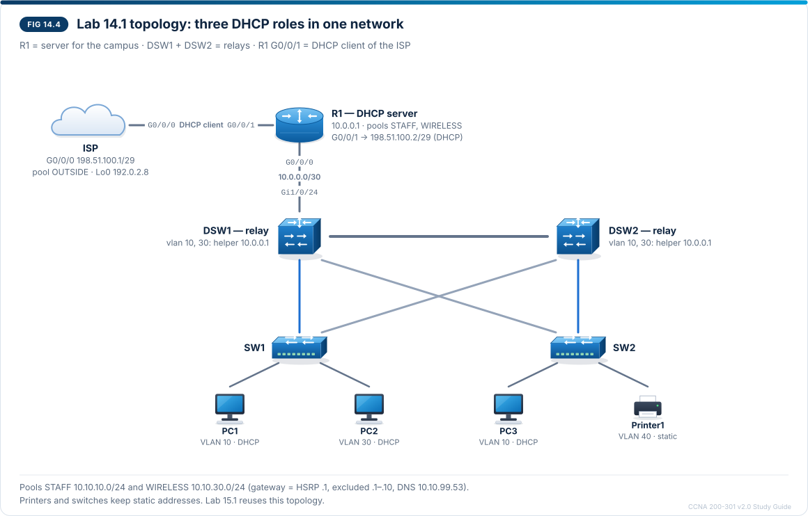

# Chapter 14 — DHCPv4 client, server and relay

CCNA-style practice questions for [Chapter 14](../CCNA%20200-301%20v2.0%20Study%20Guide.md#chapter-14--dhcpv4-client-server-and-relay) · Domain 1 · Objective 1.7. The format is described in the [question bank README](README.md).

## Questions

### Q1 · Multiple choice
<sub>Source: 14.4, 14.8, 14.10</sub>

Refer to the exhibit.

```
C:\> ipconfig /all
Ethernet adapter Ethernet:
   Connection-specific DNS Suffix  . : campus.example
   Physical Address. . . . . . . . . : 00-50-79-66-68-01
   DHCP Enabled. . . . . . . . . . . : Yes
   IPv4 Address. . . . . . . . . . . : 10.10.10.11(Preferred)
   Subnet Mask . . . . . . . . . . . : 255.255.255.0
   Lease Obtained. . . . . . . . . . : Friday, 16 October 2026 09:14:02
   Lease Expires . . . . . . . . . . : Saturday, 17 October 2026 09:14:02
   Default Gateway . . . . . . . . . : 10.10.10.2
   DHCP Server . . . . . . . . . . . : 10.0.0.1
   DNS Servers . . . . . . . . . . . : 10.10.99.53
```

PC1 is in VLAN 10 and leases its address from R1 (10.0.0.1). DSW1 (10.10.10.2) and DSW2 (10.10.10.3) are the HSRP gateways for VLAN 10, with virtual IP 10.10.10.1. PC1 can reach every other subnet today. What should the engineer change?

- [ ] Nothing; PC1 has a valid address, mask, gateway and DNS server
- [x] Set `default-router 10.10.10.1` in R1's STAFF pool
- [ ] Add `ip helper-address 10.10.10.1` to DSW1's `interface vlan 10`
- [ ] Add `ip dhcp excluded-address 10.10.10.2` on R1 so that clients stop using DSW1 as their gateway

> **Explanation:** The pool hands out DSW1's real SVI address as the gateway. It works while DSW1 is up, but if DSW1 fails, HSRP moves 10.10.10.1 to DSW2 and PC1 is left pointing at a dead address — the fault only shows up during the failure that redundancy was meant to survive. The pool's `default-router` must be the FHRP virtual IP. A helper address only relays DHCP messages and must point at the server, and an exclusion controls which addresses are leased, not which gateway clients are told to use.

---

### Q2 · Multiple choice
<sub>Source: 14.3</sub>

Two DHCP servers answer PC1's Discover, and each sends an Offer. PC1 accepts the Offer from R1. How does the other server learn that its Offer was not accepted?

- [x] PC1 broadcasts its Request naming the server it chose, so the other server sees it and returns its offered address to the pool.
- [ ] PC1 sends a DHCPDECLINE to the server whose Offer it did not choose.
- [ ] R1 sends a DHCPNAK to the other server after it acknowledges PC1.
- [ ] It never learns; the offered address stays unavailable until the lease time in the Offer runs out.

> **Explanation:** The Request is broadcast even though the client knows which server it wants, precisely so that every server that made an Offer learns which one was chosen; the others put their addresses back in the pool. A DECLINE is sent by a client whose ARP check finds that the address it was given is already in use, and a NAK is a server refusing a client's request (for example, after the client moved to another subnet).

---

### Q3 · Multiple choice — choose two
<sub>Source: 14.3, 14.6</sub>

Refer to the exhibit.

```
R1# show dhcp lease
Temp IP addr: 198.51.100.2  for peer on Interface: GigabitEthernet0/0/1
Temp  sub net mask: 255.255.255.248
   DHCP Lease server: 198.51.100.1, state: 5 Bound
   DHCP transaction id: 2C4F
   Lease: 43200 secs,  Renewal: 21600 secs,  Rebind: 37800 secs
Temp default-gateway addr: 198.51.100.1
```

R1's G0/0/1 gets its address from the ISP router. Which two statements are true? (Choose two.)

- [x] R1 first tries to renew this lease after 21,600 seconds, by unicast to 198.51.100.1.
- [x] R1 has installed a default route via 198.51.100.1 with an administrative distance of 254.
- [ ] If the renewal fails, R1 keeps using the address until the lease expires and only then broadcasts a Discover.
- [ ] If the engineer also configures a static default route on R1, the DHCP-learned default route is still preferred.
- [ ] G0/0/1 received this address because it is configured with `ip helper-address 198.51.100.1`.

> **Explanation:** The 21,600 s renewal and 37,800 s rebind are the T1 (50 %) and T2 (87.5 %) points of the 43,200 s lease. At T1 the client renews by unicast with its own server; if that fails, at T2 it rebinds by broadcast to any server, and only if the lease then expires does it stop using the address and start again with a Discover. An IOS DHCP client (`ip address dhcp`) installs the received gateway as `S* 0.0.0.0/0 [254/0]`, so a static default route (AD 1) wins. `ip helper-address` makes an interface a relay agent, not a client.

---

### Q4 · Multiple choice — choose two
<sub>Source: 14.4</sub>

Which two statements about an IOS DHCP server are true? (Choose two.)

- [x] `ip dhcp excluded-address` is entered in global configuration mode, not inside the pool.
- [x] Before it sends an Offer, the server pings the address, and an address that answers is not leased until the conflict is cleared.
- [ ] A pool with no `lease` command leases addresses for 8 days.
- [ ] `no service dhcp` stops the DHCP server but leaves `ip helper-address` relaying in place.
- [ ] A reservation is made by adding `host` and `hardware-address` to the pool that serves the whole subnet.

> **Explanation:** Exclusions are global commands (`R1(config)#`); only the pool's own settings are entered at `R1(dhcp-config)#`. IOS conflict detection pings each address before offering it and moves any address that answers into `show ip dhcp conflict` until you enter `clear ip dhcp conflict *`. The default lease is 1 day. `service dhcp` (on by default) covers both the server and the relay, so `no service dhcp` silently disables both. A reservation needs its own pool: one pool per reserved host, with `host` plus `client-identifier` or `hardware-address`.

---

### Q5 · Drag and drop — order
<sub>Source: 14.5</sub>

PC1 in VLAN 10 needs an address. The DHCP server is R1 (10.0.0.1), and DSW1's VLAN 10 SVI (10.10.10.2) is configured as a relay. Drag the steps into the order in which they happen, up to the moment PC1 receives the Offer.

1. PC1 broadcasts a Discover in VLAN 10
2. DSW1's VLAN 10 SVI, configured with `ip helper-address 10.0.0.1`, receives the broadcast
3. DSW1 writes 10.10.10.2 into the giaddr field and sends the Discover to 10.0.0.1 as a unicast
4. R1 selects the STAFF pool, because its network contains 10.10.10.2
5. R1 sends the Offer as a unicast to 10.10.10.2
6. DSW1 forwards the Offer to PC1 in VLAN 10

> **Explanation:** Routers do not forward broadcasts, so the SVI that receives the client's broadcast relays it: it stamps its own address on the client VLAN into giaddr and unicasts the message to the server. The server uses giaddr — not the client's MAC address — to choose the pool, and sends its reply back to giaddr, which is why it needs a route back to that subnet. The relay then delivers the Offer to the client; the Request and Ack follow the same path.

---

### Q6 · Drag and drop — match
<sub>Source: 14.8</sub>

Drag each DHCP symptom to its most likely cause.

| Symptom | Cause |
| --- | --- |
| Clients in VLAN 10 suddenly receive addresses in 192.168.0.0/24 | Rogue DHCP server |
| New clients fail after weeks of normal operation, while existing clients keep working | Pool exhausted |
| Clients get an address and can ping servers by IP address, but names do not resolve | `dns-server` missing from the pool |
| Only VLAN 30 clients fail, and `show ip interface vlan 30` on both gateways shows no helper address | `ip helper-address` missing |
| A PC on a newly configured access port gives up before an Offer arrives, because the port waits about 30 seconds for STP | PortFast not enabled on the access port |

**Extra targets:** Exclusions missing · Wrong `default-router`

> **Explanation:** Addresses from an unknown subnet point to a rogue server, such as a home router plugged into a wall port; DHCP snooping prevents it. A pool that has run out (`show ip dhcp pool`: leased = total) affects only new clients. Missing DNS options break name resolution, not addressing. A VLAN with no helper never gets its broadcasts relayed. An access port without PortFast spends about 30 s in STP states before forwarding. Missing exclusions cause gateway and printer addresses to be handed out (or to land in the conflict table), and a wrong `default-router` leaves clients with an address but no access off the subnet.

---

### Q7 · Drag and drop — match
<sub>Source: 14.7</sub>

Drag each command to the information it gives you.

| Command | Information |
| --- | --- |
| `show ip dhcp binding` | Which client MAC address holds which leased address, and until when |
| `show ip dhcp pool` | How many addresses a pool has and how many are leased |
| `show ip dhcp conflict` | Addresses withheld because something answered the server's ping |
| `show ip dhcp server statistics` | Whether Discovers are reaching the server at all |
| `show ip interface vlan 10` | Whether the relay has a helper address configured |
| `show dhcp lease` | The address, lease server and gateway learned by an IOS interface acting as a DHCP client |

**Extra targets:** Which access-switch ports are trusted for DHCP snooping

> **Explanation:** The first four commands run on the server: bindings (client to address), pool size and leased count, the conflict table, and message counters that show whether requests arrive at all. `show ip interface vlan 10` on the relay shows the `Helper address is 10.0.0.1` line. `show dhcp lease` runs on an IOS DHCP client such as R1's Internet-facing interface. Trusted snooping ports are shown on the access switch by `show ip dhcp snooping` (Chapter 23), not by any of these commands.

---

### Q8 · CLI
<sub>Source: 14.4, 14.9</sub>

R1 is being configured as the DHCP server for VLAN 30 (10.10.30.0/24). The HSRP virtual IP 10.10.30.1, DSW1 (10.10.30.2) and DSW2 (10.10.30.3) must never be leased, and the team keeps 10.10.30.1 through 10.10.30.10 for infrastructure. You are in global configuration mode. Enter the single command that stops R1 from leasing 10.10.30.1 through 10.10.30.10.

**Prompt:** `R1(config)#`

**Accepted:** `ip dhcp excluded-address 10.10.30.1 10.10.30.10`

> **Explanation:** `ip dhcp excluded-address <first> <last>` is a global configuration command; it is not entered inside the pool. With HSRP, both the virtual IP and the real SVI addresses must be excluded. If they are not, R1's pre-Offer ping finds them in use and they appear in `show ip dhcp conflict`.

---

### Q9 · CLI
<sub>Source: 14.6</sub>

R1's G0/0/1 connects to the ISP, which assigns R1's outside address by DHCP. You are in interface configuration mode for G0/0/1. Enter the command that makes the interface obtain its IPv4 address by DHCP.

**Prompt:** `R1(config-if)#`

**Accepted:** `ip address dhcp`

> **Explanation:** `ip address dhcp` makes the interface a DHCP client. Once the interface is up (`no shutdown`), `show dhcp lease` shows the address, the lease server and the timers, and the received gateway appears as a default route with AD 254 (`S* 0.0.0.0/0 [254/0]`).

## Testlet A · VLAN 30 clients get no address

Refer to the scenario. The campus was built as in Lab 14.1: R1 (10.0.0.1) is the DHCP server and has `ip route 10.10.0.0 255.255.0.0 10.0.0.2` back to the campus. DSW1 (10.10.30.2) and DSW2 (10.10.30.3) are the HSRP gateways for VLAN 30, with virtual IP 10.10.30.1, and both relay to R1. After a change window, PC2 in VLAN 30 runs `ipconfig /release` and `ipconfig /renew` and ends up with a 169.254.x.x address, while PC1 and PC3 in VLAN 10 renew normally. DSW2's `show ip interface vlan 30` output matches DSW1's apart from its address, 10.10.30.3/24.



```
R1# show running-config | section dhcp
ip dhcp excluded-address 10.10.10.1 10.10.10.10
ip dhcp excluded-address 10.10.30.1 10.10.30.10
ip dhcp pool STAFF
 network 10.10.10.0 255.255.255.0
 default-router 10.10.10.1
 dns-server 10.10.99.53
 domain-name campus.example
ip dhcp pool WIRELESS
 network 10.10.31.0 255.255.255.0
 default-router 10.10.30.1
 dns-server 10.10.99.53
 domain-name campus.example

DSW1# show ip interface vlan 30
Vlan30 is up, line protocol is up
  Internet address is 10.10.30.2/24
  Broadcast address is 255.255.255.255
  Address determined by non-volatile memory
  MTU is 1500 bytes
  Helper address is 10.0.0.1
  Directed broadcast forwarding is disabled
  Outgoing access list is not set
  Inbound  access list is not set
```

### Q10 · Multiple choice
<sub>Source: 14.5, 14.8, 14.10</sub>

What is the cause of PC2's failure?

- [x] No pool on R1 has a network that contains the giaddr 10.10.30.2 or 10.10.30.3, so R1 has nothing to offer.
- [ ] The helper address on the VLAN 30 SVIs points to the wrong server.
- [ ] R1 has no route back to the VLAN 30 subnet, so its Offers never reach the relays.
- [ ] R1 chooses the pool from PC2's MAC address, and PC2 has no reservation.

> **Explanation:** A 169.254.x.x address means no Offer arrived. The relays are correct (`Helper address is 10.0.0.1`, which is R1), and R1's 10.10.0.0/16 route covers 10.10.30.0/24. But the WIRELESS pool serves 10.10.31.0/24, so the relayed Discovers, stamped with giaddr 10.10.30.2 and 10.10.30.3, match no pool. This is the "Discovers arrive but no Offers go out" case: the relay and routing work, and the fault is the pool. The server chooses the pool from giaddr, not from the client's MAC address.

---

### Q11 · CLI
<sub>Source: 14.4, 14.10</sub>

You are in DHCP pool configuration mode for the WIRELESS pool on R1. Enter the command that corrects the fault so that the pool serves VLAN 30's subnet, 10.10.30.0/24.

**Prompt:** `R1(dhcp-config)#`

**Accepted:** `network 10.10.30.0 255.255.255.0` · `network 10.10.30.0 /24`

> **Explanation:** The pool's `network` must match the client VLAN, and with relay it must contain the relay's giaddr. With `network 10.10.30.0 255.255.255.0`, Discovers relayed with giaddr 10.10.30.2 or 10.10.30.3 match WIRELESS, and PC2 leases an address from 10.10.30.11 upward, because .1–.10 are excluded. `show ip dhcp binding` then lists PC2's MAC address.

---

### Q12 · Multiple choice
<sub>Source: 14.5, 14.9</sub>

After the fix, PC2 holds a lease from the WIRELESS pool. To test redundancy, the engineer shuts down `interface vlan 30` on DSW1. PC2 then runs `ipconfig /release` and `ipconfig /renew`, so it starts again with a Discover. Which statement describes how this Discover reaches R1 and how R1 handles it?

- [x] DSW2 relays it as a unicast with giaddr 10.10.30.3; R1 chooses WIRELESS because its network contains 10.10.30.3 and sends the Offer to 10.10.30.3.
- [ ] DSW2 relays it as a unicast with giaddr 10.10.30.1, the HSRP virtual IP it now owns; R1 sends the Offer to 10.10.30.1.
- [ ] DSW2 forwards it to R1 as a broadcast; R1 chooses the pool from the address of the interface it arrived on, 10.0.0.1.
- [ ] DSW2 relays it with giaddr 10.10.30.3, but R1 answers with a NAK because PC2's earlier lease was granted through DSW1.

> **Explanation:** Both gateways relay, which is why `ip helper-address` is configured on both distribution switches. With DSW1's SVI down, DSW2 receives the broadcast, writes its own interface address on the client VLAN (10.10.30.3, not the virtual IP) into giaddr and unicasts the Discover to 10.0.0.1. R1 matches 10.10.30.3 to WIRELESS and replies to giaddr. The relay always converts the broadcast into a unicast; the arrival interface chooses the pool only when there is no relay. A NAK is for a request the server must refuse, such as a client that moved to another subnet; PC2 is still in VLAN 30, so it simply gets a new lease.
