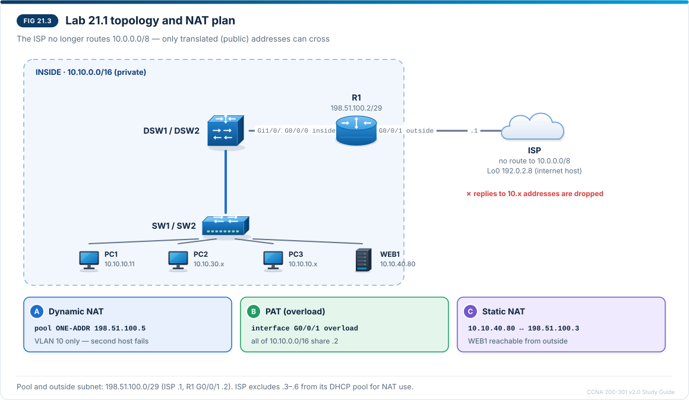

# Chapter 21 — NAT and PAT on IOS XE routers

CCNA-style practice questions for [Chapter 21](../CCNA%20200-301%20v2.0%20Study%20Guide.md#chapter-21--nat-and-pat-on-ios-xe-routers) · Domain 4 · Objective 4.3. The format is described in the [question bank README](README.md).

## Questions

### Q1 · Multiple choice — choose two
<sub>Source: 21.2</sub>

R1 translates inside hosts because their addresses come from the RFC 1918 private ranges, which internet routers do not route. Which two addresses are private? (Choose two.)

- [x] 172.20.14.9
- [x] 192.168.255.254
- [ ] 172.32.0.10
- [ ] 192.169.1.1
- [ ] 11.10.10.11

> **Explanation:** RFC 1918 reserves 10.0.0.0/8, 172.16.0.0/12 (172.16.0.0 – 172.31.255.255) and 192.168.0.0/16. 172.20.14.9 falls inside the /12 and 192.168.255.254 inside the /16. 172.32.0.10 is just past the end of 172.16.0.0/12, 192.169.1.1 is outside 192.168.0.0/16 and 11.10.10.11 is outside 10.0.0.0/8, so all three are public addresses.

---

### Q2 · Drag and drop — match
<sub>Source: 21.2, 21.4</sub>

An internet client at 203.0.113.50 opens a web session to WEB1, which R1 publishes with `ip nat inside source static 10.10.40.80 198.51.100.3`. R1 does not translate outside addresses. Drag the correct NAT term to each address in the client's packet. Each term is used once.

| Address in the client's packet | NAT term |
| --- | --- |
| Destination 198.51.100.3, as the packet crosses the ISP link to R1 G0/0/1 | Inside global |
| Destination 10.10.40.80, after R1 forwards the packet towards WEB1 | Inside local |
| Source 203.0.113.50, as the packet crosses the ISP link | Outside global |
| Source 203.0.113.50, as WEB1 receives the packet | Outside local |

> **Explanation:** Inside or outside says **whose** address it is; local or global says **where** it is seen. WEB1 is the inside host, so its public address 198.51.100.3 (seen on the outside) is the inside global address and 10.10.40.80 (seen on the inside) is the inside local address — the static command names them local first, global second. The client is the outside host: its real address on the outside is the outside global address, and because R1 does not translate outside addresses, WEB1 sees the same value as the outside local address. On this inbound packet R1 translates the destination; on WEB1's replies it changes the source from 10.10.40.80 back to 198.51.100.3.

---

### Q3 · Drag and drop — match
<sub>Source: 21.3</sub>

Drag each requirement for R1 to the NAT type that meets it. A type can be used more than once.

| Requirement | NAT type |
| --- | --- |
| WEB1 (10.10.40.80) must be reachable from the internet on its own public address, 198.51.100.3, for all of its services | Static NAT |
| Only TCP 443 on an inside server must be reachable from the internet, on R1's outside interface address | Static port forwarding |
| Every host in 10.10.0.0/16 must share the single address the ISP gives R1 G0/0/1 | PAT (overload) |
| Each permitted inside host borrows a free address from 198.51.100.5 – 198.51.100.6, one address per host while in use | Dynamic NAT |
| Three inside hosts leave through the same pool address at the same time, told apart by port number | PAT (overload) |

> **Explanation:** Static NAT is a permanent one-to-one mapping that works in both directions, so outside hosts can reach every service of the server on its own global address. Static port forwarding maps one inside address **and port** to one global address and port, which publishes a single service behind a shared address. Dynamic NAT hands each host its own pool address while in use, so the pool runs out. PAT lets many hosts share one global address, told apart by port number, and it is enabled with `overload` on either the interface address or a pool.

---

### Q4 · Multiple choice
<sub>Source: 21.4, 21.9</sub>

R1 is an ISR 4331 running IOS XE. G0/0/0 is marked `ip nat inside` and G0/0/1 `ip nat outside`. G0/0/1 currently has 198.51.100.2/29, learned from the ISP by DHCP, so the address can change. The standard ACL NAT-INSIDE permits 10.10.0.0 0.0.255.255. Which command lets all campus hosts use the internet at the same time through G0/0/1's address?

- [x] `ip nat inside source list NAT-INSIDE interface GigabitEthernet0/0/1 overload`
- [ ] `ip nat inside source list NAT-INSIDE interface GigabitEthernet0/0/1`
- [ ] `ip nat source list NAT-INSIDE interface GigabitEthernet0/0/1 overload`, with `ip nat enable` on G0/0/0 and G0/0/1
- [ ] `ip nat inside source static 10.10.0.0 198.51.100.2`

> **Explanation:** `overload` turns the rule into PAT: every host permitted by NAT-INSIDE shares the interface address, and R1 tells the sessions apart by port number. The interface form keeps working when the ISP changes the address by DHCP. Without `overload`, the interface address goes to one inside host at a time, so the first host works and the others fail until its entry times out. `ip nat enable` belongs to the NAT Virtual Interface method, which IOS XE does not support. A static entry maps one inside local address to one inside global address; it does not cover a subnet, and a hard-coded global address breaks when the DHCP address changes.

---

### Q5 · Multiple choice
<sub>Source: 21.7</sub>

Refer to the exhibit.

```
R1# show ip nat translations
Pro  Inside global         Inside local          Outside local         Outside global
tcp  198.51.100.2:49200    10.10.10.11:49200     192.0.2.8:443         192.0.2.8:443
tcp  198.51.100.2:49201    10.10.10.12:49200     192.0.2.8:443         192.0.2.8:443
tcp  198.51.100.2:51010    10.10.30.11:51010     192.0.2.8:80          192.0.2.8:80
---  198.51.100.3          10.10.40.80           ---                   ---
Total number of translations: 4
```

The engineer enters `clear ip nat translation *` on R1. Which entries are in the table immediately afterwards, before any host sends new traffic?

- [x] Only the 198.51.100.3 ↔ 10.10.40.80 entry
- [ ] No entries; the table stays empty until hosts send traffic again
- [ ] Only the three `tcp` entries, because entries with active sessions are not cleared
- [ ] All four entries, because the command removes only entries that have already timed out

> **Explanation:** `clear ip nat translation *` removes all **dynamic** entries; static entries stay. The three `tcp` lines are extended (PAT) entries, one per session, and they are dynamic, so they are removed even though their sessions were active — new entries are created when hosts send traffic again. The `---` line without ports is the static entry for WEB1 (`ip nat inside source static 10.10.40.80 198.51.100.3`), which stays in the table all the time.

---

### Q6 · Drag and drop — order
<sub>Source: 21.6</sub>

PC1 (10.10.10.11) sends a packet to 192.0.2.8. R1 has an inbound ACL on G0/0/0 (`ip nat inside`), an outbound ACL on G0/0/1 (`ip nat outside`) and a PAT rule that translates PC1 to 198.51.100.2. Drag the steps R1 performs on the packet into the correct order.

1. The inbound ACL on G0/0/0 checks the packet
2. The routing table lookup selects G0/0/1 as the exit interface
3. NAT translates the source address
4. The outbound ACL on G0/0/1 checks the packet

> **Explanation:** Inside to outside, R1 checks the inbound ACL on the inside interface, routes, translates and then checks the outbound ACL on the outside interface. The ACL on G0/0/0 therefore sees the inside local address 10.10.10.11, and the ACL on G0/0/1 sees the inside global address 198.51.100.2. Outside to inside, the order is inbound ACL on the outside interface, NAT, routing, outbound ACL on the inside interface. Either way, an ACL on the outside interface sees public addresses and an ACL on the inside interface sees private ones.

---

### Q7 · Multiple choice
<sub>Source: 21.4, 21.8, 21.10</sub>

R1 performs PAT on G0/0/1's address, but its NAT ACL contains only `permit 10.10.10.0 0.0.0.255`. The ISP has no route to 10.0.0.0/8. PC2 (10.10.30.11) pings 192.0.2.8. What happens to the echo request?

- [x] R1 routes it out G0/0/1 untranslated, with source 10.10.30.11, and the ISP has no route back for the reply.
- [ ] R1 drops it, because the implicit deny at the end of the NAT ACL blocks traffic that the ACL does not permit.
- [ ] R1 translates it to 198.51.100.2 anyway, because it arrived on an `ip nat inside` interface.
- [ ] R1 sends PC2 an ICMP unreachable message, because no translation could be created for it.

> **Explanation:** The NAT ACL only selects which packets are translated; it does not filter traffic. PC2's packet does not match it, so R1 routes the packet with its private source address unchanged. The echo request reaches the ISP, but the ISP has no route to 10.10.30.11, so the reply never returns. Arriving on an inside interface is not enough: the packet must also match the rule's ACL. The fix is to widen the ACL to `permit 10.10.0.0 0.0.255.255`.

---

### Q8 · CLI
<sub>Source: 21.4, 21.7</sub>

Refer to the exhibit.

```
R1# show ip nat statistics
Total active translations: 2 (0 static, 2 dynamic; 0 extended)
Outside interfaces:
  GigabitEthernet0/0/1
Inside interfaces:
  GigabitEthernet0/0/0
Hits: 2417  Misses: 93
Expired translations: 6
Dynamic mappings:
-- Inside Source
[Id: 1] access-list NAT-INSIDE pool PUBLIC refcount 2
 pool PUBLIC: netmask 255.255.255.248
        start 198.51.100.5 end 198.51.100.6
        type generic, total addresses 2, allocated 2 (100%), misses 85
```

R1 uses `ip nat inside source list NAT-INSIDE pool PUBLIC`. Most campus users cannot reach the internet, while a few can. The team decides to keep the two PUBLIC pool addresses and let every host permitted by NAT-INSIDE share them. You have cleared the translations and removed the old rule. Enter the global configuration command that creates the new rule.

**Prompt:** `R1(config)#`

**Accepted:** `ip nat inside source list NAT-INSIDE pool PUBLIC overload`

> **Explanation:** Dynamic NAT gives each host its own pool address. Both addresses (198.51.100.5 and .6) are allocated (100%), and the pool shows 85 misses: R1 could not create entries for further hosts because the pool is exhausted. Adding `overload` turns the rule into PAT on the pool, so many hosts share the pool addresses and are told apart by port number. Enlarging the pool would also help, but the team chose to keep the addresses. If IOS answers `%Dynamic mapping in use, cannot remove` while you remove the old rule, clear the translations again and repeat.

---

### Q9 · Drag and drop — match
<sub>Source: 21.5, 21.7</sub>

Drag each NAT symptom on R1 to its most likely cause.

| Symptom | Cause |
| --- | --- |
| No host is translated, and `show ip nat statistics` lists GigabitEthernet0/0/1 under Inside interfaces | Inside and outside interface marking swapped |
| Several VLAN 10 hosts reach the internet at the same time, but no VLAN 30 host does, and only 10.10.10.x addresses appear in the translation table | NAT ACL does not include the subnet |
| R1 translates to a /28 block that the ISP assigned separately; translations appear, but replies never return | ISP has no route for the inside global addresses |
| Removing the dynamic NAT rule fails with `%Dynamic mapping in use, cannot remove` | Dynamic entries still use the rule |

**Extra targets:** overload keyword missing · Static mapping entered with the global address first

> **Explanation:** No translations with the ISP-facing G0/0/1 listed as an inside interface means `ip nat inside` and `ip nat outside` are swapped. Several VLAN 10 hosts translating at once shows that PAT works, so VLAN 30 is simply not in the NAT ACL. Global addresses from a separately assigned block are not in R1's outside subnet, so the ISP needs a static route for that block pointing to R1's outside address; addresses in the outside subnet need no route because R1 answers ARP for them. The "Dynamic mapping in use" message means dynamic entries still use the rule: run `clear ip nat translation *`, then remove it. A missing `overload` makes only the first host work, and a reversed static entry stops outside users from reaching a server — neither matches these symptoms.

## Testlet A · WEB1 disappears from the internet

Refer to the scenario. R1 is set up as at the end of Lab 21.1: G0/0/0 (towards DSW1) is marked `ip nat inside`, G0/0/1 (198.51.100.2/29, towards the ISP) is marked `ip nat outside`, and the campus 10.10.0.0/16 uses PAT on G0/0/1's address. The ISP has no route to 10.0.0.0/8. During a change window an engineer removed and re-entered the static NAT entry that publishes WEB1 (10.10.40.80) on 198.51.100.3. Since then, a ping from the ISP router to 198.51.100.3 fails, while campus users still reach the internet.



```
R1# show running-config | include ip nat inside source
ip nat inside source list NAT-INSIDE interface GigabitEthernet0/0/1 overload
ip nat inside source static 198.51.100.3 10.10.40.80
R1# show ip nat translations
Pro  Inside global         Inside local          Outside local         Outside global
tcp  198.51.100.2:51000    10.10.30.11:51000     192.0.2.8:443         192.0.2.8:443
---  10.10.40.80           198.51.100.3          ---                   ---
Total number of translations: 2
```

### Q10 · Multiple choice
<sub>Source: 21.4, 21.5, 21.9</sub>

What is the cause of the failure?

- [x] The static entry is reversed: R1 treats 198.51.100.3 as the inside local address and 10.10.40.80 as the inside global address.
- [ ] The ISP needs a route to 10.10.40.0/24 to reach a server that is published with static NAT.
- [ ] The PAT rule takes priority over the static entry, so WEB1 is reachable only on 198.51.100.2.
- [ ] The static entry is used only for addresses that NAT-INSIDE permits, and NAT-INSIDE does not permit 198.51.100.3.

> **Explanation:** `ip nat inside source static` takes the inside local address first and the inside global address second. The line in the exhibit is reversed, and the translation table shows the signature: 10.10.40.80 in the Inside global column. R1 therefore has no mapping that turns the destination 198.51.100.3 into 10.10.40.80. No ISP route is needed: 198.51.100.3 lies in G0/0/1's subnet, so with a correct entry R1 answers the ISP's ARP requests for it. A static entry takes priority over PAT, and it does not use the NAT ACL at all.

---

### Q11 · CLI
<sub>Source: 21.4, 21.9</sub>

You have removed the wrong line with `no ip nat inside source static 198.51.100.3 10.10.40.80`. Enter the command that permanently maps WEB1 (10.10.40.80) to the public address 198.51.100.3.

**Prompt:** `R1(config)#`

**Accepted:** `ip nat inside source static 10.10.40.80 198.51.100.3`

> **Explanation:** Inside local first, inside global second. Afterwards `show ip nat translations` shows a permanent `---` line with 198.51.100.3 under Inside global and 10.10.40.80 under Inside local, and the ISP's ping to 198.51.100.3 reaches WEB1 even though the ISP still has no route to 10.0.0.0/8.

---

### Q12 · Multiple choice
<sub>Source: 21.3, 21.6, 21.8</sub>

With the corrected static entry in place, WEB1 pings 192.0.2.8. Which source address does the echo request carry when it leaves R1 G0/0/1?

- [x] 198.51.100.3
- [ ] 198.51.100.2, because PAT handles all traffic that inside hosts start
- [ ] 10.10.40.80, because static NAT translates only connections that outside hosts start
- [ ] None — the ping fails, because a static entry and a PAT rule cannot cover the same inside address

> **Explanation:** Static NAT works in both directions, and the static entry takes priority over PAT, so WEB1's own traffic also leaves as 198.51.100.3 even though NAT-INSIDE (10.10.0.0/16) includes WEB1's address. Because the outside interface sees this public address, an inbound ACL on G0/0/1 that permits web traffic to WEB1 must name 198.51.100.3, not 10.10.40.80.
