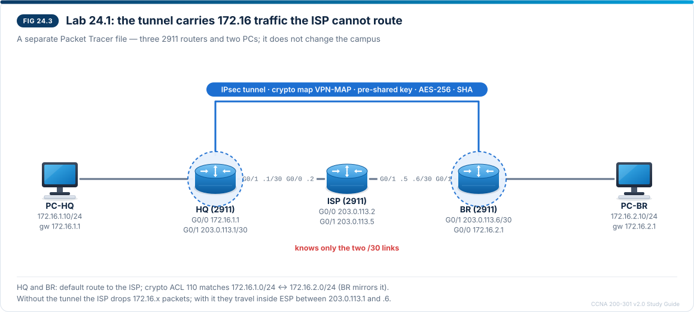

# Chapter 24 — IPsec site-to-site and remote-access VPNs

CCNA-style practice questions for [Chapter 24](../Part%202%20%E2%80%94%20Chapters%2024%E2%80%9328.md#chapter-24--ipsec-site-to-site-and-remote-access-vpns) · Domain 4 · Objective 4.5. The format is described in the [question bank README](README.md).

## Questions

### Q1 · Drag and drop — match
<sub>Source: 24.2</sub>

Drag each characteristic to the VPN type it describes. A VPN type can be used more than once.

| Characteristic | VPN type |
| --- | --- |
| Connects two networks, such as HQ and a branch, through routers or firewalls | Site-to-site |
| Hosts behind the gateways use the tunnel without any VPN software | Site-to-site |
| Often built with GRE over IPsec or a virtual tunnel interface | Site-to-site |
| Client software on a laptop connects to a headend on demand | Remote access |
| The user authenticates as well as the gateway, for example through AAA with MFA | Remote access |
| Can use TLS/DTLS instead of IPsec | Remote access |
| Can be set up as a full tunnel or a split tunnel | Remote access |

> **Explanation:** A **site-to-site** VPN joins two networks: the gateways (routers or firewalls) build a permanent tunnel, authenticate each other with pre-shared keys or certificates, and every host behind them uses it transparently. It is often combined with GRE or a VTI. A **remote-access** VPN runs from client software (for example Cisco Secure Client) on one device to a headend, is brought up on demand, authenticates the **user** (AAA, certificates, MFA) and may use IPsec with IKEv2 or TLS/DTLS. Full tunnel versus split tunnel is a remote-access choice.

---

### Q2 · Multiple choice — choose three
<sub>Source: 24.3, 24.7</sub>

A firewall sits between two IPsec site-to-site gateways. The gateways use IKE and ESP, and the tunnel must work both with and without NAT traversal. Which three must the firewall permit between the two gateways? (Choose three.)

- [x] UDP 500
- [x] UDP 4500
- [x] IP protocol 50
- [ ] TCP 500
- [ ] IP protocol 51
- [ ] TCP 443

> **Explanation:** IKE uses **UDP 500**, and **UDP 4500** when NAT traversal is in use (ESP is then carried inside UDP 4500). ESP itself is **IP protocol 50**. IKE does not use TCP. IP protocol 51 is AH, which these gateways do not use. TCP/UDP 443 is needed only for TLS-based (SSL) remote-access VPNs, not for an IPsec site-to-site tunnel.

---

### Q3 · Multiple choice — choose two
<sub>Source: 24.3, 24.7</sub>

Which two statements about the IPsec Authentication Header (AH) are true? (Choose two.)

- [x] It provides integrity and authentication but does not encrypt the payload.
- [x] It fails through NAT because its integrity check also covers the outer IP header.
- [ ] It is identified by IP protocol 50.
- [ ] NAT traversal makes it work through NAT by wrapping it in UDP 4500.
- [ ] It is the protocol almost every VPN uses, because it protects the IP header.

> **Explanation:** AH (IP protocol 51) gives integrity and authentication only — **no encryption**. Because it also protects the outer IP header, a NAT device that rewrites that header makes the check fail. IP protocol 50 is ESP. NAT-T wraps **ESP**, not AH, in UDP 4500. In practice almost every VPN uses ESP, because it encrypts and works through NAT.

---

### Q4 · Drag and drop — order
<sub>Source: 24.4</sub>

A site-to-site tunnel between two gateways uses ESP in tunnel mode. Drag the parts of a protected packet into the order in which they appear, starting with the first part sent on the wire.

1. New IP header with the gateways' public addresses
2. ESP header
3. Original IP header with the hosts' private addresses
4. TCP header and data
5. ESP trailer
6. ESP authentication data

> **Explanation:** Tunnel mode encrypts the **entire original packet** — including its IP header with the private addresses — and puts a **new IP header** in front, carrying the gateways' public addresses so the packet can cross the internet. The ESP header follows the new header; the ESP trailer and ESP authentication data come after the protected payload. In transport mode the original IP header would stay at the front, readable, and there would be no new header.

---

### Q5 · Multiple choice
<sub>Source: 24.4, 24.6</sub>

R1 and R2 run OSPF with each other across the internet over a GRE over IPsec tunnel. Which IPsec mode is usually used for this design, and why?

- [x] Transport mode, because GRE already adds an outer IP header with the tunnel endpoints' addresses
- [ ] Tunnel mode, because only tunnel mode can carry multicast routing protocols such as OSPF
- [ ] Transport mode, because it encrypts the original IP header as well as the payload
- [ ] Tunnel mode, because transport mode can be used only with AH

> **Explanation:** In GRE over IPsec, **GRE** carries multicast and routing protocols such as OSPF, and IPsec protects the GRE packets. GRE already supplies the outer header, so IPsec normally uses **transport mode**, which keeps that header and protects only the payload. The mode does not decide whether multicast can be carried — GRE does. Transport mode does not encrypt the IP header in front of the payload, and ESP works in both modes.

---

### Q6 · Drag and drop — order
<sub>Source: 24.5, 24.9</sub>

Two routers are configured for a policy-based site-to-site VPN with IKEv1 and a crypto map, and no SAs exist yet. A host sends the first packet to the remote LAN. Drag the events into the order in which they happen.

1. The packet matches the crypto ACL of the crypto map on the outside interface
2. IKE phase 1 authenticates the peers and builds the IKE SA
3. IKE phase 2 (quick mode) builds the IPsec SAs
4. ESP encrypts the traffic, and the encaps and decaps counters rise
5. The SAs reach the end of their lifetime and are rekeyed

> **Explanation:** Traffic that matches the crypto ACL ("interesting traffic") triggers IKE. **Phase 1** (main mode or aggressive mode) authenticates the peers and builds the IKE (ISAKMP) SA — `show crypto isakmp sa` then shows `QM_IDLE`. **Phase 2** (quick mode) builds the one-way IPsec SAs, and only then is data protected by ESP. This is why the first one or two pings can time out while the SAs are built. SAs expire after a lifetime (time or data volume) and are rekeyed automatically.

---

### Q7 · Multiple choice
<sub>Source: 24.5, 24.8, 24.10</sub>

Refer to the exhibit.



```
HQ# show crypto isakmp sa
IPv4 Crypto ISAKMP SA
dst             src             state          conn-id status
203.0.113.6     203.0.113.1     QM_IDLE           1001 ACTIVE

HQ# show access-lists 110
Extended IP access list 110
    10 permit ip 172.16.1.0 0.0.0.255 172.16.2.0 0.0.0.255

BR# show access-lists 110
Extended IP access list 110
    10 permit ip 172.16.2.0 0.0.0.255 172.16.3.0 0.0.0.255
```

Access list 110 is the crypto ACL of crypto map VPN-MAP on both routers. HQ and BR use the same ISAKMP policy, pre-shared key and transform set. PC-HQ (172.16.1.10) cannot ping PC-BR (172.16.2.10), and no IPsec SA is built. Which change fixes the problem?

- [x] On BR, change the access-list 110 entry to `permit ip 172.16.2.0 0.0.0.255 172.16.1.0 0.0.0.255`
- [ ] On BR, change the access-list 110 entry to `permit ip 172.16.1.0 0.0.0.255 172.16.2.0 0.0.0.255`
- [ ] On both routers, re-enter the pre-shared key
- [ ] On BR, apply crypto map VPN-MAP to the LAN interface G0/0 as well

> **Explanation:** `QM_IDLE` shows that phase 1 is complete, so the pre-shared key and ISAKMP policy already match. Phase 2 is rejected because the proxy identities do not match: the crypto ACLs must **mirror** each other — BR's ACL must have HQ's source and destination swapped (172.16.2.0/24 to 172.16.1.0/24). Copying HQ's entry unchanged to BR would select traffic that BR never sends. The crypto map belongs on the outside interface only.

---

### Q8 · Multiple choice
<sub>Source: 24.4, 24.5, 24.8</sub>

Refer to the exhibit.

```
BR# show crypto ipsec sa
interface: GigabitEthernet0/1
    Crypto map tag: VPN-MAP, local addr 203.0.113.6
   local  ident (addr/mask/prot/port): (172.16.2.0/255.255.255.0/0/0)
   remote ident (addr/mask/prot/port): (172.16.1.0/255.255.255.0/0/0)
   current_peer 203.0.113.1 port 500
    #pkts encaps: 52, #pkts encrypt: 52, #pkts digest: 52
    #pkts decaps: 52, #pkts decrypt: 52, #pkts verify: 52
     inbound esp sas:
      spi: 0x3C7D2E91(1014836881)
        transform: esp-aes 256 esp-sha-hmac ,
        in use settings ={Tunnel, }
     outbound esp sas:
      spi: 0x9B04F6A2(2600793762)
        transform: esp-aes 256 esp-sha-hmac ,
        in use settings ={Tunnel, }
```

Which statement about this output is true?

- [x] ESP with AES-256 protects the traffic between 172.16.2.0/24 and 172.16.1.0/24 in tunnel mode.
- [ ] AH protects the traffic, because the transform includes an SHA HMAC.
- [ ] Transport mode is in use, so the ISP can read the 172.16 source and destination addresses.
- [ ] A single SA protects both directions of traffic, and the two SPIs identify its two ends.

> **Explanation:** The transform `esp-aes 256 esp-sha-hmac` is **ESP** with AES-256 encryption and an SHA HMAC for integrity — the HMAC is part of ESP, not AH. `in use settings ={Tunnel, }` confirms **tunnel mode**, so the 172.16 headers are encrypted inside a new header between 203.0.113.6 and 203.0.113.1. The local and remote idents are the traffic selectors from the crypto ACL. IPsec SAs are **one-way**, so there is an inbound and an outbound SA with **different SPIs**. Equal encaps and decaps counts show traffic flowing both ways.

---

### Q9 · Drag and drop — match
<sub>Source: 24.8, 24.10</sub>

A working IKEv1 site-to-site tunnel between HQ and BR is changed so that it fails. Drag each fault to the symptom it produces on HQ. A symptom can be used more than once.

| Fault | Symptom |
| --- | --- |
| The pre-shared keys on HQ and BR differ | Phase 1 never completes (`MM_NO_STATE`) |
| The ISAKMP policies use different Diffie-Hellman groups | Phase 1 never completes (`MM_NO_STATE`) |
| The transform sets on HQ and BR differ | Phase 1 up (`QM_IDLE`), but no IPsec SA is built |
| The crypto map was removed from HQ's outside interface | No IKE negotiation starts; packets leave unencrypted |
| BR has no route back to HQ's LAN | IPsec SAs up; encaps rise while decaps stay at 0 |

**Extra targets:** Phase 1 up (`QM_IDLE`); encaps and decaps both rising

> **Explanation:** A key or ISAKMP policy mismatch (encryption, hash, DH group, authentication) stops **phase 1**, so the state never reaches `QM_IDLE`. A transform-set mismatch lets phase 1 finish but no IPsec SA forms. Without the crypto map on the outside interface nothing triggers IKE, and packets leave with their private addresses, to be dropped by the ISP. If the peer cannot route replies back into the tunnel, this side keeps encrypting (encaps rise) but nothing is decrypted (decaps 0). `QM_IDLE` with both counters rising is a healthy tunnel.

## Testlet A · A new VPN on a router that already runs PAT

Refer to the scenario. R1 already runs PAT for 10.10.0.0/16 on its outside interface GigabitEthernet0/0/1 (198.51.100.2) with `ip nat inside source list NAT-INSIDE interface GigabitEthernet0/0/1 overload`, where the standard ACL NAT-INSIDE permits 10.10.0.0 0.0.255.255. An engineer adds a crypto map on G0/0/1 that protects traffic between 10.10.0.0/16 and the branch LAN 172.16.2.0/24, with the branch gateway 203.0.113.6 as the peer. PC1 (10.10.10.11) then pings the branch server 172.16.2.10, and the ping fails. The engineer collects the output below on R1.

```
R1# show ip nat translations
Pro  Inside global         Inside local          Outside local         Outside global
icmp 198.51.100.2:9        10.10.10.11:9         172.16.2.10:9         172.16.2.10:9

R1# show crypto isakmp sa
IPv4 Crypto ISAKMP SA
dst             src             state          conn-id status

R1# show crypto ipsec sa
interface: GigabitEthernet0/0/1
    Crypto map tag: VPN-MAP, local addr 198.51.100.2
   local  ident (addr/mask/prot/port): (10.10.0.0/255.255.0.0/0/0)
   remote ident (addr/mask/prot/port): (172.16.2.0/255.255.255.0/0/0)
   current_peer 203.0.113.6 port 500
    #pkts encaps: 0, #pkts encrypt: 0, #pkts digest: 0
    #pkts decaps: 0, #pkts decrypt: 0, #pkts verify: 0
     inbound esp sas:
     outbound esp sas:
```

### Q10 · Multiple choice
<sub>Source: 24.7, 24.8</sub>

What is the most likely reason the ping fails?

- [x] PAT translates the source to 198.51.100.2 before encryption, so the packets no longer match the crypto ACL and leave unencrypted.
- [ ] The crypto map is not applied to GigabitEthernet0/0/1.
- [ ] The ISAKMP policies on R1 and the branch gateway do not match.
- [ ] The crypto ACL on the branch gateway is not a mirror of R1's.

> **Explanation:** On an IOS router, outbound packets are **translated before they are encrypted**. The NAT table shows PC1's ping to 172.16.2.10 translated to 198.51.100.2, which is outside the crypto ACL's local ident (10.10.0.0/16). The packet therefore leaves unencrypted with a private destination and is dropped by the ISP. Encaps at 0 and an empty ISAKMP table fit this: no packet ever matched the crypto ACL, so IKE never started. The crypto map is applied — the output lists it on G0/0/1. A policy mismatch would show phase 1 stuck at `MM_NO_STATE`, and non-mirrored ACLs would show phase 1 up with phase 2 failing.

---

### Q11 · CLI
<sub>Source: 24.7</sub>

The engineer creates the extended ACL NAT-INSIDE-EXT to replace NAT-INSIDE in the PAT rule. It already contains the entry `20 permit ip 10.10.0.0 0.0.255.255 any`. In ACL configuration mode, enter the entry with sequence number 10 that stops NAT from translating traffic from 10.10.0.0/16 to the branch LAN 172.16.2.0/24.

**Prompt:** `R1(config-ext-nacl)#`

**Accepted:** `10 deny ip 10.10.0.0 0.0.255.255 172.16.2.0 0.0.0.255`

> **Explanation:** In a NAT ACL, `deny` means "do not translate". The wildcard for 10.10.0.0/16 is 0.0.255.255 and for 172.16.2.0/24 it is 0.0.0.255. The deny entry must come **before** line 20, which permits 10.10.0.0/16 to any destination; without a sequence number IOS would number it 30, after line 20, and traffic to the branch would match line 20 first and still be translated. The engineer then points PAT at the new ACL with `ip nat inside source list NAT-INSIDE-EXT interface GigabitEthernet0/0/1 overload`.

---

### Q12 · Multiple choice
<sub>Source: 24.7</sub>

The NAT exemption is now in place and the PAT rule uses NAT-INSIDE-EXT. PC1 pings 172.16.2.10 again. What does R1 do with the packet?

- [x] It does not translate it; the packet keeps the source 10.10.10.11, matches the crypto ACL and is encrypted with ESP.
- [ ] It drops it, because the packet matches a `deny` entry in the NAT ACL.
- [ ] It translates the source to 198.51.100.2 and then encrypts the packet.
- [ ] It forwards it unencrypted with its private source address, because traffic exempted from NAT also bypasses the crypto map.

> **Explanation:** The `deny` line only means "do not translate" — the packet is still forwarded, now with its original source, so it matches the crypto ACL (10.10.0.0/16 to 172.16.2.0/24) and is protected by ESP in tunnel mode towards 203.0.113.6. A `deny` in a NAT ACL does not drop the packet. Internet-bound traffic from 10.10.0.0/16 still matches line 20 and is translated to 198.51.100.2 as before.
